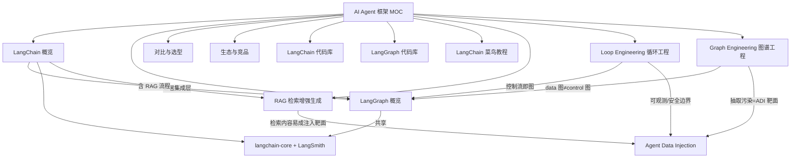

# AI Agent 框架 MOC

> [!info] 本 MOC 索引
> 收集 LangChain / LangGraph 两家主流 Agent 框架的资料，导入 Obsidian 便于检索与链接。
> 采集日期：2026-08-04 ｜ 信息源：官方文档 + 2026 年公开评测 / 博客（见各笔记内引用）

## 核心笔记（概念与选型）

- [[LangChain 概览]] —— 集成 / 连接层，LCEL 声明式组合，RAG 甜区，模块详解
- [[LangGraph 概览]] —— 有状态图状态机，循环 / 持久 / 人工介入，多智能体，生产部署
- [[LangChain vs LangGraph 对比]] —— 5 问决策框架 + 正面对比 + 两者如何配合
- [[Agent 框架生态与竞品]] —— CrewAI / AutoGen / LlamaIndex / 等横向对比与选型
- [[LangChain 菜鸟教程]] —— 菜鸟教程 landing 页整理（入门、首个程序、核心组件、参考文档）
- [[RAG 检索增强生成]] —— 检索增强生成全流程 + 2026 Advanced/GraphRAG/Agentic RAG 演进与工程落地
- [[RAG 详细学习笔记]] —— RAG 进阶 companion：Embedding 深潜 / 切分 / ANN 索引 / 混合检索 / 重排 / GraphRAG / 评估 / 生产取舍（入门见 [[RAG 检索增强生成]]）
- [[ANN 索引算法专题 学习笔记]] —— 🌱 广度种子：ANN 近似最近邻索引算法全景（HNSW / IVF-PQ / DiskANN / ScaNN / LSH + PQ·SQ 量化 + 2025-2026 GPU / 十亿级进展），与 [[RAG 详细学习笔记]]（ANN 在 RAG 中的位置）、[[向量数据库 学习笔记]]（产品生态）分工互补
- [[Loop Engineering 循环工程]] —— 把 agent 循环本身当工程对象：ReAct、五大部件、10 模式、失败目录、安全边界
- [[Loop Engineering 跨学科发散]] —— 向外辐射：控制论/OODA/PDCA/K8s 协调循环/生物学稳态/形式化验证/元认知/伦理，老智慧映射 agent loop
- [[Graph Engineering 图谱工程]] —— 知识图谱 / GraphRAG 工程化：构建五阶段、Schema 优先、三种集成模式、Vector vs Graph、本体
- [[应用层 Agent 框架 vs 系统级意图框架 对照]] —— 桥接应用层框架与 App Intents/AppFunctions/Intents Kit：同构映射 + 两层差异 + 端侧 Planner
- [[Agent 评测与基准 学习笔记]] —— 🌱 广度种子：通用/工具调用/GUI-OS/编码/RAG 五类基准地图（GAIA·τ-bench·OSWorld·AndroidWorld·SWE-bench…）+ 轨迹评测转向、污染与可信度危机 + 对 OS PM 的验收指标启发
- [[Agent 评测自动化与 LLM-as-judge 工程 学习笔记]] —— 🌱 广度种子：评测 harness/工具链与 LLM-as-judge 工程方法（eval vs benchmark 辨析·离线/在线/持续·单元/轨迹/任务级·Ragas/DeepEval/Giskard/PromptFoo/TruLens/Phoenix/Opik/LangSmith/Inspect/AgentEval 横评·Zheng 2023 偏差与 JudgeBench·2025-2026 agentic eval/评测即护栏/CI 集成），与 [[Agent 评测与基准 学习笔记]]（考卷本身）、[[Agent 可观测性 LLM Observability 学习笔记]]（线上 tracing）分工，与 [[RAG 详细学习笔记]]/[[模型服务化与 LLM 网关 学习笔记]]/[[Agent 推理成本优化 学习笔记]] 互补
- [[多智能体协作与编排 学习笔记]] —— 🌱 广度种子：多 agent 协作模式与编排框架全景（orchestrator-worker / supervisor / debate + AutoGen / CrewAI / LangGraph multi-agent / Anthropic Many hands / A2A·AGP），与 [[Loop Engineering 循环工程]]（单 agent 循环）、[[Agent 协议生态 学习笔记]]（协议）互补
- [[Agent 记忆系统 学习笔记]] —— 🌱 广度种子：Agent 长期记忆工程架构（记忆分层 episodic/semantic/procedural + 工作记忆 · 记忆中间件 Mem0/Letta/LangMem/Zep · 与上下文工程的接口），与 [[多智能体协作与编排 学习笔记]]（多 agent 共享记忆一致性）、[[个性化与端侧用户记忆 学习笔记]]（端侧个性化建模 vs 记忆系统）互补
- [[Agent 可观测性 LLM Observability 学习笔记]] —— 🌱 广度种子：Agent 可观测性/LLM Observability 全景（tracing/eval/cost&latency/用户 feedback 回路 + LangSmith/Langfuse/Phoenix/Datadog/Traceloop 等横向 + OpenTelemetry/OpenInference 语义约定 + 端侧 Agent 监控意义），与 [[Agent 评测与基准 学习笔记]]（离线基准）互补
- [[智能体的可观测性与分布式追踪 学习笔记]] —— 🌱 广度种子：聚焦更窄角度——分布式追踪 / trace 跨进程跨 agent 传播 / span 关联（trace·span·context propagation·baggage·W3C Trace Context·OTel GenAI 约定·多 agent 调用图·tail-based 抽样·与 eval 联动 2025-2026），刻意区别于 [[Agent 可观测性 LLM Observability 学习笔记]]（泛 observability 面板）、[[模型服务化与 LLM 网关 学习笔记]]（网关层埋点），与 [[Agent 评测自动化与 LLM-as-judge 工程 学习笔记]]（trace→eval 闭环）咬合
- [[GraphRAG 与知识图谱增强 Agent 学习笔记]] —— 🌱 广度种子：GraphRAG 方案横向全景（MS GraphRAG·LazyGraphRAG·LightRAG·HippoRAG 2·KAG·腾讯 Youtu-GraphRAG·Graphiti/Zep·Neo4j）+ 按"成本花在哪"分的六种范式 + 2025-2026 进展（独立评测反转口径、上下文膨胀）+ 与 Agent 结合四面（图作工具/agentic 图检索/图作记忆/决策留痕），与 [[RAG 详细学习笔记]]（向量检索原理）、[[Graph Engineering 图谱工程]]（图谱构建方法论）、[[Agent 记忆系统 学习笔记]]（记忆层）分工互补
- [[知识图谱与本体工程 学习笔记]] —— 🌱 广度种子：知识图谱构建侧全景（KG/本体/RDF/OWL/属性图辨析·本体设计→抽取→融合→存储查询流水线·Neo4j/Jena/Protégé/RDFox/Stardog 对比·2025-2026 LLM 辅助本体自动构建/自动抽取/动态自演化 KG），与 [[GraphRAG 与知识图谱增强 Agent 学习笔记]]（上游造图 vs 应用检索）、[[向量数据库 学习笔记]]（结构化图谱 vs 向量检索）、[[Graph Engineering 图谱工程]]（构建方法论）互补
- [[Agent 推理成本优化 学习笔记]] —— 🌱 广度种子：Agent 推理成本优化工程面（prompt caching / KV cache 复用·prefix sharing / batching / 模型路由 / 上下文裁剪 / 成本可观测），与 [[多智能体协作与编排 学习笔记]]（多 agent 扇出放大成本）、[[Agent 可观测性 LLM Observability 学习笔记]]（成本归因·预算告警）咬合
- [[模型服务化与 LLM 网关 学习笔记]] —— 🌱 广度种子：模型服务化 / LLM 网关基础设施层（统一 API 接入·模型路由·限流配额·密钥管理·负载均衡 fallback·守护·可观测埋点·缓存 + LiteLLM/Portkey/Cloudflare/OpenRouter/Azure/Kong 对比 + 2025-2026 进展），与 [[Agent 推理成本优化 学习笔记]]（成本技巧的承载层）、[[Agent 可观测性 LLM Observability 学习笔记]]（span 汇入）、[[Agent 协议生态 学习笔记]]（网关≠MCP/A2A 协议层）、[[多智能体协作与编排 学习笔记]]（per-agent 预算路由）正交互补
- [[数据 Agent 与 Text-to-SQL 学习笔记]] —— 🌱 广度种子：让 Agent 把"人话"翻译成 SQL/分析动作并自我纠错，聚焦**结构化数据/数据库**的 Agent 化问答（区别于 [[RAG 检索增强生成]]/[[RAG 详细学习笔记]] 的非结构化文档检索），与 [[模型服务化与 LLM 网关 学习笔记]]（模型路由承载层）、[[Agent 可观测性 LLM Observability 学习笔记]]（SQL 执行 tracing）正交互补
- [[知识库问答与 Enterprise Search 学习笔记]] —— 🌱 广度种子：企业级/权限感知检索（Enterprise Search & 权限感知 RAG），差异化于 [[AI 搜索与 RAG 问答产品生态 学习笔记]]（消费级）、[[RAG 详细学习笔记]]（原理）、[[向量数据库 学习笔记]]（向量）；覆盖 ACL/文档级/租户隔离权限模型 + 混合检索（关键词+向量+图谱）+ Glean/Hebbia/Coveo/Lucidworks/Elastic/微软 Copilot 检索层/Vertex RAG Engine/飞书/钉钉横向对比 + 合规数据边界，与 [[AI 监管与合规落地 学习笔记]]（合规）、[[Agent 推理成本优化 学习笔记]]（检索成本）咬合
- [[企业知识库连接器生态 学习笔记]] —— 🌱 广度种子：企业知识库连接器生态（Connectors for RAG / 数据源接入层），刻意区别于 [[知识库问答与 Enterprise Search 学习笔记]]（那篇讲「进来后怎么检索」，本篇讲「数据怎么进来」）；覆盖 M365/SharePoint/Outlook·Salesforce·Slack·Confluence·Google Workspace·Notion·ServiceNow·Box/Dropbox·Jira·GitHub 等数据源连接器 + LlamaIndex LlamaHub·LangChain loaders·MCP·Airbyte·unstructured.io·LlamaParse·Glean/Coveo/365 Copilot 连接器体系，聚焦「权限映射/增量同步/格式解析/元数据保留」与连接器生态格局
- [[多模态 RAG 与文档问答产品 学习笔记]] —— 🌱 广度种子：多模态文档 RAG 技术范式（ColPali/ColQwen2 视觉文档检索·page-as-image late interaction·统一多模态 embedding·layout-aware）+ 消费/通用文档问答产品生态（ChatPDF/NotebookLM/AskYourPDF/Glean/Azure Document Intelligence+AI Search/Vertex RAG Engine/达观·合合·阿里云文档智能），差异化于 [[知识库问答与 Enterprise Search 学习笔记]]（企业级权限/租户隔离广度）、[[多模态文档智能 DocAI 学习笔记]]（解析引擎而非 RAG 产品），与 [[RAG 详细学习笔记]]/[[向量数据库 学习笔记]]/[[GraphRAG 与知识图谱增强 Agent 学习笔记]]/[[端侧多模态 VLM 学习笔记]] 互补
- [[多模态 RAG 产品实测 学习笔记]] —— 🌱 广度种子：多模态 RAG 的 **empirical 实测视角**（区别于上方产品形态广度）：ColPali/ColQwen2 在真实 PDF 上的 recall 实测与域偏移翻车边界·page-as-image late interaction 的存储(257.5KB/页)·延迟/吞吐(两阶段 13–15× 加速)·与文本/OCR RAG 的精度成本对照·真实部署教训(路由/冷启动/像素投毒)·端侧 ColSmol 可行性，与 [[多模态 RAG 与文档问答产品 学习笔记]]（产品形态）、[[RAG 详细学习笔记]]（原理/评估）、[[向量数据库 学习笔记]]（多向量 MaxSim 存储）、[[端侧多模态 VLM 学习笔记]]（端侧 VLM）、[[多模态文档智能 DocAI 学习笔记]]（解析引擎）、[[知识库问答与 Enterprise Search 学习笔记]]（企业级广度）分工互补
- [[多模态 RAG 端侧化实测 学习笔记]] —— 🌱 广度种子：多模态 RAG **端侧化/on-device 可行性**（区别于上方云端 empirical 实测与产品形态）：手机/边缘跑视觉-语言文档检索的延迟·显存·精度三角·视觉编码器量化(int4/NF4/LLaVA-UHD v4 token 压缩)·多向量存储压缩(BQ/token pooling/Matryoshka/两段式)·本地 RAG 隐私收益·与云端 ColPali 的帕累托对照，与 [[多模态 RAG 产品实测 学习笔记]]（云端实测）、[[多模态 RAG 与文档问答产品 学习笔记]]（产品广度）、[[端侧多模态 VLM 学习笔记]]（端侧 VLM 选型）、[[端侧模型量化 学习笔记]]（量化工程）、[[端侧大模型推理 学习笔记]]/[[端侧推理框架生态 学习笔记]]（端侧运行时）、[[个人知识库 AI 化与本地 RAG 学习笔记]]（本地知识库落地）、[[向量数据库 学习笔记]]（多向量存储）互补
- [[垂直行业 Agent 纵深入 学习笔记]] —— 🌱 广度种子：通用 Agent 之外的行业纵深落地（法律/医疗/教育），按"行业 × 部署形态 × 监管责任门槛"组织；聚焦 copilot-in-workflow 先跑、autonomous agent 后探的落地顺序与责任归属胜负手，与 [[多智能体协作与编排 学习笔记]]（通用编排底座）、[[Agent 评测与基准 学习笔记]]（行业仍缺专属基准）、[[数据 Agent 与 Text-to-SQL 学习笔记]]（运营分析侧）、[[知识库问答与 Enterprise Search 学习笔记]]（行业知识库检索）分工互补
- [[智能体商店与 Agent 分发平台生态 学习笔记]] —— 🌱 广度种子：智能体商店 / Agent 分发平台生态（GPT Store·Claude Marketplace·Coze/豆包·元器·文心/千帆·百宝箱·钉钉·Gemini Gems·AgentForce·Copilot Studio·Dify/HF Spaces），按分发模式（平台内嵌/独立开放/企业私有/协议化能力）分类对比，与 [[Agent 协议生态 学习笔记]]（MCP/A2A 能力分发）、[[多智能体协作与编排 学习笔记]]（可复用组件）、[[模型服务化与 LLM 网关 学习笔记]]（后端承载）互补
- [[智能体间经济结算与 micropayment 学习笔记]] —— 🌱 广度种子（热点新知·2026-10-03）：agent 之间 / agent 为资源付费的结算机制与协议全景（x402·AP2·Stripe MPP/ACP·Visa TAP·Mastercard Agent Pay·UCP·Hey Anon(ANON)·agent 钱包与授权额度），与 [[智能体商店与 Agent 分发平台生态 学习笔记]]（分发/抽成门面 vs 结算底座）、[[模型服务化与 LLM 网关 学习笔记]]（计量计费承载层）、[[多智能体协作与编排 学习笔记]]（A2A 协同后对价结算）、[[Agent 协议生态 学习笔记]]（A2A/MCP 通信协议 vs 支付垂直协议层）正交互补

## 实战代码库（可直接抄）

- [[LangChain 实战代码库]] —— LCEL / RAG / 结构化输出 / 记忆 / 工具调用 / LangServe / 流式兜底
- [[LangGraph 实战代码库]] —— 状态机 / ReAct / 人工介入 / 时间旅行 / 条件边 / 多智能体 / 流式
- [[Loop Engineering 实战代码库]] —— ReAct/Reflection/Tool-use/Ralph/Circuit Breaker/Bounded/Sub-agent/Human Gate/追踪/预算/多循环编排 可运行范式

## 概念地图

## 建议学习路径

1. 先读 [[LangChain vs LangGraph 对比]] 的 5 问决策框架，建立"何时用哪个"的直觉。
2. 按需求进 [[LangChain 概览]] 或 [[LangGraph 概览]] 看概念与架构图。
3. 写代码时直接抄 [[LangChain 实战代码库]] / [[LangGraph 实战代码库]] 的片段。
4. 选型纠结其他框架时查 [[Agent 框架生态与竞品]]。

## 与其它知识库的关联

- 系统级意图框架主题：[[App Intent 的核心作用]] ｜ [[Apple Intelligence 与 App Intents]] ｜ [[手机AI智能体知识库]]
- 执行安全主题：[[Agent Data Injection 数据注入攻击]] ｜ [[Windows Copilot Actions 与 Agent Workspace 2026]] ｜ [[确认机制]] ｜ [[隔离执行]]
- 端侧运行时：[[OS-PM-系统AI Runtime vs 应用引擎]]
- 检索增强生成：[[RAG 检索增强生成]]（RAG 是 LangChain 核心应用场景，检索内容亦属 [[Agent Data Injection 数据注入攻击]] 靶面）
- 循环工程：[[Loop Engineering 循环工程]]（agent 循环即控制流，可观测/安全边界与 ADI 主题咬合）
- 图谱工程：[[Graph Engineering 图谱工程]]（知识图谱/GraphRAG，注意与 LangGraph 执行图区分）｜方案选型与 Agent 结合见 [[GraphRAG 与知识图谱增强 Agent 学习笔记]]
- LLM 基础与跨学科：[[LLM 跨学科发散]]（信息论/语言学/连接主义/压缩/Transformer/Scaling/涌现/对齐向外辐射 LLM 构件根脉，见 [[AI 工程 MOC]]）

## 待补 / 待核实

- ⚠️ 版本口径：各源对 LangChain / LangGraph 当前主版本说法不一（有 v0.3.x，有称 2026 已进入 v1.x），以 PyPI 官方为准，待查实修正。
- ⚠️ LangChain GitHub star 数各源差距大（12.8 万 / 14.2 万），未写入具体数字。
- ⚠️ NVIDIA NemoClaw Blueprint 的成本对比数字来自厂商评测，待官方复核。
- 可补：与其他框架（CrewAI/AutoGen/LlamaIndex）的**横向基准对比表**（目前仅聚焦用户指定的 LangChain + LangGraph，竞品放在 [[Agent 框架生态与竞品]] 做概览）。

> [!note] 相关概念
> [[LangChain 概览]] ｜ [[LangGraph 概览]] ｜ [[LangChain vs LangGraph 对比]] ｜ [[LangChain 实战代码库]] ｜ [[LangGraph 实战代码库]] ｜ [[Agent 框架生态与竞品]] ｜ [[LangChain 菜鸟教程]] ｜ [[RAG 检索增强生成]] ｜ [[Loop Engineering 循环工程]] ｜ [[Loop Engineering 跨学科发散]] ｜ [[Loop Engineering 实战代码库]] ｜ [[Graph Engineering 图谱工程]] ｜ [[手机AI智能体知识库]] ｜ [[OS-PM-系统AI Runtime vs 应用引擎]] ｜ [[LLM 跨学科发散]] ｜ [[AI 工程 MOC]]

- [[AI Agent 的持久化与状态管理 学习笔记]] —— 🌱 广度种子：Agent 运行态任务的状态如何落盘/恢复/隔离（checkpointer vs durable execution：LangGraph/Temporal/Inngest/Restate/DBOS + 各 SDK session），刻意区别于 [[Agent 记忆系统 学习笔记]]（长期记忆模型）与 [[多智能体协作与编排 学习笔记]]（编排模式），与 [[Agent 可观测性 LLM Observability 学习笔记]]（resume 轨迹 tracing）咬合
- [[AI Agent 的权限与可撤销委托 学习笔记]] —— 🌱 广度种子：agent 授权与权限范围全景（OAuth 2.1 scopes / capability tokens / 委托与可撤销 / least-privilege / session-scoped / AAuth·AAP·MCP scoped auth·A2A·Entra Agent ID），刻意区别于 [[智能体身份与信任 学习笔记]]（身份而非 scope）、[[工具调用安全 学习笔记]]（工具执行鉴权）、审批 UI 长相（本库暂未建对应笔记），与 [[Agent 协议生态 学习笔记]]（协议层）、[[多智能体协作与编排 学习笔记]]（委托链）咬合
- [[Agent 安全护栏模式库 学习笔记]] —— 🌱 广度种子：Agent 安全护栏**设计模式库**全景（输入/输出/检索/执行/对话/内容分级/语义防火墙/HITL 闸门等护栏模式 + 主流框架对比 Guardrails AI·NeMo Guardrails·LiteLLM·Azure Prompt Shields·Meta Purple Llama·Google ShieldGemma·Anthropic + OWASP LLM Top 10 2025 护栏映射 + GuardBench 基准），刻意区别于 [[工具调用安全 学习笔记]]（鉴权）、[[AI Agent 沙箱与安全执行环境 学习笔记]]（隔离）、[[AI 评测红队与对齐 学习笔记]]/[[AI 评测红队 Agent 链路注入 学习笔记]]（红队/注入攻防）、[[智能体身份与信任 学习笔记]]（身份）、[[AI 模型供应链安全与开源投毒防护 学习笔记]]（投毒）、[[AI Agent 的权限与可撤销委托 学习笔记]]（委托）、[[Confirmation UI 分级与产品责任边界]]（人审 UI），聚焦"有哪些护栏模式 + 怎么编排"
- [[Agent 离线评估与偏好数据集 学习笔记]] —— 🌱 广度种子：Agent 离线评估方法论与偏好数据集全景（轨迹级/步骤级/结果级偏好·LLM-as-judge 标注·离线基准 vs 在线监控·Web-Shepherd/WebArbiter/WebPRM·RewardBench 2·UltraFeedback/Nectar·AgentRewardBench/AgentBoard + 2025-2026 进展），刻意区别于 [[Agent 评测自动化与 LLM-as-judge 工程 学习笔记]]（评测 harness/工具链），与 [[Agent 评测与基准 学习笔记]]（考卷本身）、[[Agent 可观测性 LLM Observability 学习笔记]]（线上监控）、[[Agent 安全护栏模式库 学习笔记]]（奖励黑客/护栏）分工互补
- [[AI Agent 评测的对抗鲁棒性持续监控 学习笔记]] —— 🌱 广度种子：production guardrail eval drift / 在线护栏衰减（护栏作为会过期的分类器，概念漂移·对手适应·模型静默更新致 FPR/FNR 静默衰减 + verdict 结构化事件监控·7 日移动平均相对告警·留存对抗测试集·影子评估·护栏回归进 CI·agent-native 五道门禁 + 2025-2026 进展：评测即 CI / OTel GenAI 语义约定 / GuardBench·GuardianAgentBench 预印本 / FairJudge judge 偏差），与 [[Agent 安全护栏模式库 学习笔记]]（护栏设计模式）、[[Agent 评测自动化与 LLM-as-judge 工程 学习笔记]]（评测 harness/CI 门禁）、[[Agent 可观测性 LLM Observability 学习笔记]]（线上 trace/漂移）、[[Agent 离线评估与偏好数据集 学习笔记]]（离线 vs 在线）分工互补
- [[Agent 评测的数据污染与可复现性治理 学习笔记]] —— 🌱 广度种子：评测基准的**数据污染与可复现性治理**全景（污染定义/T1–T4 分类·N-gram/Min-K%/MIA/DCQ/水印检测·可复现六失效点·抗污染基准 LiveBench/MMLU-CF/SEAL·排行榜治理 HF 退场/《Leaderboard Illusion》/CTC 披露卡·eval-as-code/OTel·2025-2026 进展），刻意区别于 [[Agent 评测与基准 学习笔记]]（考卷本身）、[[Agent 评测自动化与 LLM-as-judge 工程 学习笔记]]（评测 harness/裁判模型）、[[Agent 离线评估与偏好数据集 学习笔记]]（离线偏好集），与 [[AI Agent 评测的对抗鲁棒性持续监控 学习笔记]]（judge 漂移/污染审计并入持续监控门禁）咬合
- [[Agent 评测的成本归因与评测 ROI 学习笔记]] —— 🌱 广度种子（相邻外辐射·全新广度）：聚焦「评测动作自身」的成本与回报——评测成本构成（token/标注/基础设施/平台订阅）·成本归因维度（按 token/rollout/branch/每 10 万 agent token 错误数）·评测 ROI 框架（cost per verified outcome、4-layer KPI、隐藏成本 10-20%）·评测降本（小模型评大模型 RocketEval、采样评测、离线在线权衡）·LangSmith/Langfuse/Helicone 评测计费维度横评（含口径冲突），刻意区别于 [[智能体经济学与 AI 成本归因 学习笔记]]（Agent *运行期* 成本追踪 vs 本篇 *评测期* 成本）、[[Agent 评测自动化与 LLM-as-judge 工程 学习笔记]]（评测 harness/裁判方法）、[[模型服务化与 LLM 网关 学习笔记]]（网关计量承载层），与 [[Agent 评测的数据污染与可复现性治理 学习笔记]]（评测可信度前置条件）正交互补
- [[AI Agent 的流式与实时交互架构 学习笔记]] —— 🌱 广度种子：把长时多步 Agent 运行变成可增量观看、可中途干预、可断线续传的**事件流**（输出流式 SSE/WebSocket·内部步骤/工具调用流式可见·前端增量渲染与打字机·HITL 实时审批回路·边缘/端侧流式推理·长任务断线重连）；刻意区别于 [[AI Agent 的持久化与状态管理 学习笔记]]（状态落盘/resume 本身）、[[Agent 可观测性 LLM Observability 学习笔记]]（trace 监控而非实时推送）、[[模型服务化与 LLM 网关 学习笔记]]（请求承载层），与 [[多智能体协作与编排 学习笔记]]（编排）、[[Agent 协议生态 学习笔记]]（MCP/A2A 事件机制）、[[AI Agent 评测自动化与 LLM-as-judge 工程 学习笔记]]（实时轨迹评测）互补
- [[智能体的人机信任校准与过度依赖防范 学习笔记]] —— 🌱 广度种子：聚焦人机信任校准与过度依赖防范（under-trust/over-trust 双端·5 类校准机制：不确定性表达/能力边界提示/摩擦与确认/可验证证据/反馈回路·appropriate reliance 度量与干预·2025-2026 摩擦设计/置信度 UI 进展·over-trust 案例），刻意区别于 [[智能体身份与信任 学习笔记]]（身份/授权）、[[AI Agent 的权限与可撤销委托 学习笔记]]（委托 scope）、[[确认机制]]/[[Confirmation UI 分级与产品责任边界]]（确认控件），与 [[Agent 安全护栏模式库 学习笔记]]（护栏模式）互补
- [[多智能体编排的容错与错误传播隔离 学习笔记]] —— 🌱 广度种子：多智能体编排的**容错与错误传播隔离**（cascading failure / blast radius·重试/熔断/降级/超时/补偿事务·隔离粒度 进程/容器/microVM/事务级·OWASP ASI08·MAST·Anthropic 单写者原则·LangGraph/CrewAI/AutoGen 容错机制·Google Agent Sandbox/E2B/WASM 隔离），刻意区别于 [[智能体的可观测性与分布式追踪 学习笔记]]（那篇看传播、本篇挡传播）、[[多智能体协作与编排 学习笔记]]（编排模式）、[[Agent 安全护栏模式库 学习笔记]]（护栏设计模式）
- [[AI Agent 工具调用的幂等性与副作用管理 学习笔记]] —— 🌱 广度种子：agent 工具调用的**幂等性与副作用管理**（幂等键 idempotency key·只读/写分级·Saga 补偿事务·人工确认阈值·tool 沙箱白名单·confirmation 网关·MCP ToolAnnotations·OWASP ASI02/LLM06 least agency·2025-2026 exactly-once 语义迁移与副作用放大），刻意区别于 [[AI Agent 的权限与可撤销委托 学习笔记]]（委托 scope）、[[Agent 安全护栏模式库 学习笔记]]（护栏模式）、[[多智能体编排的容错与错误传播隔离 学习笔记]]（隔离/补偿同源），与 [[AI Agent 的持久化与状态管理 学习笔记]]（durable execution 承载幂等）、[[Agent 协议生态 学习笔记]]（MCP 约束）咬合
- [[AI Agent 的长上下文管理与上下文压缩 学习笔记]] —— 🌱 广度种子：Agent 多步任务撑爆窗口前如何裁旧/压冗余/按需检索（截断·compaction·RAG 减负·重要性筛选·KV cache·分层记忆）；区别于 [[Context Engineering 学习笔记]]（上下文组装概念）、[[AI Agent 的持久化与状态管理 学习笔记]]（运行态落盘）；串接 [[Agent 记忆系统 学习笔记]]、[[Agent 推理成本优化 学习笔记]]、[[Agent 可观测性 LLM Observability 学习笔记]]
- [[AI Agent 的测试时计算与推理时缩放 学习笔记]] —— 🌱 广度种子：推理阶段投入更多计算提升质量这一范式（o1/R1 长链推理·search/browsing/tool-use 即计算·self-consistency/best-of-n 采样投票·debate·PRM·verifier-in-the-loop·Agent 本身即 test-time compute）；刻意区别于 [[服务端 LLM 推理引擎生态 学习笔记]]（serving 引擎）、[[Context Engineering 学习笔记]]（上下文组装）、[[端侧大模型推理 学习笔记]]（端侧推理原理）、[[多智能体协作与编排 学习笔记]]（多 agent 编排），与 [[Agent 推理成本优化 学习笔记]]（长思考拉高每 query 成本）、[[Agent 评测与基准 学习笔记]]（推理质量如何测）咬合
- [[AI Agent 的离线优先与弱网降级 学习笔记]] —— 🌱 广度种子：从「AI Agent 框架」锚点向外辐射，落在**可靠性/韧性**视角——把"网络可用"当临时特权而非默认前提（local-first 架构·离线任务队列 store-and-forward·断网期本地推理/规则兜底·恢复后冲突解决与同步·优雅降级 LLM→规则/模板·重试退避与熔断·离线状态 UI）；刻意区别于 [[AI Agent 的流式与实时交互架构 学习笔记]]（实时流式相反维度），与 [[AI Agent 的持久化与状态管理 学习笔记]]（durable 承载排队/resume）、[[AI Agent 工具调用的幂等性与副作用管理 学习笔记]]（重放防双执行）、[[多智能体编排的容错与错误传播隔离 学习笔记]]（熔断/补偿同源）、[[Agent 安全护栏模式库 学习笔记]]（降级闸门）、[[多模态 RAG 端侧化实测 学习笔记]]/[[AI Agent 的测试时计算与推理时缩放 学习笔记]]/[[模型服务化与 LLM 网关 学习笔记]]（端侧推理/本地思考预算/网关 fallback）互补
