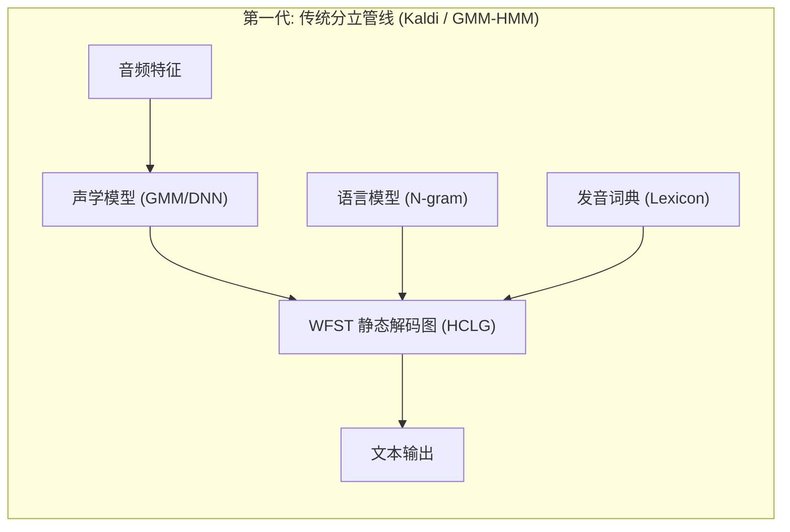
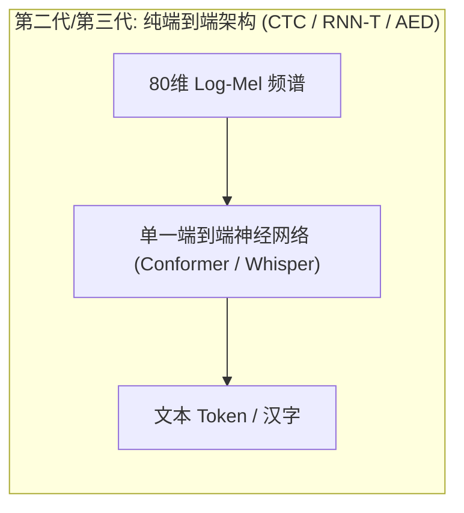
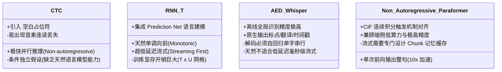
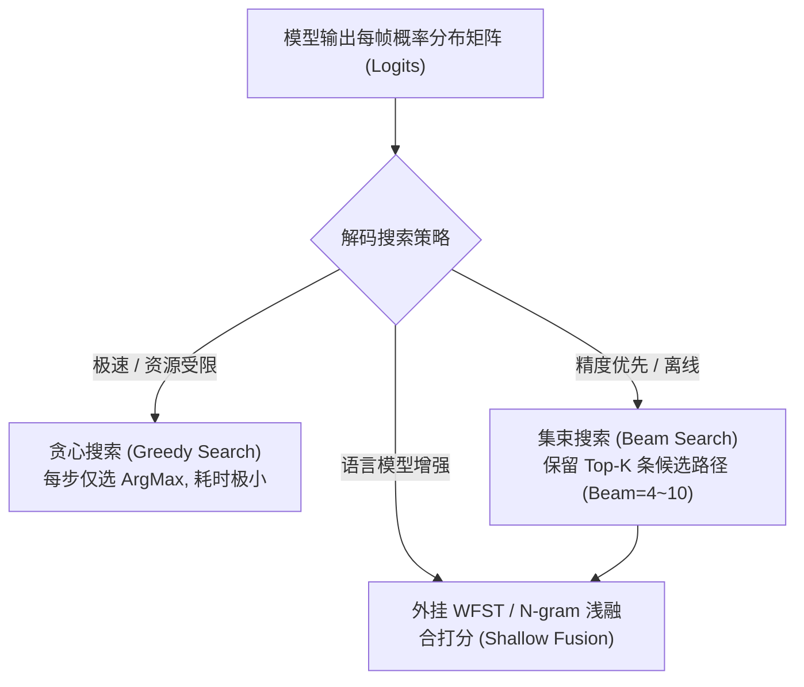

# ASR-原理与关键概念

> 语音识别（Automatic Speech Recognition, ASR）是整个语音交互管线中计算最密集、架构演进最剧烈的心脏组件。
> 其底层本质是**从连续时变的一维声学频谱流中，求解后验概率最大的离散自然语言 Token 序列**。
> 掌握主流端到端架构（CTC、RNN-T、AED、Non-autoregressive）的根本分歧，是做好端侧算力、内存与交互延迟权衡的前提。

---

## 一、ASR 的第一性公式与演进脉络

数学上，ASR 任务可形式化为：给定声学特征观察序列 $X = (x_1, x_2, \dots, x_T)$，在候选文本空间中寻找最匹配的词序列 $W^* = (w_1, w_2, \dots, w_U)$：

$$W^* = \arg\max_W P(W|X)$$

利用贝叶斯定理拆解：
$$P(W|X) = \frac{P(X|W) \cdot P(W)}{P(X)} \implies W^* = \arg\max_W \underbrace{P(X|W)}_{\text{声学模型 (AM)}} \cdot \underbrace{P(W)}_{\text{语言模型 (LM)}}$$





- **第一代（传统分立式 / Kaldi 时代）**：声学模型（$P(X|W)$）、发音字典（G2P / Lexicon）、语言模型（$P(W)$）完全割裂，依赖 WFST（加权有限状态转换机）将四张图编译为巨大的 `HCLG.fst` 解码图。体积臃肿（常需数百 MB 内存），维护极其昂贵。
- **第二代（端到端神经化 / CTC & RNN-T）**：抛弃繁琐的发音词典与音素强对齐，模型直接从声学频谱映射到字母或汉字。
- **第三代（大模型与多任务多模态 / AED & 原生语音模型）**：以 OpenAI Whisper、SenseVoice 以及 Gemini/GPT-4o 原生多模态为代表，单网络联合吞吐文本、标点、语种、时间戳甚至情绪。

---

## 二、四大主流端到端架构深度对比

声学特征序列的长度 $T$（通常 1 秒 = 100 帧）远大于输出文本词序列的长度 $U$（1 秒人类通常说 3~5 个汉字或单词），即 $T \gg U$。**如何优雅解决 $T$ 与 $U$ 之间的非对齐时序映射，构成了各大架构的本质分水岭**。



### 1. CTC（Connectionist Temporal Classification）
- **核心机理**：允许模型输出一个特殊占位符 `<blank>`（空白）。如果连续多帧对应同一个音，模型输出形如 `[h, h, <blank>, e, l, <blank>, l, o]`，最后经 Collapse 规则去重压缩为 `hello`。
- **致命弱点**：**条件独立性假设**——第 $t$ 帧预测什么字，与第 $t-1$ 帧预测什么字在数学上被假设为相互独立。因此 CTC 经常拼出在发音上合理但在语法上荒谬的错误句子，工业界通常需要外挂外部 n-gram 语言模型做浅融合（Shallow Fusion）补偿。

### 2. RNN-T / Conformer-Transducer（端侧流式之王）
- **核心机理**：由三部分组成：
  1. **Transcription Network（声学编码器）**：读取音频帧，输出时域声学向量；
  2. **Prediction Network（预测网络）**：读取历史已输出的文本 Token，起到内置语言模型的作用；
  3. **Joint Network（联合网络）**：在 $T \times U$ 的时空二维网格上寻找最佳前向路径。
- **为什么是端侧流式首选**：解码过程是严格单调向前的（Monotonic），音频来一帧即可向前推演一帧，无需等待整句说完，**算法延迟可压低至 100ms ~ 200ms**。

### 3. AED（Attention-based Encoder-Decoder，如 Whisper）
- **核心机理**：标准的 Transformer 架构。Encoder 将整段音频压缩为全局键值对（Key-Value），Decoder 类似 GPT-2，以自回归方式逐个预测下一个 Token。
- **优缺点**：得益于全局 Cross-Attention，模型能反复“回看”整句话的声学校验上下文，在离线长音频转写、口音泛化、小语种多任务上精度登峰造极。但**因为必须等待完整音频送入 Encoder，且 Decoder 必须逐字自回归生成，它无法作为原生毫秒级全双工流式 ASR 使用**。

### 4. 连续积分触发非自回归（Paraformer / CIF）
- **核心机理**：阿里达摩院在 FunASR 中开源的工业级创新。通过引入 **CIF（Continuous Integrate-and-Fire）** 软对齐模块，动态累加声学权重，达到阈值即触发一个字预测，实现“一次前向推断输出整句所有文字”。
- **价值**：既有 AED 级别的高识别精度，又有比 Whisper 快 **5 ~ 10 倍**的推理吞吐，且大幅降低端侧 NPU/CPU 持续发热功耗。

---

## 三、核心度量与评估标准

### 1. 错误率（WER 与 CER）
$$\text{Error Rate} = \frac{S (\text{替换错误}) + D (\text{删除错误}) + I (\text{插入错误})}{N (\text{标注总字数})} \times 100\%$$
- **CER（Character Error Rate / 字错误率）**：中文、日文评测通用标准。
  - *标注*：“今天天气怎么样”
  - *识别*：“今天**天**怎么样”（漏掉一个“气”字，属于删除错误 $D=1$，总字数 7，$\text{CER} = 1/7 \approx 14.3\%$）。
- **WER（Word Error Rate / 词错误率）**：英文以空格为单位的单词评测标准。

### 2. 实时率（Real-Time Factor, RTF）
$$\text{RTF} = \frac{\text{模型处理音频耗费的物理时间 (秒)}}{\text{输入音频自身的物理时长 (秒)}}$$
- **判定标准**：
  - $\text{RTF} = 1.0$：临界点（处理 1 秒音频刚好用 1 秒），任何瞬态波动都会导致积压卡顿；
  - $\text{RTF} \le 0.3$：**端侧工业级合格线**。确保系统即便在主频降频、CPU 被前台 App 挤占时，依然不会造成音频丢帧或响应堆积。

### 3. 首字时间（TTFT）与抖动率（Flicker Rate）
- **TTFT（Time-to-First-Token）**：从用户说话开始，屏幕上首次弹出第一个文字的时长。流式体验要求控制在 **300ms 以内**。
- **Flicker Rate（文本抖动率）**：流式 ASR 中，随着后续声学上下文不断输入，模型常常撤回修改前几个字（例如先上屏“他”，随后结合句意更正为“它”）。撤回率过高会导致界面疯狂闪烁，严重损害可读性。

---

## 四、解码搜索策略（Decoding Strategies）



1. **Greedy Search（贪心解码）**：
   - 每一时刻只取 Softmax 概率最大的单个 Token。
   - **特点**：速度极快，端侧无额外内存开销。现代高质量声学模型（如 Paraformer）在通用场景下使用 Greedy Search 精度已足够接近 Beam Search。
2. **Beam Search（集束搜索）**：
   - 每一步保留概率最高的前 $K$ 条最优路径。
   - **代价**：计算量与显存占用呈线性倍数放大（Beam=5 时算力开销约为 Greedy 的 4 倍）。
3. **热词激励（Contextual Biasing / Hotwords）**：
   - 智能家居或手机 OS 场景下，用户经常呼叫冷门人名（如“呼叫诸葛孔明”）或设备名（“打开扫地机”）。
   - 通过在解码树节点上施加局部 Prefix Trie 树加权（Boosting Score），动态抬高特定热词概率，防止生僻实体识别崩塌。

---

## 五、OS PM 选型决策树

```mermaid
flowchart TD
    Req{"端侧产品场景核心诉求"}
    Req -->|离线长语音会议记录 / 播客转写| WhisperLarge["选型: Whisper-Large / SenseVoice<br/>(高精度 / AED / 批量推断)"]
    Req -->|全双工实时语音交互 / 打断对谈| Transducer["选型: Sherpa-ONNX Conformer / RNN-T<br/>(原生流式 / 延迟 < 200ms)"]
    Req -->|极低功耗端侧即时响应 (手机系统级输入法/助手)| Paraformer["选型: FunASR Paraformer-ONNX<br/>(非自回归 / 50MB / 极低算力)"]
```

---

## 六、关联导航
- 实战部署与代码调用：[[ASR-官方资料与练习]]
- 标点与文本边界修复：[[Punc-原理与文本边界]]
- 离线与流式工程架构：[[语音集成-离线与流式架构]]
- 全链路总控：[[语音交互与端侧管线 MOC]]
