# LID-原理与语言路由

> 在端侧操作系统或全球化产品中，我们常常面临“多语言并发”与“端侧资源有限”的尖锐冲突。
> 语种识别（Language Identification, LID）是实现**多语种动态路由（Dynamic Language Routing）**的指挥官：它在极短音频窗口内判定发音语种，并将音频流调度至针对该语种深度优化的专有引擎，避免用一个臃肿低效的全能大模型拖垮系统。

---

## 一、端侧系统第一性：为什么需要 LID 路由？

```mermaid
flowchart TD
    AudioStream["实时语音输入流"] --> AFE["音频前端 (16kHz PCM)"]
    AFE --> LID["LID 快速嗅探器 (300ms ~ 800ms 音频窗口)"]
    
    LID -->|置信度 > 0.85: 中文| EngineZH["端侧极速中文引擎<br/>(Paraformer / 50MB / RTF=0.08)"]
    LID -->|置信度 > 0.85: 英文| EngineEN["端侧专精英文引擎<br/>(Conformer-EN / 60MB / RTF=0.09)"]
    LID -->|小语种 / 专有方言| EngineCloud["云端大模型逃逸<br/>(Whisper-Large / 多语种集群)"]
    LID -->|置信度低 / 中英混杂 (Code-Switching)| EngineBilingual["双语混合解码引擎<br/>(SenseVoice-Small)"]
```

### 1. 内存预算与专用性优势
- **全能模型的代价**：一个能同时高精度识别 100 种语言的模型（如 Whisper-Large v3），参数量达 15 亿（1.5GB 权重），在手机端侧常驻极易触发 OOM，且在单语种识别上的字错误率（CER）往往打不过经过千万小时垂直训练的 50MB 专有模型。
- **专有引擎的轻巧**：专有单语种 ASR 词表小、体积小、运行快。通过引入一个只有 **5MB ~ 15MB** 的轻量 LID 作为前置分发器，系统可以用最低的 RAM 预算实现全球化语言支持。

### 2. 云端逃逸与本地分流策略（Cloud Escape vs Edge Local）
- 在操作系统级架构中，**本地承接率（Local Handling Rate）**是衡量端侧 AI 架构成败的核心指标。
- **策略**：本地驻留覆盖 90% 用户常住语言的轻量模型（如“中文普通话 + 英语”）；当 LID 识别出西班牙语、印地语、泰语等长尾低频小语种时，系统自动将音频流安全提升至云端大模型处理（云端逃逸），平衡设备资源与全球体验。

---

## 二、LID 核心技术原理

LID 在技术路线上主要分为两大学派：**声学表征分类（Acoustic-based）**与**端到端自注意力探测（Transformer-based）**。

| 技术路线 | 代表架构 | 工作原理 | 决策耗时 | 优缺点对比 |
| :--- | :--- | :--- | :--- | :--- |
| **时延深层神经网络 (TDNN)** | **x-vector / ECAPA-TDNN** (SpeechBrain) | 统计池化（Statistical Pooling）提取说话人与声学音素全局指纹 | 需至少 **1.0s ~ 2.0s** 音频 | 传统工业界成熟；但对小于 1 秒的短发音分类精度差。 |
| **自监督声学嵌入 (SSL)** | **Wav2Vec 2.0 / HuBERT LID** | 利用大规模未标注音频自监督预训练的隐层特征进行线性探测 | **500ms ~ 1000ms** | 泛化能力强，对不同口音鲁棒；但模型体积偏大（>100MB）。 |
| **编码器首帧探测** | **Whisper LID Head / SenseVoice** | 仅利用 Transformer Encoder 提特征，结合专有 Language Token 分类头 | **200ms ~ 500ms** | **当前端侧首选**。可直接复用 ASR 前端编码器，无额外参数冗余，判定极快。 |

### 声学指纹提取的第一性机理
人类不同语言在**元音分布位置、共振峰轨迹、辅音爆破时长以及声调（Tonal Variations）**上具有显著的物理统计差异：
- 汉语是典型的**声调语言（Tonal Language）**，基频（Pitch / $F_0$）的时序变化轨迹极其剧烈；
- 英语是**重音定时语言（Stress-timed Language）**，具有丰富的轻重读音节对比；
- 日语是**音拍定时语言（Mora-timed Language）**，每个音节时长近乎恒定。
现代声学 LID 通过深度网络捕捉声学频谱中上述时序声调与音素过渡的指纹，即使没有生成任何文字，也能准确判定所属语种。

---

## 三、系统级路由架构设计（三种工程模式）

```mermaid
gantt
    title 并行投机路由 (Parallel Speculative Routing) 交互时序
    dateFormat X
    axisFormat %s
    section 麦克风输入
    用户开始说话 (0ms) :active, mic, 0, 1000
    section 默认中文引擎 (投机)
    流式解码输出 Partial Text :crit, zh, 100, 500
    发现误判, 撤回清空 :zh_drop, 500, 520
    section 旁路 LID 嗅探
    收集特征分析 :active, lid, 0, 500
    500ms 判定为英文 (置信度0.96) :done, lid_hit, 500, 500
    section 切换英文引擎
    重放前 500ms 缓冲音频并继续解码 :active, en, 520, 1000
```



### 模式 1：前置串行硬路由（Serial Hard Routing）
- **逻辑**：麦克风输入 $\to$ 强制等待收集 800ms 音频 $\to$ LID 判定为英语 $\to$ 启动英文 ASR。
- **致命缺点**：强制增加 800ms 初始白屏等待（TTFT 首字延迟极差），完全破坏流式交谈体验。

### 模式 2：双轨并行与投机路由（Parallel Speculative Routing / 推荐）
- **逻辑**：
  1. 麦克风一有声音，立即按**系统默认主语言**（如用户系统语言为中文）启动流式 ASR 解码并向前端屏幕抛出 Partial Token；
  2. 旁路轻量 LID 同步消耗音频流；
  3. 当音频达到 400ms~600ms 时，LID 给出正式判定：
     - 若判定与主语言一致：系统平滑继续，**首字延迟为零额外开销**；
     - 若判定为另一语种（如英语，且置信度 $> 0.9$）：系统下发撤回事件（Rollback Partial Text），无缝将环形缓冲区积累的音频重喂给英文引擎。

### 模式 3：中英混说（Code-Switching）的原生退化
- 日常生活中大量存在“帮我把 meeting schedule 移到明天 afternoon”这类中英夹杂语句。
- **决策**：对于中英混合场景，**严禁在句中切换模型**，因为跨进程/跨引擎上下文切换必然导致卡顿。必须在底层直接选型原生支持 Code-Switching 的双语混合声学模型（如 FunASR SenseVoice 或 WeNet 中英混模型）。

---

## 四、OS PM 关键指标与失败模式排障

| 评估指标 | 目标基准 | PM 决策建议 |
| :--- | :--- | :--- |
| **Top-1 判决准确率** | $\ge 98\%$ (主流语种) | 若低于 95%，必须增加置信度阈值判定，未达阈值时回落至系统默认母语。 |
| **判决窗口时长** | $\le 600\text{ms}$ | 超过 1 秒才判出结果的 LID 在流式交互中失去工程意义。 |
| **中英夹杂逃逸率** | $< 2\%$ | 避免中英混杂语句被错误判定为全英文小语种引擎导致前半截中文彻底乱码。 |

### 典型失败模式与兜底防御
1. **短发音/单音节冷启动失败**：
   - 用户只说了“嗨（Hi）”、“OK”、“Bye”。由于发音时长仅 100~200ms，LID 无法提取足够的声学统计特征，输出概率处于混沌状态。
   - **防御机制**：音频时长 $< 300\text{ms}$ 时禁用 LID 切换，强制保持当前系统默认语言。
2. **重口音（Accent）误导**：
   - 带有浓重方言或母语口音的非母语发音（如中式英语、印式英语），其音素基频特征容易被分类器误判回母语。
   - **防御机制**：提供用户全局设置选项（如“默认多语言自动识别”或“强制锁定当前语言”），让用户拥有最终控制权。

---

## 五、关联导航
- 实操模型与代码工程：[[LID-官方资料与练习]]
- 上游端点截取：[[VAD-原理与端点检测]]
- 核心解码引擎：[[ASR-原理与关键概念]]
- 总控全貌：[[语音交互与端侧管线 MOC]]
