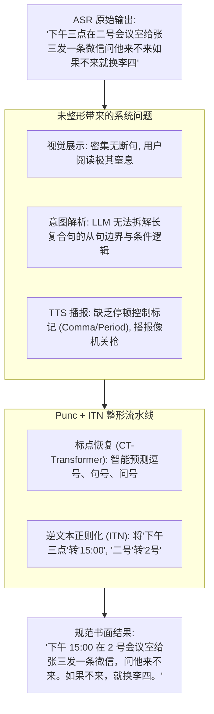
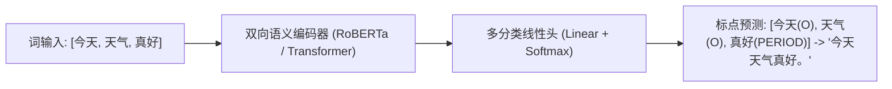

# Punc-原理与文本边界

> 原生 ASR 输出的只是干瘪的单音节文字流，既没有逗号句号，也没有书面数字与语义边界。
> 标点恢复（Punctuation Restoration, Punc）与逆文本正则化（ITN）是连接**声学识别层**与**上层 LLM 语义意图理解/TTS 播报**不可或缺的“语法整形器”。

---

## 一、系统级第一性：为什么需要文本整形？

若跳过 Punc 与 ITN，直接把原生 ASR 文本送入下游 Agent 或屏幕展示，会引发三层灾难性后果：

1. **意图路由准确率暴跌**：
   - 现代 OS 级意图框架（如 Apple App Intents、Android AppFunctions）依赖 LLM 从自然语言中提取实体槽位（Slot Filling）。
   - 若输入文本缺乏标点断句，LLM 极易在主谓宾分割、否定从句上产生结构性误判。
2. **数字与实体无法对齐**：
   - 麦克风录入“我的电话是一三八零零一三八零零零”，原生 ASR 只能输出全中文大写汉字。
   - 若不经 ITN 规整为 `13800138000`，下游拨号系统必须靠昂贵的 Prompt 指令强行让大模型进行清洗，大幅增加端侧算力与延迟。

---

## 二、标点恢复核心技术机制

标点预测任务在底层可形式化为**受约束的序列标注（Sequence Labeling）**：给定词序列 $W = (w_1, w_2, \dots, w_n)$，预测每个词后方应附带的标点标签 $Y = (y_1, y_2, \dots, y_n)$，其中：
$$y_i \in \{\text{O (无标点)}, \text{COMMA (，)}, \text{PERIOD (。)}, \text{QUESTION (？)}\}$$

### 1. 离线双向自注意力 vs 流式可控时延（CT-Transformer）
- **离线模型（如 BERT/RoBERTa Punc）**：利用全局双向自注意力，能看清整句话的所有前后上下文，断句极其精准；但**天然不支持流式**（你必须等用户把整段话说完才能推断第一个逗号）。
- **可控时延 Transformer（Controllable Time-delay Transformer, CT-Transformer）**：
  - 阿里 FunASR 的标点核心技术。
  - **核心机制**：在自注意力矩阵中限制向后看（Lookahead）的步长（例如只允许看未来 2~3 个词）。这样既保留了短程未来语义约束，又支持随着 ASR 文字吐出而实时给出标点，延迟控制在毫秒级。

---

## 三、逆文本正则化（ITN）：确定性规则 vs 神经网络

将口语化文字转换为标准书面表达，工业界存在两条截然不同的技术路线：

| 对比维度 | 基于 WFST 加权状态机 (WeTextProcessing) | 基于端到端小神经网络 (Seq2Seq / SLM) |
| :--- | :--- | :--- |
| **实现机理** | 基于严格编写的人工语法规则，编译为 FST 状态机 | 微调小型语言模型进行文本重写 |
| **准确率与确定性** | **100% 规则确定，绝对不发生胡言乱语** | 存在小概率幻觉（可能把人名、生僻词改丢） |
| **执行开销** | 纯 C++ 纳秒级正则匹配，内存 < 5MB | 需调用推理框架，耗时几十毫秒，显存数十兆 |
| **PM 生产选型** | **端侧与生产管线唯一推荐标准** | 仅用于复杂语义润色，严禁用于基础 ITN |

### 核心规整场景速查：
- **时间与日期**：“二零二六年十月二十六号晚上八点” $\to$ `2026-10-26 20:00`
- **百分比与分数**：“百分之九十八点五” $\to$ `98.5%`
- **金额与货币**：“两百五十块五毛” $\to$ `250.5元`
- **车牌与代码**：“京A八八八八八” $\to$ `京A·88888`

---

## 四、流式标点与“文字抖动（Flicker）”的动态治理

在全双工实时流式输入中，标点预测面临严峻的哲学两难：
- **场景**：用户刚说完“今天下午开会”。
  - 如果模型判定为句号“今天下午开会。”，下游系统可能误以为说话结束立刻执行；
  - 结果 300ms 后用户紧接着说“需要带上投影仪吗？”；
  - 此时模型必须把刚才的句号强制更正为逗号，变成“今天下午开会，需要带上投影仪吗？”。

```mermaid
gantt
    title 固定提交窗 (Fixed Commit Window) 抖动治理
    dateFormat X
    axisFormat %s
    section 物理时间轴
    已锁定绝对不可修改区 (Stable Chunk) :done, c1, 0, 70
    浮动缓冲区允许标点重写 (Floating Chunk) :crit, c2, 70, 100
```

### 生产级治理策略：固定提交窗（Fixed Commit Window）
1. **划分两段状态**：
   - **稳定区（Stable/Committed Text）**：距离当前最新词超过 $N$ 个词（通常取 4~6 个字）的左侧文本，**标点一旦盖章，绝对不允许回退修改**，防止屏幕剧烈闪烁；
   - **动态浮动区（Floating Window）**：最新识别出的尾部几个字，界面采用弱化浅灰字体展示，标点允许随着新词进入动态修正。
2. **长停顿强截断**：
   - 若 VAD 检出物理静音超过 600ms，不管语义是否完整，强制将尾部最后一个词打上句号并立刻将全量文本移入锁定区。

---

## 五、OS PM 决策清单与指标

| 指标 | 目标基准 | PM 决策考量 |
| :--- | :--- | :--- |
| **标点准确率 (F1-Score)** | 逗号/句号 F1 $\ge 85\%$，问号 F1 $\ge 75\%$ | 问号较难预测（中文常省略“吗/呢”等疑问词，仅靠声调反转），需重点关注。 |
| **单句吞吐延迟** | $< 10\text{ms}$ (100 字文本) | 标点模型必须在 ASR 吐字的同时瞬间完成打点，严禁成为流式瓶颈。 |
| **ITN 误伤率** | $< 0.1\%$ | 避免将专有名词或成语强行规整（例如成语“朝三暮四”决不能被改成“朝3暮4”）。 |

---

## 六、关联导航
- 实战模型调用与练习：[[Punc-官方资料与练习]]
- 上游识别核心输出：[[ASR-原理与关键概念]]
- 时间轴与词级对齐：[[语音集成-接口与时间轴]]
- 全链路总控：[[语音交互与端侧管线 MOC]]
