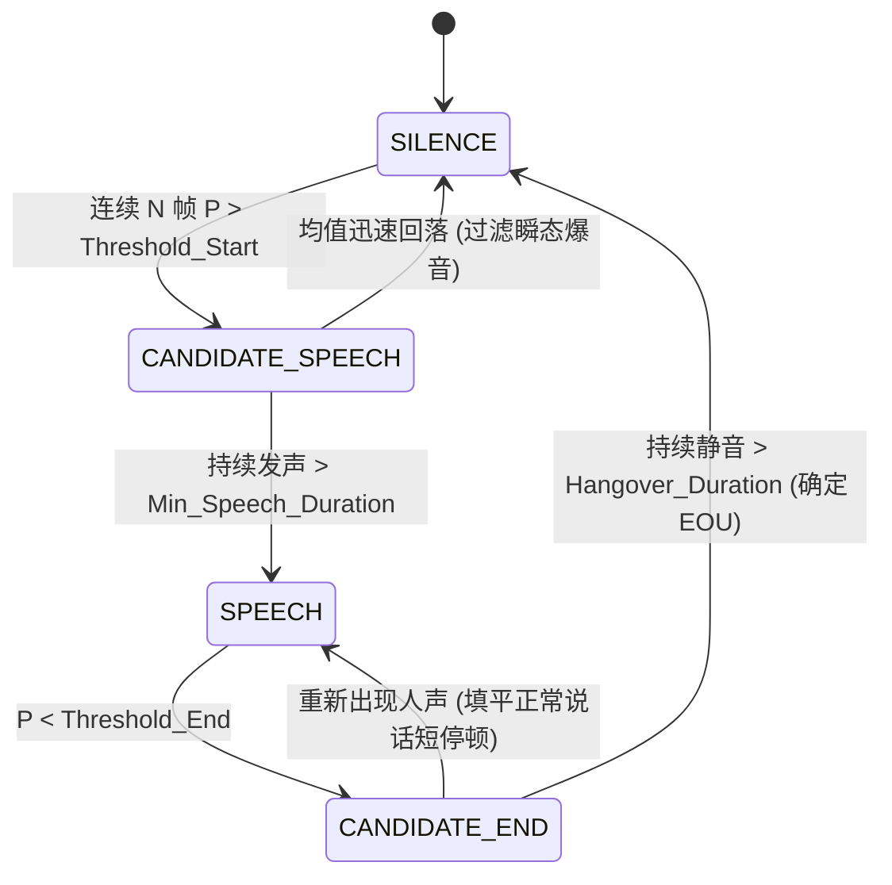

# VAD-原理与端点检测

> 语音活动检测（Voice Activity Detection, VAD）不仅是 ASR 的“门禁”，更是端侧 OS 级智能体兼顾**超低功耗待机、全双工低延迟响应与自然打断（Barge-in）**的生命线。
> VAD 的本质是一个二分类器加时序状态机：准确判断每一帧音频是“人声”还是“静音/底噪”，并在毫秒级精度内标定语音起始点（Speech Onset）与结束点（Speech Offset / EOU）。

---

## 一、端侧系统第一性：为什么 VAD 高于一切？

在 Android / 端侧设备上，VAD 承担着三重不可替代的系统级职责：

```mermaid
flowchart TD
    MIC["麦克风持续收音"] --> VAD{"VAD 哨兵判断"}
    VAD -->|非语音/稳态背景底噪| Sleep["低功耗休眠: 保持挂起, 算力功耗 < 5mW"]
    VAD -->|检出人声起始 (Onset)| WakeASR["唤醒大模型: 调度 ASR/NPU 开始流式解码"]
    VAD -->|检出人声截断 (Offset/EOU)| TriggerLLM["截断封包: 判定句子完结, 触发下游意图决策"]
    VAD -->|播放中检出人声| BargeIn["瞬间打断: 强制下发中断信号, 掐断 TTS 扬声器"]
```

1. **功耗防线（Battery Preserver）**：
   - 移动端 90% 以上的环境声音是环境底噪（键盘敲击、风声、空调运转、远端电视声）。
   - 若麦克风采集的数据持续送入百兆级的 Conformer/Whisper ASR 模型，主 CPU/NPU 持续飙高，手机电池将在数小时内耗尽并严重发热。
   - VAD 必须极小（< 2MB 参数）、极省电，常驻在低功耗协处理器（DSP / Sensor Hub）上充当“守门人”。
2. **延迟与心智节奏（Latency & Conversation Flow）**：
   - 用户说完最后一句话到屏幕给出反应的时间，被称为端到端交互延迟。
   - 句子完结判断（End of Utterance, EOU）取决于 VAD 的静音判定时长（Hangover）。截断太快会“吞字”（把用户说话间隙的喘气停顿误当成说完）；截断太慢会显得“迟钝反应慢”。
3. **全双工打断触发器（Barge-in Trigger）**：
   - 当系统正在播放 TTS 音频时，用户突然插话“别说了”或“换一首”。VAD 必须在回声消除（AEC）过滤后的信号中，以 **100ms ~ 150ms** 的极高灵敏度检测到真实人声，瞬间向音频系统广播中断事件。

---

## 二、VAD 技术演进与原理机制

| 技术流派 | 代表实现 | 特征输入 | 优点 | 致命缺陷 | 适用场景 |
| :--- | :--- | :--- | :--- | :--- | :--- |
| **传统时域能量法** | 短时能量 (STE) + 零交叉率 (ZCR) | 幅度、过零率 | 计算量几乎为 0，十行代码即可实现 | 抗噪极差；突发高能量敲击声严重误报；无法识别微弱清音（如 /s/, /f/） | 实验室绝对安静环境、超廉价单片机 |
| **统计声学模型** | **WebRTC VAD** (Google 开源) | 6 频带子带能量特征 (Sub-band Energy) | 基于高斯混合模型 (GMM)，C语言极致优化，纯 CPU 纳秒级开销 | 遇到非平稳瞬态噪音（翻书声、关门声、打字声）容易漏检与误触；近 10 年无架构更新 | 早期 WebRTC 通话、对资源极其敏感的边缘设备 |
| **深度神经网络 (SOTA)** | **Silero VAD** (PyTorch / ONNX) | STFT 幅度谱，单次输入 512 点 (32ms) | 基于小参数量卷积 + LSTM。单帧推断 < 1ms，对各类环境噪音、音乐、笑声鲁棒性极高 | 需浮点/ONNX 运行环境（虽极轻，但仍需数兆内存） | **现代端侧与云端语音全双工事实标准** |
| **时延感知记忆网络** | **FSMN-VAD** (阿里 FunASR) | Fbank 80 维特征 | 前馈前向记忆网络（FSMN），具有长程记忆且支持纯前向推理，无双向依赖 | 模型体积稍大 (~5MB)，更适合中文长文本切片 | 中文长语音分段、离线转写批处理 |

---

## 三、时序状态机与平滑决策（State Machine）

深度学习 VAD 每 32ms 输出一个介于 0.0 到 1.0 之间的概率值（$P_{\text{speech}}$）。但网络输出必然存在单帧抖动，**绝不能把单帧输出直接当成开/关控制**，必须通过双门限时序状态机进行过滤。



### 关键调优参数详解

1. **起始检测与前置回溯（Pre-speech Padding / Lookback）**：
   - 当状态机确认从 `SILENCE` 转移到 `SPEECH` 时，由于确认需要耗费 2~3 帧（60ms~100ms），如果不做前置回溯，句首的爆破音（如“B”、“P”、“T”）就会被切掉，导致 ASR 首字识别错乱。
   - **规则**：状态机触发时，必须将确认点前 **150ms ~ 200ms** 的环形缓冲区音频一同划入有效语音段。
2. **尾部平滑与拖尾机制（Hangover / Speech Padding）**：
   - 人类连续说话中，词与词之间天然存在 100ms ~ 300ms 的短暂生理停顿（停顿呼吸、辅音闭塞期）。
   - **规则**：检测到 $P < \text{Threshold}$ 后，必须维持一段 Hangover 时间（建议 **300ms ~ 500ms**）。如果在这段时间内又有人声出现，则强行缝合为一个完整长句；只有静音持续超过 Hangover 阈值，才判定为真正的“发言完毕（End of Utterance）”。
3. **最小有效语音长度（Min Speech Duration）**：
   - 过滤短于 100ms 的咳嗽声、鼠标点击声、吸气声。小于该时长的片段直接丢弃，不唤醒下游 ASR。

---

## 四、下一代突破：声学 VAD 到语义辅助断句（Semantic EOU）

单纯依赖物理静音的 VAD 存在天然天花板：
- **痛点**：用户说话时经常伴随“思考停顿”——例如“帮我打开……（停顿 700ms 思考）……主卧的空调”。
  - 如果 Hangover 设为 500ms：系统在“打开”后强行截断并报错“意图不完整”，体验极差；
  - 如果 Hangover 设为 1200ms：用户正常利索说话时，必须傻等 1.2 秒系统才响应，迟钝感致命。
- **端侧解决之道：声学 VAD + 端侧小语言模型（SLM）语义打分**：
  - 当声学 VAD 检出 300ms 静音时，同时调取流式 ASR 输出的 Partial Text；
  - 若文本是“帮我打开”，SLM 判定“句子未完成（Incomplete Intent）”，动态拉长 Hangover 至 1500ms；
  - 若文本是“帮我打开空调。”，SLM 判定“句子完结（Intent Complete）”，瞬间提前截断，实现毫秒级快速闭环。

---

## 五、OS PM 决策清单与度量指标

| 决策点 | 权衡目标 (Trade-off) | 推荐标准口径 | 失败模式 (Failure Mode) |
| :--- | :--- | :--- | :--- |
| **虚警率 (FAR)** | 避免噪音误唤醒 ASR | FAR < 1 次/小时（静止底噪环境） | 手机放在桌上莫名其妙发热耗电，ASR 输出胡言乱语 |
| **漏检率 (FRR)** | 绝不吞掉用户的第一声发音 | FRR < 0.5% | 用户连叫三声“小爱同学”，系统毫无反应 |
| **端到端截断延迟** | 极致响应速度 vs 吞字容忍度 | 默认 Hangover 建议 **350ms ~ 400ms** | 设太短（<200ms）用户被频繁打断；设太长（>800ms）冷场尴尬 |
| **Barge-in 打断确认** | 抢话打断判定灵敏度 | 检出强语音持续 **120ms ~ 160ms** 即掐断 TTS | 设太短导致用户清嗓子就把 AI 说话打断；设太长用户插不上话 |

---

## 六、关联导航
- 实战部署与代码练习：[[VAD-官方资料与练习]]
- 上游信号采集与物理量：[[语音集成-音频与时间基础]]
- 下游识别引擎交互：[[ASR-原理与关键概念]]
- 全链路总控：[[语音交互与端侧管线 MOC]]
