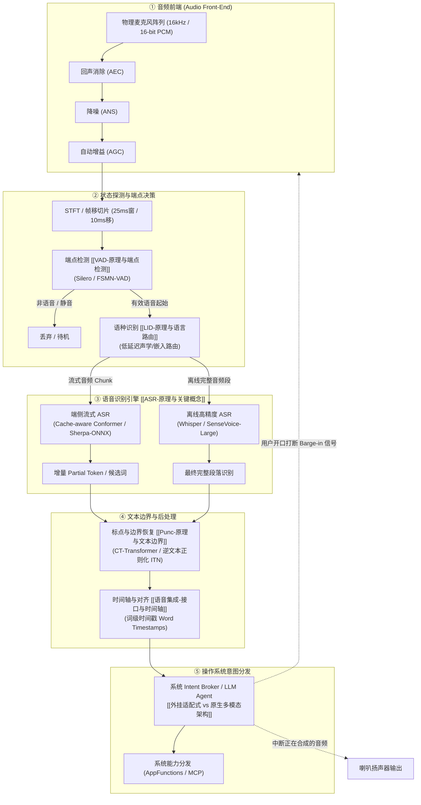

# 语音交互与端侧管线 MOC

> 语音是智能体最自然、也是吞吐最高的输入通道。但在端侧操作系统中，语音不是简单的「调个模型转文字」，而是一条对**实时性、内存带宽、端点灵敏度、容错截断**极度严苛的精密流水线。
> 本 MOC 梳理了从麦克风物理波形采集到最终输出结构化意图的全链路体系，覆盖 **VAD（端点检测）、LID（语种路由）、ASR（语音识别）、Punc（标点恢复）** 以及系统级集成架构。

---

## 一、端侧全双工流式管线架构图

在 OS 级智能体架构中，外挂式语音管线与下层硬件、上层意图框架的协同链路如下：

---

## 二、知识库全景目录（16 篇核心主题）

### 1. 物理层与基础规范
- [[语音集成-音频与时间基础]]：采样率、位深、声道、PCM 编码、帧长（Frame Length）与帧移（Frame Shift）、STFT、Mel 频谱图及时间轴换算原理。
- [[语音集成-术语速查]]：ASR、VAD、LID、Punc、AEC、WER、CER、RTF、Chunk Size、Barge-in、Full-Duplex 等核心术语全量速查手册。

### 2. 端点与状态检测（VAD）
- [[VAD-原理与端点检测]]：传统能量法/零交叉 vs 深度学习（Silero VAD / FSMN-VAD）；静音抑制、Speech Onset/Offset、Hangover 机制与全双工用户打断（Barge-in）。
- [[VAD-官方资料与练习]]：Silero-VAD 官方使用规范、ONNX 部署、分块流式音频处理实战、高噪声下的端点调试代码。

### 3. 语种识别与动态路由（LID）
- [[LID-原理与语言路由]]：声学特征表征 vs 文本二次研判；多语种混合输入下的低延迟流式路由决策树与降级模式。
- [[LID-官方资料与练习]]：Whisper LID、SpeechBrain、FastText 与 VoxLingua107 实操；多语种动态派发原型构建。

### 4. 语音识别核心引擎（ASR）
- [[ASR-原理与关键概念]]：声学模型 + 语言模型进化史；CTC、RNN-T/Transducer、AED（Attention-based Encoder-Decoder）；WER/CER 评估与实时率 RTF 核心指标。
- [[ASR-官方资料与练习]]：OpenAI Whisper（离线基线）、阿里 FunASR / SenseVoice、新一代 Kaldi（Sherpa-ONNX）本地部署与流式调用练习。

### 5. 标点恢复与文本边界（Punc）
- [[Punc-原理与文本边界]]：无标点连续文本的断句挑战；语义边界判定；流式预测中的文字抖动（Flicker）与延迟折中；CT-Transformer 原理。
- [[Punc-官方资料与练习]]：FunASR 标点模型实战；逆文本正则化（ITN：数字/日期规整）；流式文本二次校正 Pipeline。

### 6. 系统集成与端侧工程（Speech Integration）
- [[语音集成-接口与时间轴]]：流式传输协议（WebSocket / gRPC / WebRTC）、分块 Chunk Payload 设计、词级时间戳（Word-level Timestamps）与强制对齐（Forced Alignment）。
- [[语音集成-模型选型比较]]：端侧 NPU/内存带宽预算下的选型决策树；Whisper、SenseVoice、Paraformer、Sherpa-ONNX 在延迟、内存与精度维度的横向权衡。
- [[语音集成-离线与流式架构]]：离线批处理 vs 流式分块架构；Cache-aware Conformer 原理；端到端延迟预算分配（Latency Budget）。
- [[语音集成-评估与数据集]]：中文（WenetSpeech, AISHELL-1/2/4）与英文（LibriSpeech, CommonVoice）数据集；WER/CER 自动评测工具与归因分析方法。
- [[语音集成-排障与常见误区]]：采样率混叠、声道非交错、环形缓冲区欠载、VAD 吞尾字、扬声器串扰回声、模型量化掉精等经典坑位与排障指南。
- [[语音集成-最小实践指南]]：零依赖极简端到端原型：麦克风实时拾音 -> VAD 切分 -> ASR 识别 -> Punc 标点输出闭环实现。

---

## 三、OS PM 第一性设计准则（端侧语音）

1. **带宽是死穴，不是算力**：
   - 语音模型的声学特征（如 80 维 Fbank）每 10ms 一帧，特征传输本身极轻；
   - 但若在端侧常驻一个 1.5GB 参数的 ASR 模型，在低功耗待机下会严重侵占 RAM 并拖慢系统冷启。
   - **决策**：VAD 必须极其轻量（<10MB，驻留在常开低功耗传感器中枢 DSP/Always-on AP）；只有检出有效语音，才唤醒并加载/调度 ASR 模型计算。

2. **延迟预算与“心智等待”**：
   - 人类对话间隙为 **200ms ~ 300ms**。超过 500ms 用户就会产生“模型没在听”的焦虑，甚至重复发声导致串扰。
   - 端到端预算公式：
     $$\text{Total Latency} = \text{VAD End Hangover}(200\text{ms}) + \text{ASR Chunk RTF}(100\text{ms}) + \text{LLM First Token}(200\text{ms})$$
   - 任何超过 600ms 的设计，都必须用流式 Partial Text（边听边打字）或即时声效（Earcon）来提供确定性反馈。

3. **打断（Barge-in）高于一切**：
   - 传统单工模式下，Agent 播报语音时麦克风静音；
   - 全双工全链路下，扬声器播放的同时必须保持 AEC（回声消除）持续收音，一旦 VAD 检出用户发声超过阈值（如 150ms 强语音），系统必须瞬间下发降噪中断并掐断 TTS 播放通道。

---

## 四、关联知识库航标
- 宏观多模态路线对比：[[外挂适配式 vs 原生多模态架构]]
- 模型量化与内存调度：[[端侧模型量化 学习笔记]]
- 移动端计算硬件基石：[[移动端 NPU 与推理编译栈 学习笔记]]
- 端侧 SLM 与智能体协同：[[端侧小语言模型 SLM 生态 学习笔记]]
- 全库 AI 骨架索引：[[AI模型基础 MOC]]
