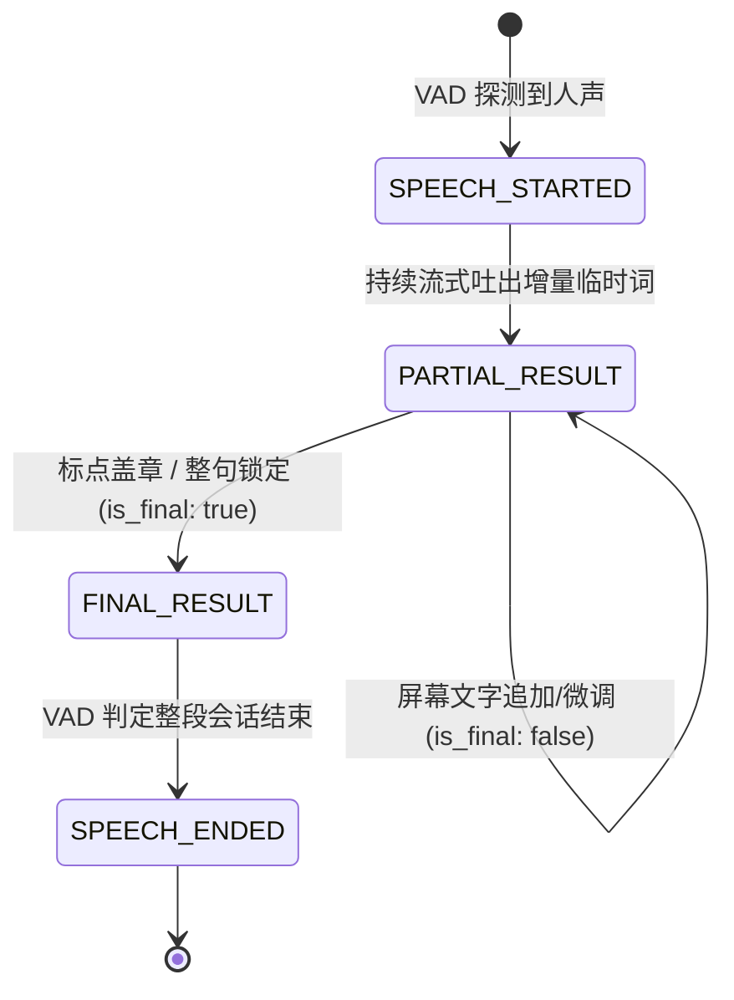
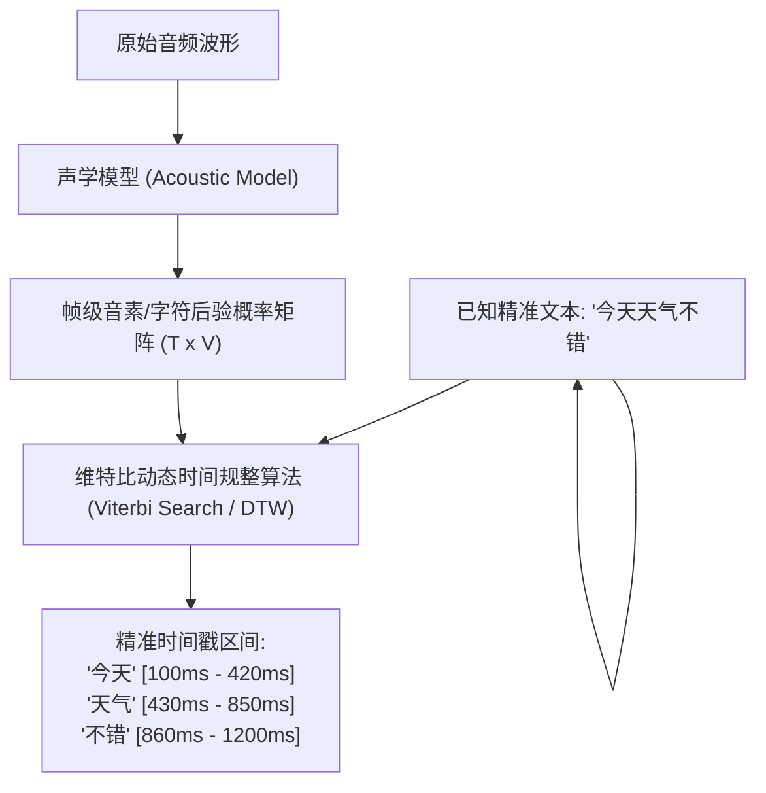

# 语音集成-接口与时间轴

> 语音系统一旦脱离单机 Python 脚本走向工业落地，其成败就不再取决于模型单点精度，而取决于**接口协议的健壮性、IPC 传输零拷贝、流式状态契约以及毫秒级时间戳对齐能力**。
> 本篇系统规范流式音频上下行协议设计，并深入词级时间戳（Word-level Timestamps）与强制对齐（Forced Alignment）的底层实现机制。

---

## 一、端侧与端云流式传输协议选型

在 Android OS 内部进程间以及端云协同网络传输中，音频数据的流动面临完全不同的物理边界：

```mermaid
flowchart TD
    subgraph EdgeSystem["端侧操作系统内部 (In-Device)"]
        AudioRecord["音频硬件驱动 (HAL)"] -->|零拷贝 / 双缓冲| AudioServer["AudioFlinger / 系统音频服务"]
        AudioServer -->|匿名共享内存 (Ashmem / MemoryFile)| ASRService["端侧 ASR 独立进程"]
    end
    
    subgraph CloudBridge["端云协同网络链路 (Device to Cloud)"]
        ASRService -->|WebRTC / RTP| CloudRealtime["超低延迟实时通话 (<150ms)"]
        ASRService -->|WebSocket 双全工| CloudStreaming["商用通用流式语音转写 (200~400ms)"]
        ASRService -->|HTTP/2 gRPC Bidirectional| CloudBackend["微服务高并发集群"]
    end
```

| 通信场景 | 推荐协议 / 传输介质 | 传输格式 | 延迟水平 | OS PM 选型决策与关键约束 |
| :--- | :--- | :--- | :--- | :--- |
| **Android 跨进程 (IPC)** | **Ashmem (匿名共享内存)** | 原始 PCM 裸流 | $< 1\text{ms}$ | **严禁直接走原生 Binder 传音频大数组**！Binder 事务缓冲区全系统共享仅 1MB，塞音频必触发 `TransactionTooLargeException`。必须通过传递共享内存文件描述符（`fd`）实现零拷贝。 |
| **端云通用流式交互** | **WebSocket (全双工)** | 上行: Opus 压缩流<br>下行: JSON 文本帧 | $150\text{ms} \sim 300\text{ms}$ | 支持双向同时推拉，无需像 HTTP 轮询。上行音频与下行识别文本完全异步解耦。 |
| **超低延迟全双工对谈** | **WebRTC (SRTP + DataChannel)** | 上行/下行: Opus 双向直连流 | $< 100\text{ms}$ | 针对丢包严重（弱网、移动基站切换）场景自带抗抖动缓冲区（Jitter Buffer）与拥塞控制。 |
| **服务端集群微服务间** | **gRPC 双向流 (Streaming gRPC)** | Protobuf 二进制 | $50\text{ms} \sim 150\text{ms}$ | 强类型契约、HTTP/2 多路复用，自动生成各语言 SDK，内部链路首选。 |

---

## 二、工业级流式分块协议 Schema 设计

一个具备生产鲁棒性的流式语音接口，必须拥有严密的**会话状态机、分包序列号与事件广播机制**。

### 1. 客户端上行音频包协议（Client $\to$ Server/Engine）
```json
{
  "session_id": "sess_20261026_9b83a1",
  "sequence_id": 42,
  "timestamp_client_ms": 1729958400120,
  "audio_meta": {
    "format": "PCM",
    "sample_rate": 16000,
    "channels": 1,
    "bit_depth": 16
  },
  "is_end_of_stream": false,
  "payload_base64": "...(base64 encoded audio chunk or raw binary websocket frame)..."
}
```

### 2. 服务端/引擎下行事件协议（Engine $\to$ Client/UI）
下行数据流绝不能只返回字符串，必须区分四种明确的事件类型：



```json
{
  "session_id": "sess_20261026_9b83a1",
  "sequence_id": 42,
  "event_type": "PARTIAL_RESULT",
  "is_final": false,
  "duration_processed_ms": 1340,
  "result": {
    "text": "明天下午去北京",
    "words": [
      { "word": "明天", "start_ms": 200, "end_ms": 520, "confidence": 0.98 },
      { "word": "下午", "start_ms": 530, "end_ms": 860, "confidence": 0.95 },
      { "word": "去",   "start_ms": 870, "end_ms": 980, "confidence": 0.99 },
      { "word": "北京", "start_ms": 990, "end_ms": 1320, "confidence": 0.92 }
    ]
  }
}
```

---

## 三、时间轴与强制对齐（Forced Alignment）底层原理

词级时间戳（Word Timestamps）是语音高阶交互（卡拉OK字幕变色高亮、视频精剪剪辑、录音回放精准点击跳转）的基石。



### 1. CTC 峰值对齐机理
- CTC 模型在每一帧都会输出一个针对特定 Token 的概率。
- 观察 CTC 的后验概率分布曲线可以发现：在发音最饱满的核心音素位置，模型会输出极尖锐的峰值脉冲（Spike），而在前后静音或连读平滑期输出 `<blank>`。
- **对齐算法**：通过检测每一个非 `<blank>` 字符的起始上升沿与下降沿，即可毫秒级锁定该字的物理发音起止区间。

### 2. 交叉注意力热力图对齐（Whisper 机制）
- Whisper 属于 AED 自回归架构，其 Decoder 每生成一个 Token，都会与 Encoder 的全局音频表征计算 Cross-Attention 矩阵。
- **原理**：将指定层（通常是中后层）的注意力权重矩阵做动态时间规整（DTW），找到与当前 Token 关联最紧密的音频帧区间作为时间戳。
- **精度缺陷与 WhisperX 改进**：原生 Whisper 注意力对齐由于下采样和自回归延迟，时间戳容易存在 100~200ms 漂移。工业级方案（如 **WhisperX**）采用“Whisper 识别出文本 $\to$ 挂接专有轻量 Phoneme CTC 声学模型（如 Wav2Vec2）执行二次强制对齐”，将精度提升至 **20ms 以内**。

---

## 四、OS PM 系统级稳定性准则

1. **音频丢帧检测与时间戳单调递增保证（Monotonic Clock）**：
   - 网络抖动或线程调度卡顿可能导致音频分包乱序到达。
   - **规则**：服务端/引擎必须校验 `sequence_id`。若发生丢包，**严禁使用系统本地壁钟（Wall Clock）直接补时间**，必须依据已接收采样点数严格推算时间戳，确保输出的 `start_ms` 恒定单调递增。
2. **连接断开优雅重连（Graceful Reconnect）**：
   - 移动端从 Wi-Fi 切换到 5G 基站时，WebSocket 链路会有短暂 1~2 秒中断。
   - **架构要求**：客户端必须保留最近 3 秒未收到 `FINAL_RESULT` 确认的音频缓存；重连建立后，携带上次最后确认的 `sequence_id` 实施断点增量补发，避免用户一整句话全部丢失重新说。

---

## 五、关联导航
- 物理时间基础与换算：[[语音集成-音频与时间基础]]
- 离线与流式全貌：[[语音集成-离线与流式架构]]
- 系统排障与常见误区：[[语音集成-排障与常见误区]]
- 全链路总控：[[语音交互与端侧管线 MOC]]
