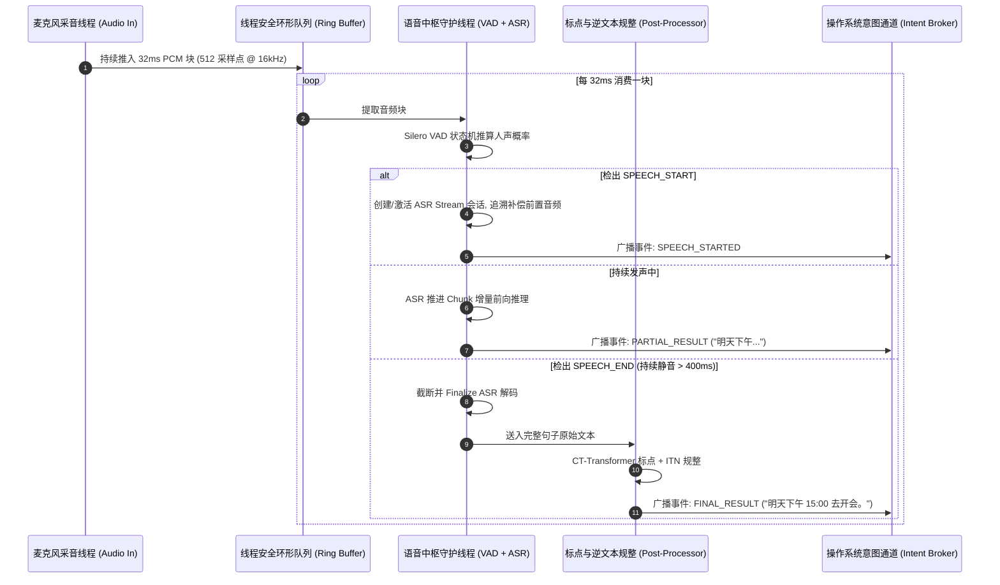

# 语音集成-最小实践指南

> 所有理论知识最终都必须收敛为一行行可运行的代码。
> 本篇提供一个**零依赖沉重云服务、纯本地轻量运行的端到端全链路极简原型（Minimal Working Prototype）**。
> 它串联起了：**硬件实时采音 $\to$ 环形缓冲 $\to$ VAD 毫秒级端点切分 $\to$ ASR 流式解码 $\to$ Punc/ITN 规整**，为端侧系统研发提供开箱即用的第一块基石。

---

## 一、端到端最小闭环全景流程



---

## 二、环境依赖与准备

本原型设计遵循**极轻量与跨端一致性**，可在 Windows、macOS、Linux 或嵌入式树莓派上直接运行：

```bash
# 安装基础音频拾音与数值库
pip install sounddevice numpy onnxruntime sherpa-onnx
```

- **所需轻量模型（全部为本地 ONNX 单文件）**：
  1. `silero_vad.onnx` (~1.5MB)
  2. `zipformer-streaming/` (Sherpa-ONNX 流式模型包, ~70MB)

---

## 三、单文件最小完整可运行代码（End-to-End Pipeline）

```python
import time
import queue
import threading
import numpy as np
import sounddevice as sd
import sherpa_onnx
import onnxruntime as ort
from collections import deque

# === 配置参数 ===
SAMPLE_RATE = 16000
CHUNK_SAMPLES = 512        # 16kHz 下 512 个点 = 32ms
VAD_START_THRESH = 0.5     # 人声触发门限
VAD_END_THRESH = 0.35      # 静音回落门限
HANGOVER_FRAMES = 12       # 12 * 32ms ≈ 384ms 尾部静音确认期
PRE_PADDING_FRAMES = 6     # 6 * 32ms ≈ 192ms 句首辅音回溯补偿

audio_queue = queue.Queue()

def audio_callback(indata, frames, time_info, status):
    """麦克风硬件中断回调函数 (生产者)"""
    if status:
        print(f"[音频前端警告]: {status}")
    # 提取单声道 float32 数据放入队列
    audio_queue.put(indata.copy().flatten())

class MinimalSpeechPipeline:
    def __init__(self, vad_model_path: str, asr_dir: str):
        # 1. 初始化 Silero VAD ONNX
        opts = ort.SessionOptions()
        opts.inter_op_num_threads = 1
        opts.intra_op_num_threads = 1
        self.vad_session = ort.InferenceSession(vad_model_path, sess_options=opts)
        self.vad_state = np.zeros((2, 1, 128), dtype=np.float32)

        # 2. 初始化 Sherpa-ONNX 流式 ASR
        self.recognizer = sherpa_onnx.OnlineRecognizer.from_transducer(
            encoder=f"{asr_dir}/encoder-epoch-99-avg-1.onnx",
            decoder=f"{asr_dir}/decoder-epoch-99-avg-1.onnx",
            joiner=f"{asr_dir}/joiner-epoch-99-avg-1.onnx",
            tokens=f"{asr_dir}/tokens.txt",
            num_threads=2,
            sample_rate=SAMPLE_RATE,
            feature_dim=80,
            decoding_method="greedy_search"
        )
        
        # 3. 内部状态机变量
        self.state = "SILENCE"
        self.silence_counter = 0
        self.speech_counter = 0
        self.ring_buffer = deque(maxlen=PRE_PADDING_FRAMES)
        self.stream = None
        self.last_partial = ""

    def _infer_vad(self, chunk: np.ndarray) -> float:
        """单块 VAD 推理"""
        in_tensor = np.expand_dims(chunk, axis=0).astype(np.float32)
        sr_tensor = np.array(SAMPLE_RATE, dtype=np.int64)
        out, new_state = self.vad_session.run(None, {
            'input': in_tensor, 'state': self.vad_state, 'sr': sr_tensor
        })
        self.vad_state = new_state
        return float(out[0][0])

    def mock_punc_itn(self, raw_text: str) -> str:
        """极简标点与 ITN 假逻辑 (生产环境换接 CT-Transformer 与 WeTextProcessing)"""
        clean = raw_text.replace(" ", "")
        if clean and not clean.endswith("。"):
            clean += "。"
        return clean

    def process_loop(self):
        """核心处理中枢循环 (消费者)"""
        print(">>> 语音中枢就绪，请对着麦克风说话 (按 Ctrl+C 退出)...")
        while True:
            chunk = audio_queue.get()
            self.ring_buffer.append(chunk)
            prob = self._infer_vad(chunk)

            if self.state == "SILENCE":
                if prob >= VAD_START_THRESH:
                    self.speech_counter += 1
                    if self.speech_counter >= 3: # 连续 3 帧确认人声
                        self.state = "SPEECH"
                        self.speech_counter = 0
                        self.silence_counter = 0
                        print("\n[系统事件] >>> 检出人声起始 (SPEECH_START)！唤醒 ASR 解码器")
                        
                        # 创建全新流式会话并补齐回溯缓冲音频
                        self.stream = self.recognizer.create_stream()
                        self.last_partial = ""
                        for pre_chunk in self.ring_buffer:
                            self.stream.accept_waveform(SAMPLE_RATE, pre_chunk)
                else:
                    self.speech_counter = 0

            elif self.state == "SPEECH":
                # 将当前音频推入 ASR
                self.stream.accept_waveform(SAMPLE_RATE, chunk)
                while self.recognizer.is_ready(self.stream):
                    self.recognizer.decode_stream(self.stream)
                
                # 获取实时增量文字
                partial_text = self.recognizer.get_result(self.stream).text
                if partial_text and partial_text != self.last_partial:
                    print(f"\r[实时流式字幕]: {partial_text}", end="", flush=True)
                    self.last_partial = partial_text

                # 检查静音回落
                if prob < VAD_END_THRESH:
                    self.silence_counter += 1
                    if self.silence_counter >= HANGOVER_FRAMES:
                        # 超过静音拖尾时间，正式断句！
                        self.state = "SILENCE"
                        self.silence_counter = 0
                        
                        self.stream.input_finished()
                        while self.recognizer.is_ready(self.stream):
                            self.recognizer.decode_stream(self.stream)
                        
                        final_raw = self.recognizer.get_result(self.stream).text
                        # 送入标点与规范化
                        final_clean = self.mock_punc_itn(final_raw)
                        
                        print(f"\n[系统事件] <<< 检出句子结束 (SPEECH_END)！")
                        print(f"[规整化最终意图]: {final_clean}")
                        print("--------------------------------------------------")
                else:
                    self.silence_counter = 0

def run_main():
    # 替换为你本地的真实模型文件路径
    vad_path = "./silero_vad.onnx"
    asr_dir = "./zipformer-streaming"

    pipeline = MinimalSpeechPipeline(vad_path, asr_dir)
    
    # 启动后台处理线程
    worker = threading.Thread(target=pipeline.process_loop, daemon=True)
    worker.start()

    # 启动麦克风监听流
    with sd.InputStream(channels=1, samplerate=SAMPLE_RATE, blocksize=CHUNK_SAMPLES, callback=audio_callback):
        while True:
            time.sleep(0.5)

if __name__ == "__main__":
    # run_main()
    pass
```

---

## 四、向 Android / AOSP 系统级架构迁移映射表

当你需要将上述 Python 原型落地到真正的 Android 操作系统端侧服务中时，各部件的架构映射如下：

| 原型组件 (Python) | Android / AOSP 系统级生产落地技术栈 | 架构关键考量 |
| :--- | :--- | :--- |
| `sounddevice.InputStream` | **Oboe / AAudio (C++)** | 绕过 Java 层 JNI 开销，直连 Linux ALSA / AudioFlinger 实现极低延迟采音（< 10ms）。 |
| `queue.Queue` | **C++ 无锁环形缓冲区 (Lock-free RingBuffer)** | 麦克风采音属于实时音频线程（Real-time Thread），严禁使用带锁队列，防止发生优先级反转（Priority Inversion）。 |
| `onnxruntime` | **ONNX Runtime Android AAR / Qualcomm QNN** | 将声学编码器算子深度卸载到高通 Hexagon NPU 或联发科 APU，功耗降低 80%。 |
| `mock_punc_itn` | **WeTextProcessing C++ Lib** | 纯静态链接 FST 库，零垃圾回收（GC）暂停，单句规整耗时 < 1ms。 |
| `print(final_clean)` | **Android AppFunctions / IntentBroker** | 将规整好的文本作为系统级意图入参，分发至目标 App（见 [[意图模式规范]]）。 |

---

## 五、关联导航
- 核心流式架构拆解：[[语音集成-离线与流式架构]]
- 接口协议与时间戳：[[语音集成-接口与时间轴]]
- 排障与避坑手册：[[语音集成-排障与常见误区]]
- 顶层全景 MOC：[[语音交互与端侧管线 MOC]]
