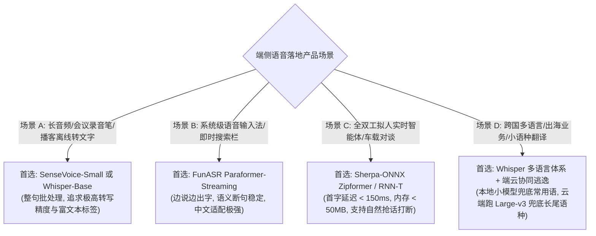

# 语音集成-模型选型比较

> 离开硬件约束空谈模型精度（WER/CER），是做端侧产品最大的自嗨陷阱。
> 端侧 ASR 模型的核心瓶颈**不是 NPU 算力（FLOPS）不够，而是内存带宽与常驻内存（RAM PSS/RSS）预算受限**。
> 本篇以操作系统产品经理的第一性视角，横向拆解当前主流语音模型在参数体积、量化支持、流式时延、内存开销与精度上的真实权衡，给出工业级选型决策矩阵。

---

## 一、端侧选型第一性评估维度

1. **常驻内存与 PSS 预算**：
   - 在 Android 系统级后台服务中，语音交互组件分配的常驻内存上限通常被限制在 **150MB ~ 250MB** 以内。
   - 超过 500MB 的模型一旦后台常驻，在用户运行重度大型手游或多任务切换时，必然首当其冲被 LMK（Low Memory Killer）直接杀死。
2. **算法延迟与流式亲和度**：
   - 用户说话过程中的实时反馈（Partial Text）依赖**流式切块（Chunk-based）**能力。不支持流式的纯自回归离线大模型只能在用户说完后进行整句转写，无法支撑全双工自然交互。
3. **多模态与富文本衍生价值**：
   - 现代语音交互已不仅是“文字转录”，更需要声音事件（如是否包含掌声、笑声、背景音乐）以及说话人情绪（愤怒、喜悦、焦急），用于支撑 Agent 更具共情力的拟人化决策。

---

## 二、工业主流语音模型横向对比矩阵

| 模型系列 | 开源方 / 架构 | 参数量 / 磁盘体积 | 8-bit 量化内存 (RAM) | 原生流式支持 | 中文 CER (通用/噪声) | 英文 WER | RTF (端侧单核 CPU) | 核心定位与 PM 决策总结 |
| :--- | :--- | :--- | :--- | :--- | :--- | :--- | :--- | :--- |
| **Whisper-Base** | OpenAI (AED) | 74M / ~140MB | ~90MB | 伪流式 (滑动窗口) | 8.5% / 15.2% | ~5.8% | 0.25 | 适合全球多语言、配置受限的入门级离线转写。 |
| **Whisper-Large-v3** | OpenAI (AED) | 1550M / ~3.0GB | ~1.6GB | 不支持 (纯离线) | 3.5% / 6.8% | ~3.8% | > 1.2 (CPU跑不动) | **离线转写天花板**。仅适合云端服务器或高端 PC 本地 GPU 加速运行。 |
| **SenseVoice-Small** | 阿里通义 (非自回归) | 200M / ~400MB | ~120MB | 块级流式 (Chunk 1s) | **3.8% / 6.2%** | ~6.5% | **0.08** (极快) | **多任务性价比之王**。兼具极高中文/粤语/日韩精度，且自带情绪检测与音频事件标签。 |
| **Paraformer-Streaming** | 阿里达摩院 (CIF-Sanm) | 220M / ~420MB | ~130MB | **原生流式** (Chunk 600ms) | 4.2% / 7.5% | ~8.0% | 0.12 | **国内中文商用流式第一梯队**。阿里工业级产物，对中文口语、数字规整契合度极佳。 |
| **Sherpa-ONNX (Zipformer)** | 新一代 Kaldi (RNN-T) | 65M / ~70MB | **~45MB** | **原生极速流式** (Chunk 160ms) | 5.5% / 9.8% | ~7.2% | **0.05** (极低) | **移动端与嵌入式首选**。首字延迟 < 150ms，内存占用极小，跨端 C++ 支持无懈可击。 |

---

## 三、四大主力选型深度剖析

### 1. 极致轻量流式：Sherpa-ONNX (Zipformer-Transducer)
- **第一性优势**：采用 U2++ / Zipformer 架构，对时间序列进行了多尺度压缩，模型参数仅 60M 左右。在低端 Android 手机的 CPU 线程上，仅占用 **30MB~50MB** 内存即可平稳运行，RTF 跑进 0.05。
- **代价**：在重度嘈杂声学环境、重度方言口音下，错误率略高于 200M+ 的大模型。

### 2. 语义与富文本全能：SenseVoice-Small
- **第一性优势**：突破了传统 ASR 只能输出干瘪文字的限制。它在输出文本的同时，直接输出声音事件与情感：
  - 输入：“（大笑）哈哈，太好笑了！（掌声）”
  - 输出带有 `<|HAPPY|>` 情感标和 `<|LAUGHTER|>` 事件标。
- **价值**：对于操作系统级智能体，这些富文本标签能够直接作为上层意图框架的上下文输入（例如：检测到用户发音带有 `<|ANGRY|>` 愤怒情感，Agent 自动切换为严肃、言简意赅的服务语气）。

### 3. 非自回归速度王者：Paraformer
- **第一性优势**：基于连续积分触发（CIF）机制，摆脱了自回归生成逐字依赖的瓶颈。一次前向传播完成整句识别，推理速度比传统自回归模型快 5~10 倍，能大幅缩短端侧 NPU/CPU 满载时间，从而保护设备续航。

---

## 四、OS PM 落地资源预算表

在立项阶段，PM 必须在 PRD 中明确以下四张硬性资源红线支票：

| 资源类别 | 严苛级约束 (如常驻后台助手) | 宽松级约束 (如前台独立转写 App) | 规避动作 |
| :--- | :--- | :--- | :--- |
| **安装包体积 (APK/AAR 增量)** | $\le 40\text{MB}$ | $\le 200\text{MB}$ | 采用动态按需下发（Dynamic Feature Delivery），首次开机联网静默下载。 |
| **运行时内存 (RSS / PSS)** | $\le 120\text{MB}$ | $\le 500\text{MB}$ | 必须启用 INT8 权重量化与 KV Cache 共享，严禁 FP32 原始加载。 |
| **端侧推理首字延迟 (TTFT)** | $\le 250\text{ms}$ | $\le 800\text{ms}$ | 禁用大步长双向注意力，流式 Chunk 限制在 160ms~200ms。 |
| **CPU 占用率 (四核手机平均)** | $\le 15\%$ | $\le 40\%$ | 将部分算子卸载到端侧 NPU（如 Android NNAPI / QNN），释放通用 CPU。 |

---

## 五、关联导航
- 核心识别原理与架构：[[ASR-原理与关键概念]]
- 离线与流式工程实现：[[语音集成-离线与流式架构]]
- 数据集基准与评测：[[语音集成-评估与数据集]]
- 全链路总控：[[语音交互与端侧管线 MOC]]
