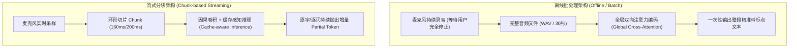
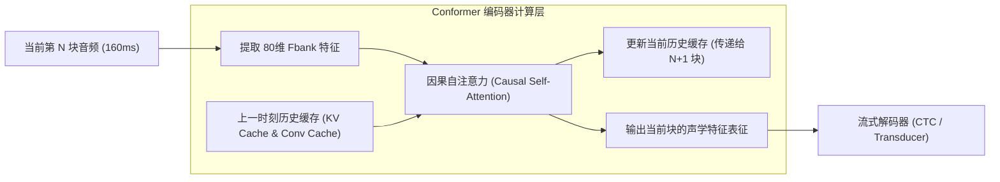
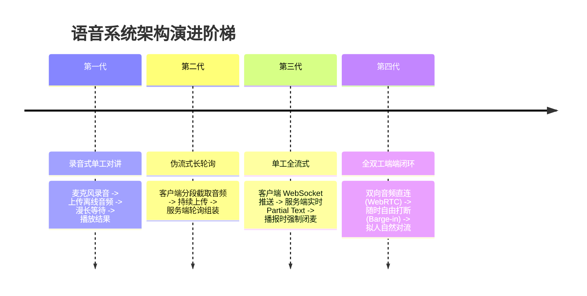

# 语音集成-离线与流式架构

> 在语音交互架构中，“离线批处理（Offline Batch）”与“实时流式（Streaming）”是两套完全不同的系统哲学。
> 离线架构追求**全局上下文带来的极致识别准确率**，而流式架构追求**毫秒级响应的心智无缝感与端到端低时延**。
> 本篇系统解构端到端延迟预算的物理分配，并深入剖析现代流式核心技术——缓存感知卷积注意力（Cache-aware Conformer）。

---

## 一、离线批处理 vs 实时流式架构全景对比

| 对比维度 | 离线批处理架构 (Offline) | 实时流式分块架构 (Streaming) |
| :--- | :--- | :--- |
| **音频输入方式** | 一次性喂入已知长度的完整音频（整句/整段） | 连续切块，按时钟周期持续推入（如每 160ms 一块） |
| **时序依赖关系** | **双向可见**：模型能“向后看”未来全部音频 | **因果单向/受限可见**：模型只能看到过去与当前 Chunk |
| **状态维护 (State)** | 无状态（Stateless），单次函数前向推断 | **强有状态（Stateful）**，需维护并传递跨分块的 Key-Value 缓存 |
| **算法延迟 (Latency)** | 严重受限：必须等待用户说完（通常 > 1.5s ~ 3s） | **超低**：首字延迟可压低至 **150ms ~ 300ms** |
| **识别精度 (CER)** | 极高（基线水准） | 相对离线有 5% ~ 15% 的相对精度回落（因缺少全局未来信息） |
| **端侧产品适用场景** | 录音笔转文字、长语音留言、会议纪要生成 | **OS 助手对话、实时输入法、全双工车载 Agent、同传翻译** |

---

## 二、现代流式架构的核心：Cache-aware 机制

为什么不能简单地把长音频强行切断，直接丢给离线模型识别？
- **边界效应（Boundary Effect）**：如果一个汉字“好”（发音约 250ms）恰好被 160ms 的 Chunk 从中间切断，前后两个孤立的半截音频无论如何都无法被正确识别。
- **音素连续性断裂**：自然语言存在大量的连读、轻声与声调过渡，必须跨越时间块建立依赖。

### 1. 缓存感知因果注意力（Cache-aware Attention）
- 传统的全局 Attention 会计算矩阵 $Q K^T$，随着时间推移，矩阵大小呈 $O(T^2)$ 二次爆炸。
- **流式解法**：强制使用**局部 Chunk 注意力 + 固定长度历史缓存**。模型只计算当前 Chunk 与前序 $M$ 帧历史缓存（History Buffer）的注意力，未来绝对不可见（或仅留出 40ms 的微小 Lookahead 窗口）。计算复杂度直接降为线性 $O(T)$，内存开销恒定。

### 2. 深度可分离卷积缓存（Convolution Cache）
- Conformer 架构中包含 1D 深度可分离卷积层（Depthwise Conv），其卷积核大小（Kernel Size）通常为 15 或 31。
- **工程处理**：每次处理完当前 Chunk，必须保留最后 `(Kernel_Size - 1)` 帧的中间激活值存入 `conv_cache`。当下一个 Chunk 到达时，先将 `conv_cache` 拼接在头部，再执行卷积计算，从而**在数学上彻底抹平分块边界的接缝**。

---

## 三、端到端交互延迟预算分解（Latency Budget）

在端侧 OS 全双工交互中，人类对“流畅交谈”的容忍上限是 **500ms ~ 600ms**。超过该阈值，用户体验就会迅速劣变。

以下是工业级系统级流水线的时间开销红线拆解：

```mermaid
gantt
    title 端到端全链路延迟预算 (总计 ~480ms)
    dateFormat X
    axisFormat %s
    section 音频采集与前端
    麦克风硬件缓冲 (Chunk 160ms) :active, a1, 0, 160
    AEC + 降噪前端处理 (20ms) :active, a2, 160, 180
    section 判定与识别
    VAD 静音截断判断 (Hangover 200ms) :crit, v1, 180, 280
    ASR 流式尾包推理 (RTF=0.1, 耗时 50ms) :done, a3, 280, 330
    section 语义与意图
    端侧 SLM 首字推理 (TTFT 100ms) :active, l1, 330, 430
    section 响应与呈现
    TTS 首帧波形合成与扬声器起振 (50ms) :crit, t1, 430, 480
```

1. **硬件与音频前端（180ms）**：
   - 麦克风音频采集必须按 Chunk 攒批，160ms 的 Chunk 本身就带来 160ms 物理缓冲延迟；
   - 硬件 AEC/ANS 耗时约 20ms。
2. **端点判定与识别（150ms）**：
   - VAD 确认用户说完一句话并下发截断，需保留极短的静音确认期（通常优化至 100~150ms）；
   - ASR 处理最后一个尾包的增量特征推断，耗时约 30~50ms。
3. **下游大模型与合成（150ms）**：
   - 端侧 SLM 执行首字预测，耗时约 100ms；
   - TTS 接收到前几个字，生成第一包可播报音频，耗时约 50ms。
4. **总延迟总结**：$180 + 150 + 150 \approx 480\text{ms}$，刚好落在人类自然交谈心理舒适区（300~500ms）。

---

## 四、架构演进四阶天梯

---

## 五、OS PM 生产可用性与架构决策

1. **“假流式”识别陷阱的识别与规避**：
   - **典型误区**：某些团队为了图省事，将离线 ASR 模型用一个 2 秒的滑动窗口（Sliding Window）反复识别重叠音频。
   - **后果**：每次滑动都要重复计算前 1.5 秒的音频，导致端侧 CPU 占用率飙升 300%，且窗口交界处的文字由于上下文不一致疯狂跳变、抖动，电量瞬间崩溃。
   - **PM 准则**：凡是声称支持流式的模块，**必须审查其是否具备真正的增量 State 传递（如 RNN-T 或 Cache-aware Transformer）**。
2. **弱网与断流降级策略**：
   - 端云协同流式架构中，遇到弱网突发丢包时，系统必须在本地保留至少 3 秒的原始 PCM 环形缓存；
   - 若网络超过 1 秒未返回 ACK，系统应立刻**降级为端侧本地轻量 ASR 引擎接管**，保证屏幕打字不中断，待网络恢复后在后台进行静默云端二次高精校正。

---

## 六、关联导航
- 核心识别原理：[[ASR-原理与关键概念]]
- 接口与数据流契约：[[语音集成-接口与时间轴]]
- 系统排障避坑：[[语音集成-排障与常见误区]]
- 全链路总控：[[语音交互与端侧管线 MOC]]
