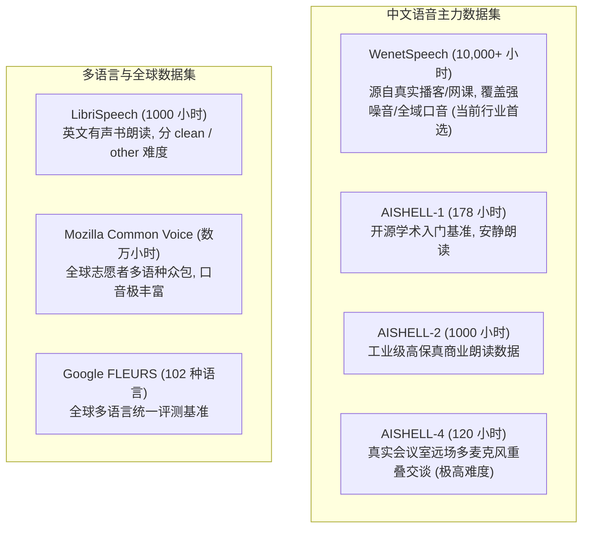
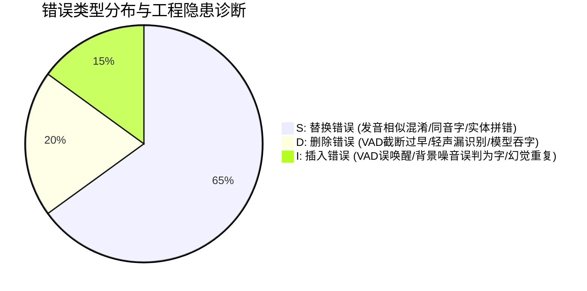

# 语音集成-评估与数据集

> “在干净数据集上测得 2% 的超低字错误率（CER），一到真机落地就完全不可用”——这是语音产品最常见翻车现场。
> 评估语音系统不是拿一个公开排行榜盲目背书，而是必须建立覆盖**真实声学环境（混响/远场/噪声）、人群口音、中英混杂以及特定垂直业务名词**的黄金评测集（Golden Test Set）。

---

## 一、工业级主流标准数据集全景图



| 数据集名称 | 主语言 | 总时长 | 声学场景 | 标注质量 | 工业评价与适用定位 |
| :--- | :--- | :--- | :--- | :--- | :--- |
| **WenetSpeech** | 中文普通话 | 10,000+ 小时 | 真实网络视频、播客、采访、会议 | 弱监督 + 强校验分级 | **中文工业级模型训练与压力测试唯一必选**。真实噪音、吞音口音分布极其充分。 |
| **AISHELL-1** | 中文普通话 | 178 小时 | 室内安静环境、近场手机录音 | 人工精准校验 | **学术界论文发榜标配**。难度偏低，适合验证算法代码正确性，不适合衡量真机抗噪力。 |
| **AISHELL-4** | 中文普通话 | 120 小时 | 真实会议室、远场阵列、多人抢话打断 | 真实会议场景 | 专门用于测试远场拾音与多人重叠说话打断。 |
| **LibriSpeech** | 英语 | 1000 小时 | 有声读物朗读 (Clean / Other) | 精准对齐 | 英文 ASR 领域如同“ImageNet”一般的通用标杆基准。 |
| **Common Voice** | 100+ 语言 | 数万小时 | 众包设备录制（笔记本、手机、耳麦） | 社区投票众包 | 口音极其多样化、带有各类家庭背景音，泛化度测试首选。 |

---

## 二、评测指标第一性：错误分类与根因归纳

在 PM 审核算法交付的评测报告时，绝不能只看单一的总体错误率（CER/WER），必须审查三种错误类型的物理构成：

$$\text{Error Rate} = \frac{S (\text{替换错误}) + D (\text{删除错误}) + I (\text{插入错误})}{N (\text{真值总字数})} \times 100\%$$



1. **替换错误（Substitution, $S$）占比过高**：
   - *现象*：把“张经理”识别成“章经历”。
   - *病因分析*：声学模型区分度足够，但语言模型解码打分较弱，或专有名词未注入热词字典。
2. **删除错误（Deletion, $D$）占比过高**：
   - *现象*：把“今天去吃饭吧”识别成“今天去吃饭”（丢失末尾轻声）。
   - *病因分析*：VAD 的 Hangover 拖尾时间设得太短，或者声学模型在低信噪比下发生“吞音逃逸”。
3. **插入错误（Insertion, $I$）占比过高**：
   - *现象*：一段无人的键盘敲击声被识别成“阿阿阿”或“嗯”。
   - *病因分析*：VAD 虚警率（FAR）过高把非人声塞进了 ASR，或者 Whisper 等自回归模型陷入了无限循环的“幻觉发散”。

---

## 三、评测工程致命陷阱：文本规整化（Text Normalization）

在计算 CER 前，如果不做**无损且对称的文本归一化（Sanitization）**，测试结果将完全失真！

### 典型假性错误场景（False Errors）：
- **标点符号污染**：标注是“去北京”，识别输出“去北京。”。若不清洗标点，计算程序会直接给出一个插入错误 $I=1$，导致短句错误率凭空暴增 33%。
- **繁简字形混淆**：OpenAI Whisper 经常吐出繁体中文（如“這裏” vs “这里”）。如果不挂接 `OpenCC` 强制转为简体，全句都会被判定为替换错误 $S$。
- **数字大写与阿拉伯数字**：“开会时间2点” vs “开会时间两点”。必须先统一跑一遍一致的 ITN 规则。
- **大小写与多余空格**：英文单词中大小写混杂（`Apple` vs `apple`）必须全部转换为统一小写。

---

## 四、自动化评测工具实战代码（基于 jiwer）

```python
# 需提前安装: pip install jiwer opencc
import jiwer
import opencc

def evaluate_asr_dataset(ground_truths: list, hypotheses: list) -> dict:
    """
    工业级 ASR 评测清洗与指标分解流水线
    自动执行繁简转换、标点移除、大小写标准化
    """
    cc = opencc.OpenCC('t2s') # 繁体转简体

    # 定义文本规整管道
    transformation = jiwer.Compose([
        jiwer.ToLowerCase(),
        jiwer.RemovePunctuation(),
        jiwer.RemoveMultipleSpaces(),
        jiwer.Strip()
    ])

    clean_refs = []
    clean_hyps = []

    for ref, hyp in zip(ground_truths, hypotheses):
        # 1. 繁简转为统一简体
        r_clean = cc.convert(ref)
        h_clean = cc.convert(hyp)
        # 2. 移除标点与冗余空白
        clean_refs.append(transformation(r_clean))
        clean_hyps.append(transformation(h_clean))

    # 3. 针对中文按单个字符切片 (英文按单词切片)
    # 中文若不切分单字，jiwer 默认会将整句当成一个单词计算
    char_refs = [" ".join(list(text.replace(" ", ""))) for text in clean_refs]
    char_hyps = [" ".join(list(text.replace(" ", ""))) for text in clean_hyps]

    # 4. 执行对齐评测
    out = jiwer.process_words(char_refs, char_hyps)

    return {
        "cer": round(out.wer * 100, 2), # 在字符切分下，WER 即为 CER
        "substitutions": out.substitutions,
        "deletions": out.deletions,
        "insertions": out.insertions,
        "hits": out.hits,
        "total_chars": out.substitutions + out.deletions + out.hits
    }

# === 示例运行 ===
if __name__ == "__main__":
    gt = ["今天下午去開會，討論AI產品架構。"]
    pred = ["今天下午去开会讨论AI产品结构"]
    report = evaluate_asr_dataset(gt, pred)
    print(f"自动化评测报告: CER = {report['cer']}%")
    print(f"替换={report['substitutions']}, 删除={report['deletions']}, 插入={report['insertions']}")
```

---

## 五、OS PM 建立业务黄金测试集（Golden Test Set）SOP

1. **场景分桶（Bucket Segmentation）**：
   - 严禁全量混合测试。测试集必须严格拆解为 5 大互斥子集：
     1. **安静近场基线集（Quiet Office）**：100 条标准朗读，目标 CER $\le 2.0\%$；
     2. **车载高噪与风噪集（In-car 100km/h）**：100 条真实车载，目标 CER $\le 5.0\%$；
     3. **远场客厅带电视底噪集（Living Room）**：100 条智能家居控制指令，目标 CER $\le 6.5\%$；
     4. **高频方言与口音集（Dialect & Accent）**：川普、粤普、东北口音，目标 CER $\le 8.0\%$；
     5. **中英混杂与垂直专有名词集（Code-Switching）**：涵盖最新产品名、系统 API 名，目标 CER $\le 5.0\%$。
2. **基线冻结与单调棘轮原则（Monotonic Ratchet）**：
   - 每次模型算法版本升级（如权重更新或量化压缩），新版本在新测试集上的**总准确率必须提高，且任何单一子集的退化（Regression）不得超过 0.5%**，防止出现“修好了方言、搞坏了基础普通话”的负向回归。

---

## 六、关联导航
- 核心指标术语速查：[[语音集成-术语速查]]
- 模型横向选型对比：[[语音集成-模型选型比较]]
- 接口协议与时间轴：[[语音集成-接口与时间轴]]
- 全链路总控：[[语音交互与端侧管线 MOC]]
