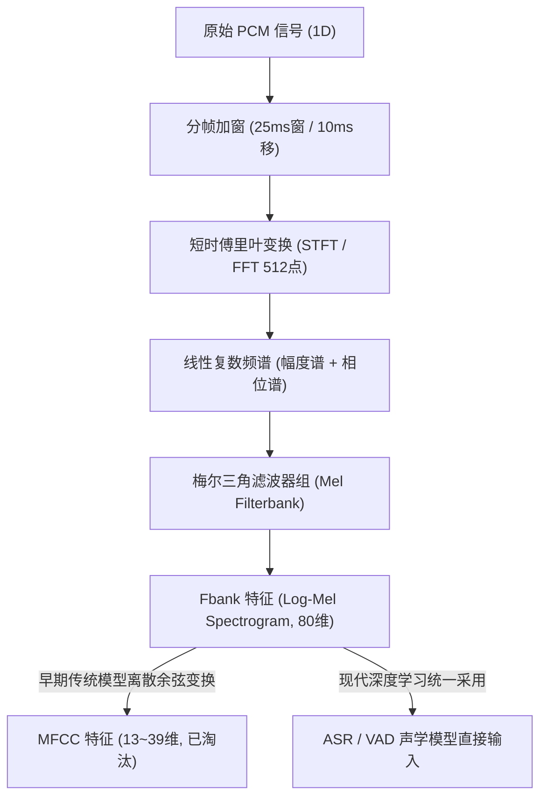

# 语音集成-音频与时间基础

> 无论是百亿参数的端侧语音多模态大模型，还是轻量级的端点检测器，其底层处理的全部是**离散数字时间序列**。
> 理解采样率、量化精度、短时平稳性假说、时频变换（STFT/Mel）以及时间戳换算，是构建低延迟、无抖动、高对齐精度的语音管线的第一性物理基石。

---

## 一、声音的数字化（物理波形到 PCM）

自然界的声音是连续变化的空气气压振动（连续模拟信号）。数字音频的采集遵循三个不可再分的物理变量：

### 1. 采样率（Sample Rate, $f_s$）
- **定义**：每秒钟对模拟信号采集的离散样本点数量，单位赫兹（Hz）。
- **奈奎斯特-香农采样定理（Nyquist-Shannon Theorem）**：
  $$f_s \ge 2 \cdot f_{\max}$$
  采样率必须大于信号最高频率的 2 倍，才能无失真地还原模拟信号；低于该值会发生**频域混叠（Aliasing）**。
- **工业级标准分档**：
  - **8,000 Hz（8kHz / 窄带）**：传统 PSTN 电话音质，最高还原 4kHz 频率。人声基本可懂，但齿音、辅音细节大量丢失。
  - **16,000 Hz（16kHz / 宽带 / ASR 黄金工业基准）**：绝大多数 ASR（Whisper, Paraformer, Conformer）与 VAD 的输入标准。人声核心能量集中在 300Hz ~ 3.4kHz，8kHz 频带覆盖绝大部分元音和辅音泛音，兼顾识别精度与极低特征计算量。
  - **44,100 Hz / 48,000 Hz（44.1k/48k / 全频带）**：CD 音乐与电影级原声，人耳听觉极限（20kHz）。端侧麦克风硬件默认通常以 48kHz 采集，**必须经过高质量抗混叠重采样（Resampling）降为 16kHz** 再送入 ASR。

### 2. 位深（Bit Depth / 采样位宽）
- **定义**：每个离散采样点幅值所占用的二进制位数，决定了动态范围（Dynamic Range）和信噪比。
- **量化噪声与动态范围公式**：
  $$\text{Dynamic Range (dB)} \approx 6.02 \times N \text{ (bits)}$$
  - **16-bit Signed Integer（int16 / 常用）**：动态范围约 96dB，取值范围 $[-32768, 32767]$。绝大多数端侧音频驱动与 ASR 声学特征提取的标准接口。
  - **32-bit Float（float32）**：将幅值归一化至 $[-1.0, 1.0]$，深度学习模型推理（ONNX/TensorRT）内部张量计算的标准格式。

### 3. 声道（Channels）
- **Mono（单声道）**：ASR 核心引擎识别阶段**仅接受单声道音频**。
- **Stereo / Multi-channel（立体声/多声道阵列）**：用于麦克风前端硬件波束成形（Beamforming）、盲源分离与回声消除（AEC）。在送入 VAD/ASR 之前，必须在音频前端（Audio Front-End, AFE）处理为干净的单声道音轨。

---

## 二、帧、窗与时序切片（Time-Frequency Slicing）

物理音频波形是一维的幅度-时间曲线（1D Time Domain）。但傅里叶变换要求信号具有平稳性（周期信号），而人类语言的音素每时每刻都在改变。

### 1. 短时平稳性假说（Quasi-stationarity）
人类发音器官的肌肉运动速度有限，在 **10ms ~ 30ms** 的极短时间片段内，声道几何形状可以视为保持不变，该短时信号可近似视为平稳信号。

### 2. 窗长（Window Length）与帧移（Frame Shift / Hop Length）
- **窗长（Frame Size / Window Length）**：提取特征的时间切片长度，通常设定为 **25ms**（在 16kHz 下对应 $16000 \times 0.025 = 400$ 个采样点）。
- **帧移（Frame Shift / Hop Size）**：相邻两帧窗口滑动的步长，通常设定为 **10ms**（在 16kHz 下对应 $16000 \times 0.010 = 160$ 个采样点）。
- **加窗函数（Hamming Window）**：为了消除将信号强行截断引起的频谱泄露（Gibbs 效应），截取片段时必须与钟形窗函数（如汉明窗）相乘，使两端平滑衰减至零。
- **重叠率（Overlap）**：重叠时长通常为 $25 - 10 = 15\text{ms}$（重叠率 60%），确保音素过渡特征不因窗口边界截断而丢失。

```mermaid
gantt
    title 音频分帧示意图 (窗长 25ms / 帧移 10ms)
    dateFormat X
    axisFormat %s
    section Frame 1
    0ms - 25ms :active, f1, 0, 25
    section Frame 2
    10ms - 35ms :active, f2, 10, 35
    section Frame 3
    20ms - 45ms :active, f3, 20, 45
    section Frame 4
    30ms - 55ms :active, f4, 30, 55
```

### 3. 时间轴换算公式（极其重要）
在端侧时间轴对齐、词级时间戳（Word Timestamp）与字幕打点中，经常需要在“采样点”、“物理毫秒”和“模型特征帧”之间相互换算：

| 物理量 | 换算公式（基于 16kHz 采样率, 窗长 25ms, 帧移 10ms） | 示例（音频长度 1 秒） |
| :--- | :--- | :--- |
| **采样点数 ($N_{\text{samples}}$)** | $T(\text{秒}) \times f_s$ | $1 \times 16000 = 16000$ 采样点 |
| **PCM 字节数 ($B$)** | $N_{\text{samples}} \times (\text{Bit Depth} / 8) \times \text{Channels}$ | $16000 \times 2 \times 1 = 32000$ 字节 (~31.25 KB) |
| **声学特征总帧数 ($N_{\text{frames}}$)** | $\lfloor (N_{\text{samples}} - \text{FrameSize}) / \text{HopSize} \rfloor + 1$ | $\approx 1000\text{ms} / 10\text{ms} = 100$ 帧 |
| **第 $k$ 帧中心时间戳** | $T(k) = k \times \text{HopSize} + \frac{\text{FrameSize}}{2}$ | 第 50 帧中心 $\approx 50 \times 10 + 12.5 = 512.5\text{ms}$ |

---

## 三、时频变换与特征提取（从 STFT 到 Fbank）

深度学习声学模型不能直接输入原始 PCM 振幅序列，而是输入时频谱（Spectrogram）。

### 1. 梅尔刻度（Mel Scale）的人耳感知第一性
- 人耳对声调频率的高低感知是**非线性的**：
  - 在 1000Hz 以下，人耳对频率变化极其敏感（线性响应）；
  - 在 1000Hz 以上，人耳对频率变化的感知呈对数衰减（对 4000Hz 到 5000Hz 的音高变化远不如 500Hz 到 1000Hz 敏感）。
- **梅尔公式**：
  $$m = 2595 \log_{10}\left(1 + \frac{f}{700}\right)$$
- 通过在频域布置低频密、高频疏的梅尔三角滤波器组（Mel Filterbanks），将 512 点 FFT 压缩为 **80 维（或 128 维）** 更有生理意义的对数能量特征（Log-Mel / Fbank）。

### 2. 为什么淘汰 MFCC，全面拥抱 Fbank？
- **MFCC（梅尔频率倒谱系数）**：在 Fbank 基础上增加了离散余弦变换（DCT）去相关，降维到 13~39 维。适用于传统 GMM-HMM 时代（因为对角协方差假设要求特征维度正交）。
- **Fbank（Filter Bank）**：现代深度神经网络（CNN / Conformer / Transformer）具有极强的特征表征与特征关联学习能力。DCT 变换属于强制有损压缩，抹杀了相邻频带的连续空间结构。因此，**Whisper、Paraformer、SenseVoice、WeNet 等现代语音系统全部以 80 维 Fbank 作为标准特征**。

---

## 四、容器与编码格式对比

| 格式分类 | 代表格式 | 头信息开销 | 压缩算法 | 延迟特性 | 端侧与流式推荐场景 |
| :--- | :--- | :--- | :--- | :--- | :--- |
| **未压缩裸流** | **PCM** (Signed 16-bit LE) | 0 字节 | 无压缩 (100%保真) | 0 额外编解码延迟 | **端侧内部模块间、共享内存传输唯一标准** |
| **未压缩容器** | **WAV** (RIFF) | 44 字节头 | 无压缩 (带元数据) | 需先知道完整大小 | 离线音频落盘、数据集存储、模型单元测试 |
| **低延迟有损压缩** | **Opus** | 极小 (分包包头) | SILK + CELT 双核 | **5ms ~ 20ms** 算法延迟 | **端云协同流式传输（WebSocket/WebRTC）唯一首选** |
| **传统压缩** | **MP3 / AAC** | 中等 | MDCT 频域掩蔽 | 100ms+ 帧缓冲延迟 | 音频播放/播客存储，**严禁用于低延迟实时语音输入** |

---

## 五、OS PM 工程决策与边界考量

1. **统一端侧音频时基（Clock Drift & Resampling）**：
   - 麦克风硬件晶振与系统软件时钟存在天然漂移（Clock Drift，通常在万分之几秒）。
   - **坑位**：录音硬件以 48000Hz 采集，若使用简单插值重采样至 16000Hz，会导致高频假音（混叠）从而使 ASR 的 WER 暴增 5%~10%。
   - **PM 动作**：系统驱动必须内置高质量多相滤波器（Polyphase Filter / Bandlimited Sinc Interpolation）重采样算法，保证通带平坦、阻带衰减 > 80dB。
2. **环形缓冲区（Ring Buffer）大小规划**：
   - 100ms 的 16kHz 16-bit 单声道音频大小：
     $$\text{Size} = 16000 \times \frac{16}{8} \times 1 \times 0.1 = 3200 \text{ 字节 } (\approx 3.125 \text{ KB})$$
   - 为防止系统调度被高优先级进程抢占导致 Buffer Overflow（丢帧/爆音），端侧音频缓冲队列通常分配 **500ms ~ 1000ms** 容量（约 16KB ~ 32KB），内存开销微乎其微，但能有效抗住主线程卡顿抖动。

---

## 六、关联导航
- 核心术语一览：[[语音集成-术语速查]]
- 下一环节端点裁剪：[[VAD-原理与端点检测]]
- 接口传输与数据协议：[[语音集成-接口与时间轴]]
- 总控索引：[[语音交互与端侧管线 MOC]]
