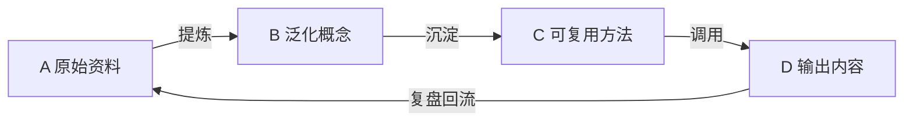

# 知识飞轮看板

## 工作入口

- 新素材：放入 [[A-原始资料]]，使用 [[_模板/原始资料]] 记录来源与问题。
- 知识蒸馏：每周从 A 提炼为 B；成熟结论沉淀为 C。
- 产出：从 C 选择方法，写入 D；发布后补全反馈并回流。

## 本周清单

- [ ] A 中需要处理的资料
- [ ] 可沉淀到 B 的概念
- [ ] 可更新到 C 的方法
- [ ] D 中待复盘的输出

## 规则

1. A 保留来源和原始语境，不追求整洁。
2. B 一条笔记只表达一个可迁移的概念。
3. C 必须包含触发条件、步骤、检查标准和示例。
4. D 必须记录实际反馈，并把新问题回写到 A。

## 本次新增（2026-07-30）· AppIntent 跨平台情报

来源：外部情报简报，按飞轮分层落库，并双链到已有 [[手机AI智能体知识库]] 体系（未重复已有概念/国内生态笔记）。

- **A 原始资料**
  - [[AppIntent 跨平台情报简报 2026-07-30]]
- **B 泛化概念 · 平台卡（2026 技术细节）**
  - [[Apple AppIntents Schema Protocol 2026]]（链 [[Apple Intelligence 与 App Intents]]）
  - [[Android AppFunctions 设备侧意图 2026]]（链 [[国内安卓厂商做 App Intent 的阻力]]）
  - [[HarmonyOS Intents Kit 与 ArkAF 2026]]
  - [[Windows Copilot Actions 与 Agent Workspace 2026]]
- **B 泛化概念 · 跨平台概念节点**
  - [[Intent Schema Protocol 意图模式规范]] ｜ [[Intent Router 语义路由]] ｜ [[Function Calling 端侧工具调用]]（含端侧 Planner 评测表）
  - [[Confirmation UI 安全机制]] ｜ [[Atomic Service 元服务]] ｜ [[Agent Workspace 隔离执行]] ｜ [[A2A 端侧智能体协议]] ｜ [[XPIA 跨提示注入]]
- **C 可复用方法**
  - [[系统级 Intent 路由评估 SOP]]
- **D 输出内容**
  - [[AppIntent 跨平台格局总览 2026]]（与 [[手机AI智能体知识库]] 互补）

> 待办：补 Gemma 4 / Qwen3-Coder-Next 端侧路由实测；补四平台 Registry/权限横向 Checklist。

## 本次新增（2026-07-31）· OS PM 近一月情报（一次性获取，检索窗口≈近1个月）

独立获取、未改动自动化（自动化仍为原 AppIntent 每日 09:00 版）。来源：近一月外部检索，按飞轮分层落库并双链去重。

- **A 原始资料**
  - [[OS PM 近一月情报简报 2026-07-31]]
- **B 泛化概念 · 新增（净新增节点）**
  - [[System Orchestrator 系统编排]]（Apple iOS 27 系统编排者，App 不直接互驱）
  - [[Local Agent Bench 端侧智能体基准]]（端到端智能体基准，qwen3:1.7b #1）
- **B 泛化概念 · 既有增补（不重复，仅补新进展）**
  - [[Apple AppIntents Schema Protocol 2026]]（补 System Orchestrator / 限速 / SiriKit 弃用 / 新框架族）
  - [[Android AppFunctions 设备侧意图 2026]]（补 Gemini 私测 / Android 16+ / @AppFunction / Kotlin 生成）
  - [[HarmonyOS Intents Kit 与 ArkAF 2026]]（补 ArkAF 三层 / DevEco Code / 小艺 1.8 亿 DAU / HPIC）
  - [[Windows Copilot Actions 与 Agent Workspace 2026]]（补 6 known folders / opt-in 路径 / XPIA 缓解）
  - [[Function Calling 端侧工具调用]]（补官方 BFCL / S25 Ultra 实测 / Local Agent Bench 链接 / 口径校准）
- **D 输出内容**
  - [[OS PM 2026-07 月报：四平台新增进展]]（与 [[AppIntent 跨平台格局总览 2026]] 互补的增量月报）

> 待办（延续）：补 Gemma 4 / Qwen3-Coder-Next 端侧路由实测；补四平台 Registry/权限横向 Checklist；回填 Local Agent Bench Round 3 来源 URL。

## 本次新增（2026-07-31）· AI Agent 半月情报（一次性获取，检索窗口≈近半个月）

独立获取、未改动自动化（自动化仍为原 AppIntent 每日 09:00 版）。范围：通用 AI Agent（模型/评测/企业平台/安全），与 OS PM 近一月情报互补、不重复。来源：近半月外部检索，按飞轮分层落库并双链去重。

- **A 原始资料**
  - [[AI Agent 半月情报简报 2026-07-31]]
- **B 泛化概念 · 净新增节点（与既有端侧/OS 笔记互补，未改旧文件）**
  - [[前沿 Agent 大模型 2026H2]]（Opus5 / Gemini3.6Flash / GPT-5.6 + Agent 专项基准；链 [[Function Calling 端侧工具调用]]）
  - [[通用 AI Agent 评测基准 2026]]（AgentCompass / OmniaBench / AgenticDataBench / EdgeBench；链 [[Local Agent Bench 端侧智能体基准]]）
  - [[企业级 Agent 平台与 Agent-as-Asset 2026]]（阿里 Agent Native Cloud / 蚂蚁 Agentar / OpenAI Presence / WAIC 互联互通；链 [[Agent Workspace 隔离执行]]）
  - [[Agent 身份与硬件级审批]]（YubiKey 5.8 / Entrust / Qoder；链 [[XPIA 跨提示注入]] / [[Confirmation UI 安全机制]]）
- **D 输出内容**
  - [[AI Agent 半月观察 2026-07-31]]（与 [[OS PM 2026-07 月报：四平台新增进展]] 互补的通用视角月报）

> 待办（延续）：跟踪 Opus5/Gemini4 正式版与 Agent 专项基准更新；跟踪 WAIC 互联互通倡议是否成跨厂商标准；回填部分来源 URL（OmniaBench/AgenticDataBench/Unified Framework 为 arXiv 编号）。

## 本次新增（2026-07-31）· 最近一个月热门 AI Agent Skill 整理（用户定向请求：整理+中文详解）

独立获取、未改动自动化（仍为原 AppIntent 每日 09:00 版）。范围：Agent Skills 生态（定义/格式/热度榜/分类/对 OS PM 启发），与既有 Agent 笔记互补、双链去重、未改旧文件。

- **A 原始资料**
  - [[AI Agent Skill 生态半月情报 2026-07-31]]（来源 URL 全收录：claudeskills/claudewave/aibestskill/lobehub/skillsmp/今日头条/CSDN/theagenticleaderboard/Anthropic 官方）
- **B 泛化概念 · 净新增节点**
  - [[Agent Skills 技能范式 2026]]（SKILL.md 渐进式披露 / Skill vs Prompt vs MCP / 格式之争；链 [[Function Calling 端侧工具调用]]、[[Local Agent Bench 端侧智能体基准]]、[[企业级 Agent 平台与 Agent-as-Asset 2026]]、[[Agent 身份与硬件级审批]]、[[Apple AppIntents Schema Protocol 2026]]、[[Windows Copilot Actions 与 Agent Workspace 2026]]）
- **D 输出内容**
  - [[最近一个月热门 AI Agent Skill 整理 2026-07-31]]（中文详解主文：定义/生态规模/Top20 热度榜/分类地图/对 OS PM 启发/趋势）

> 待办（延续）：跟踪 skill 格式统一标准进展（AIDF 候选）；跟踪 self-improving skill（claude-reflect 类）与长期记忆方向；补 obsidian-second-brain 与知识飞轮对照。

## 本次新增（2026-07-31）· AppIntent 每日情报（自动化 09:00 版，检索窗口 24h + 库内空白补漏）

严格 24h 命中 4 条（OSWorld 首破 90.2% / 豆包手机二代弃 GUI 转 MCP / 华为小艺 GUI 实测"微信未接入" / 智能体互联 7 项国标）；另补 5 条库内空白的近期官方进展（Android 17 GA、HarmonyOS 7 HMAF 2.0、iOS 27 第三方实测、端侧 Planner 评测补齐、Gemini 40+ App），均已标真实日期、双链去重、未改旧文件。

- **A 原始资料**：[[AppIntent 每日情报 2026-07-31]]
- **B 泛化概念 · 净新增**：[[OSWorld 计算机操作基准]] ｜ [[智能体互联国家标准与 AIP]] ｜ [[端侧执行通道 GUI 与 MCP 路线之争]]
- **B 泛化概念 · 既有增补（追加，不重复）**：[[Android AppFunctions 设备侧意图 2026]] ｜ [[HarmonyOS Intents Kit 与 ArkAF 2026]] ｜ [[Apple AppIntents Schema Protocol 2026]] ｜ [[Confirmation UI 安全机制]] ｜ [[Function Calling 端侧工具调用]]
- **C 可复用方法 · 净新增**：[[端侧执行通道选型 SOP]]
- **D 输出内容 · 净新增**：[[AppIntent 每日情报速览 2026-07-31]]

> 待办（延续）：核验 OSWorld 官方榜单与 7 项国标标准号；完成四平台 Registry/权限横向 Checklist（已挂 3 天）；跟踪 iOS 27 正式版（9-14）第三方覆盖；回填 Gemma 4 / Qwen3-Coder-Next 评测来源。

## 本次新增（2026-08-01）· AppIntent 每日情报（自动化 09:00 版，检索窗口 24h + 库内空白补漏）

严格 24h 硬命中仅 1 条（DroiClaw 登国际媒体）；因连续两天 24h 窗口过薄，本日采用「24h 真增量 + 库内空白补漏」策略，补漏 6 条均标真实日期、双链去重、未改旧文件。最高价值条目为 Copilot for Word 文档型 XPIA 自传播蠕虫（执行安全范式跃迁）。

- **A 原始资料**：[[AppIntent 每日情报 2026-08-01]]
- **B 泛化概念 · 净新增（3）**：[[Simple Attention Network 无FFN端侧路由]] ｜ [[Agentic OS 意图调度内核]] ｜ [[文档型 XPIA 自传播蠕虫]]
- **B 泛化概念 · 既有增补（5，追加不重复）**：[[XPIA 跨提示注入]]（补写回路径失效 / 类别未关闭）｜ [[Function Calling 端侧工具调用]]（补 Needle 26M / 无 FFN 架构）｜ [[Apple AppIntents Schema Protocol 2026]]（补 WWDC26 345 代码级细节）｜ [[Confirmation UI 安全机制]]（补「可逆」维度 + 权限自动回收）｜ [[HarmonyOS Intents Kit 与 ArkAF 2026]]（补负一屏元服务 / Today-Task Skill）
- **C 可复用方法 · 净新增**：[[Agent 写回路径 XPIA 风险评估 SOP]]（写回路径三问判据）
- **D 输出内容 · 净新增**：[[AppIntent 每日情报速览 2026-08-01]]

> 待办（延续）：**将自动化改 7 日滚动窗口**（保留首次入库存量判定做去重）；把「四平台 Registry/权限横向 Checklist」扩为六方（+ AgenticOS / Step AOS）；核验 Needle 评测集；跟踪 Måløy 系列后续 / 微软类别级缓解；澄清鸿蒙设备数口径冲突；跟踪荣耀 Robot Phone 8 月发布。

## 本次新增（2026-08-02）· AppIntent 每日情报（自动化 09:00 版，已切换 7 日滚动窗口 2026-07-26→08-02）

本日**正式从 24h 切换为 7 日滚动窗口**（依记忆文件建议，保留首次入库存量判定做去重）。7 日窗口内真增量 2 条（EU AI Act Article 15 今日生效 / HarmonyOS HDD 西安站端侧云侧 A2A 双模 08-01）；库内空白补漏 2 条（Apple Session 343 + 2.0 / Android AppFunctions Agent Skill 四步 lifecycle，均标真实日期）；排除 1 条（M365 Copilot Agentic 模式，应用层非 OS 级）。本日**未新建独立 B 节点 / C 层 SOP**，全部以「既有 B 追加」形式落库，避免重复。

- **A 原始资料**：[[AppIntent 每日情报 2026-08-02]]
- **B 泛化概念 · 既有增补（5，追加不重复）**：[[HarmonyOS Intents Kit 与 ArkAF 2026]]（补小艺 Agentic 自演进定位 + 端侧/云侧 A2A 落地实证 + 奇妙工具箱开发者实证）｜ [[A2A 端侧智能体协议]]（补端侧/云侧双模路由判据 + 落地实证）｜ [[Apple AppIntents Schema Protocol 2026]]（补 Session 343 View Annotations/IntentValueQuery/Confirmations+entity ownership + 2.0 streaming/多轮）｜ [[Android AppFunctions 设备侧意图 2026]]（补官方 Agent Skill 四步生命周期 + 设备侧 MCP 官方澄清）｜ [[Windows Copilot Actions 与 Agent Workspace 2026]]（补 EU AI Act Article 15 合规抬高）
- **D 输出内容 · 净新增**：[[AppIntent 每日情报速览 2026-08-02]]

> 待办（延续）：跟踪 Digital Omnibus 正式文本是否通过（决定是否更新 Article 15 生效日口径）；理清四平台对 Article 15 的合规触发条件；核验 HarmonyOS 银行 App 具体名称与 1000+ 意图清单；独立确认「Per-Intent Privacy Manifest」是否为真实 Apple API；回填 Android AppFunctions Agent Skill 发布日期；延续六方 Registry/权限 Checklist（AgenticOS/Step AOS 仍未入表）；跟踪荣耀 Robot Phone 8 月发布、Måløy Word 蠕虫类别级缓解。

## 本次新增（2026-08-03）· AppIntent 每日情报（自动化 09:00 版，7 日滚动窗口 2026-07-27→08-03）

本期最重条目为执行安全第三个分水岭 ADI（Agent Data Injection）：攻击者无需注入指令，只伪造 Agent 视为可信的结构化元数据即可使其自推错误结论（同环境对照经典指令注入 0–0.7%，ADI 最高 100%）；姊妹研究 DualView 提出 AgentView/HumanView 双视图隔离原语。窗口内真增量 1 条（DroiClaw 诸葛中国市场正式发布 08-03）；库内空白补漏 4 条（Android alpha10 架构+Registry 硬细节 / ADI / DualView+带外防御 / LFM2.5-8B-A1B+LocalCowork，均标真实一手日期）。净新增 B 2、B 既有增补 6、C 净新增 1、D 净新增 1。

- **A 原始资料**：[[AppIntent 每日情报 2026-08-03]]
- **B 泛化概念 · 净新增（2）**：[[Agent Data Injection 数据注入攻击]] ｜ [[Dual View 智能体数据视图隔离]]
- **B 泛化概念 · 既有增补（6，追加不重复）**：[[Android AppFunctions 设备侧意图 2026]]（补 alpha10 编译时入口点 + Registry 硬细节 + 安全路线分歧）｜ [[XPIA 跨提示注入]]（补 ADI 新攻击类别 + CaMeL Strict 36.5% 可用性代价）｜ [[Confirmation UI 安全机制]]（补 Android 确认下放 + AIMS 带外授权第四维）｜ [[Agent Workspace 隔离执行]]（补数据形态隔离与进程隔离正交）｜ [[Function Calling 端侧工具调用]]（补 LFM2.5-8B-A1B + LocalCowork）｜ [[Agentic OS 意图调度内核]]（补 DroiClaw 中国发布 + 架构口径）
- **C 可复用方法 · 净新增**：[[Agent 读入路径可信数据边界 SOP]]（与 08-01 写回路径 SOP 构成双向闭环）
- **D 输出内容 · 净新增**：[[AppIntent 每日情报速览 2026-08-03]]

> 待办（延续）：**【本期最高优先级】追四平台是否有 ADI 类别评估 / 意图元数据来源校验**（Apple `.appEntityIdentifier` 是否有来源绑定/签名，均待补）；补齐 Apple/HarmonyOS/Windows 的 Registry 动态可见性 API（填满六方 Checklist，仅 Android 一列填实）；跟踪 Anthropic/OpenAI/Google 对 ADI 的类别级缓解；用作者 AgentDojo 扩展版测试套件评估自建端侧 ADI 回归集；跟踪 Digital Omnibus 正式文本、HarmonyOS 银行 App 名、Per-Intent Privacy Manifest、荣耀 Robot Phone、Måløy 类别级缓解。

## 本次新增（2026-08-03 · 晚间增补）· AppIntent 每日情报（自动化 21:00 版，窗口 2026-07-27→08-03）

同日 09:00 已跑完整 7 日窗口，本轮为**增补跑**，只记 09:00 版之后的净新增，**不覆盖上午成果**。四大 OS 官方渠道（Apple/Android/HarmonyOS/Windows）经逐条复核**无新增可核实动作**，已在 A 层显式列出「已复核·无净新增」清单，避免下次重复检索。真增量 2 条：① Bonsai 1-bit 量化模型 BFCL 实测（7/10）② 银联 APOP/AVOP 生态里程碑（6/10）。净新增 B 1、B 既有增补 1、C 既有修订 1、D 净新增 1。

- **A 原始资料**：[[AppIntent 每日情报 2026-08-03-晚]]
- **B 泛化概念 · 净新增（1）**：[[意图支付授权协议 APOP]]（协议层意图授权凭证，既有 [[确认机制]]/[[意图模式规范]] 无法承载该面）
- **B 泛化概念 · 既有增补（1，追加不重复）**：[[Function Calling 端侧工具调用]]（补 Bonsai 1-bit 全表 + 「1-bit QAT 在结构化输出上是增益」反直觉结论 + BFCL/NexusRaven 分裂 30 分 + 端侧规模阶梯更新）
- **C 可复用方法 · 既有修订（1）**：[[系统级 Intent 路由评估 SOP]]（步骤 4 升级为**必须双基准**：BFCL 测格式合规 + NexusRaven 测语义理解；新增量化选型纪律「不按保精度选、按保 Schema 合规选」；失败表增 2 行；**顺手修正残留旧口径 46%→90% 为官方 58%→85%**）
- **D 输出内容 · 净新增**：[[AppIntent 每日情报速览 2026-08-03-晚]]

**本期两条最可执行的结论**：① 内部端侧 Planner 选型表若只有 BFCL 必须补「语义理解分」——同一模型 BFCL 73.3%/NexusRaven 43.8% 且与对手排名倒转，只看 BFCL 会在跨应用编排上选错模型；② 确认 UI 的产物应该是**数据不是事件**——弹窗点确认只产生不可核验、可被 XPIA 绕过的事件，应产出带意图内容哈希的凭证，这是防线从 UI 层下沉到协议层的入口。

> 待办（延续）：**【连续第 2 日未解，最高优先级】四平台 ADI 类别评估 / 意图元数据来源校验**——常规检索路径已失效，下轮改查各平台安全白皮书 PDF；**新增**：追 PrismML 官方技术报告回填 1-bit QAT 训练配方与官方分数；核实 APOP 是否真做到「意图内容与凭证绑定」及协议全文链接；核实 APOP 能否与 AppFunctions/App Intents 对接（还是必须走各自 SDK）；补齐 Apple/HarmonyOS/Windows 的 Registry 动态可见性 API（六方 Checklist 仍仅 Android 填实）；沿用既有待办：Digital Omnibus 正式文本、HarmonyOS 银行 App 名、Per-Intent Privacy Manifest、荣耀 Robot Phone、Måløy 类别级缓解。

## 本次新增（2026-08-04）· AppIntent 每日情报（自动化 21:00 版，7 日滚动窗口 2026-07-29→08-04）

本期两条 8/10 并列最重。**① BFCL v4 权重重构**属「口径变化」而非新事实——Agentic 40% + Multi-Turn 30% 合计 70%，经典单轮压到 20%，另加 Hallucination 10%；**后果是库内所有历史 BFCL 分数（Bonsai 73.3%、qwen3-0.6b-tool-router 90.42% 等）全部是 v3 时代的「格式合规分」，与 v4 不可比**，已在两个 B 节点集中打版本标签。**② 挂了 3 天的最高优先级待办有实质进展但仍未解**：微软 Agent Governance Toolkit 给出成熟的数据溯源模型（六类来源 + 四级密级 + 单调棘轮 + 两阶段闸口，对齐 EU AI Act Article 10），但**已 WebFetch 复核 Windows 官方 agentic security 文档确认 OS 层无来源分级**——结论从「没人做」精化为「治理层有成熟模型、OS 层全空白」。③ Project Perception 公开预览（7/10），Defender 开始检查 agent loop 三段流量，标志防线从「隔离」延伸到「检查」。四大 OS 官方渠道经复核**无新增可执行 API**，已在 A 层显式记录避免重复检索。净新增 B 1、B 既有增补 4、C 既有修订 1、D 净新增 1。

- **A 原始资料**：[[AppIntent 每日情报 2026-08-04]]
- **B 泛化概念 · 净新增（1）**：[[数据溯源分级与单调棘轮]]（ADI 的第一个可落地正面答案，成本远低于 Dual View 的 ~15× 调用开销）
- **B 泛化概念 · 既有增补（4，追加不重复）**：[[Function Calling 端侧工具调用]]（补 BFCL v4 权重表 + 全库历史分数版本作废警示 + 08-03 benchlm 快照）｜ [[Local Agent Bench 端侧智能体基准]]（定位修正：v4 已覆盖 agentic+multi-turn，其价值从「补单点」转为「补部署现实」）｜ [[Agent Data Injection 数据注入攻击]]（补 AGT 溯源模型 + Defender agent-loop 检查；四平台待查清单结论精化，仍全部待补）｜ [[Windows Copilot Actions 与 Agent Workspace 2026]]（补 Project Perception + 「位置权限 ≠ 来源密级」正交性校准 + Article 10 合规勾稽）
- **C 可复用方法 · 既有修订（1）**：[[Agent 读入路径可信数据边界 SOP]]（**步骤 2 由二元「可信/不可信」升级为可执行分级判据**：六类来源枚举表 + 四级密级单调棘轮 + 两阶段闸口；完成标准同步改为三问式）
- **D 输出内容 · 净新增**：[[AppIntent 每日情报速览 2026-08-04]]

**本期两条最可执行的结论**：① **选端侧 Planner 时，v4 的 Hallucination 10% 比总分更值得看**——意图路由最怕「该说不会时硬编一个函数调用」，这正是该子项测的东西，而端侧小模型恰恰在 v4 加权最重的 agentic/多轮上最弱；② **做 OS 意图 Registry 时，「文件夹白名单」这类位置权限是最低门槛而非终点**——真正防 ADI 的是给每条读入数据打来源标签并禁止降级，且这一层四大 OS 都不提供，**必须自己补**。

> 待办（延续）：**【最高优先，本期新增】核实 Berkeley 官方 BFCL v4 权重原文**——本期核心结论建立在二手快照上，下轮优先花检索预算专攻官方源；**【连续第 4 日未解】跟踪四平台是否采纳意图元数据来源分级**（Apple `.appEntityIdentifier` 来源绑定/签名仍待补）；Project Perception 口径统一（CyberGym 95.95% vs 96%、MAI-Cyber-1-Flash vs MAI-Cyber-Flash-1）；**新问题回流**：若 OS 不提供来源分级，应用侧自行打标能否防住 ADI、打标器本身会否成为新靶面；沿用既有待办：PrismML 技术报告、APOP 协议全文与对接方式、六方 Registry Checklist（仍仅 Android 填实）、Digital Omnibus 正式文本、HarmonyOS 银行 App 名、Per-Intent Privacy Manifest、荣耀 Robot Phone（8 月发布）、Måløy 类别级缓解。

## 本次新增（2026-08-05）· AppIntent 每日情报（自动化 21:00 版，7 日滚动窗口 2026-07-30→08-05）

本期两条 7/10 真增量。**① Windows Agent Launchers** —— 一个本库此前未记录的系统级 Agent 注册表，基于 App Actions 框架 + ODR（`com.microsoft.windows.ai.agentInfo` AppExtension、`odr.exe agent-info add/remove/list`），注册「agent 实体」而非 MCP 连接器，补齐 Windows 与 Apple/Android/HarmonyOS 在「应用向系统声明能力」层的对齐缺口。**② LFM2.5-2.6B**（Liquid AI，2026-08-04）端侧 agentic 小模型入表，使 LFM2.5 家族规模阶梯（230M/450M/2.6B/8B-A1B）完整。另**关闭一条延续待办**：BFCL v4 权重公式（Agentic 40% / Multi-Turn 30% / 其余各 10%）经 EvalScope 官方文档交叉确认，从「二手快照」升为「已核实口径」。四大 OS 官方渠道经逐条复核**无新增可执行 API**，已在 A 层显式列出「已复核·无净新增」清单避免重复检索。B 既有增补 3、D 净新增 1、A 净新增 1、看板已登记。

- **A 原始资料**：[[AppIntent 每日情报 2026-08-05]]
- **B 泛化概念 · 既有增补（3，追加不重复）**：[[Windows Copilot Actions 与 Agent Workspace 2026]]（补 Agent Launchers 第二层注册表 + 四平台对齐对照表）｜ [[Function Calling 端侧工具调用]]（补 LFM2.5-2.6B + BFCL v4 权重官方确认 + 08-05 benchlm 12 模型快照）｜ [[Local Agent Bench 端侧智能体基准]]（补 LFM2.5-2.6B 与端侧 agentic 规模阶梯 / 分层判断）
- **D 输出内容 · 净新增**：[[AppIntent 每日情报速览 2026-08-05]]

**本期两条最可执行的结论**：① **Windows 的系统级意图框架比此前认知更完整**——ODR（工具注册）+ Agent Launchers（agent 注册）两层，跨平台对标时不再是「只有工具注册」的短板，颗粒度差异（agent vs 细粒度 intent）是下一步要追问的点；② **端侧选型表若只有 BFCL 总分仍会选错**——v4 把 70% 权重压在 agentic+multi-turn（小模型最弱处），而 Hallucination 10% 才是跨应用意图路由最该盯的一栏（该说不会时硬编函数调用，恰是 Registry 变大后最高频失败模式）。

> 待办（延续）：**【连续第 5 日未解，最高优先】四平台意图元数据来源分级**（Apple `.appEntityIdentifier` 来源绑定/签名仍待补，改查安全白皮书 PDF 路径仍未跑完）；核实 Agent Launchers 具体 Insider build 号/发布日期/opt-in 开关归属；复核 LFM2.5-2.6B 的 BFCLv4 绝对值（厂商 + 镜像站 56.9%，需 Berkeley 官方榜）；Berkeley 官方 BFCL v4 博客原文逐字确认；沿用既有待办：PrismML 技术报告、APOP 协议全文与对接、六方 Registry Checklist（仍仅 Android 填实）、Digital Omnibus 正式文本、HarmonyOS 银行 App 名、Per-Intent Privacy Manifest、荣耀 Robot Phone、Måløy 类别级缓解。

## 本次新增（2026-08-06）· 日报索引化重构（结构改造，非情报跑）

用户反馈日报节点过大且重复、A/D 层节点连线少成孤岛。将 07-31→08-04 共 6 期 AppIntent 每日情报日报（08-05 早先做范本）由「大节点 + 内联分析」重构为**纯索引**：每条信息 1 行（重要性 + 原子笔记链接 + 主题枢纽链接 + 一手来源），正文零内容损失（6 个子代理先 grep 核实内容已在 B 泛化概念再压缩）。A 层从内容黑洞转为索引层，孤岛主因消除。

- **重构为索引的 A 原始资料（6）**：[[AppIntent 每日情报 2026-07-31]] ｜ [[AppIntent 每日情报 2026-08-01]] ｜ [[AppIntent 每日情报 2026-08-02]] ｜ [[AppIntent 每日情报 2026-08-03]] ｜ [[AppIntent 每日情报 2026-08-03-晚]] ｜ [[AppIntent 每日情报 2026-08-04]]
- **B 泛化概念 · 净新增（2，重构中发现内容无承载而补建）**：[[Intent Routing Stack 六方意图路由分层对照 2026]]（六层 × 六方意图路由矩阵，08-01 内容此前无节点承载）｜ [[带外防御与确定性门控]]（arXiv 2606.26479「门不能是模型」系统化，此前仅碎片存在于确认机制/数据溯源笔记）
- **链接校验**：全库 wikilink 可解析性扫描，仅 1 断链（08-01 索引 `[[元服务]]` 裸别名），已通过给 [[Atomic Service 元服务]] 加 `aliases: [元服务]` 根因修复（同时消除 2 个 D 速览的同类断链）。

> 待办（延续）：① 将索引中暂存的厂商口径细节并入对应 B 笔记（去内联，见子代理标注「暂存待并入」）② 清理 4 个老简报孤岛（AI Agent 半月情报 2026-07-31 / AppIntent 跨平台情报简报 2026-07-30 等，出链 1–5）③ 后续每日 09:00 跑按「日报=索引」约定产出，不再膨胀。

## 本次新增（2026-08-09）· AppIntent 每日情报（自动化 21:00 版，7 日滚动窗口 2026-08-03→08-09）

本期**库内空白补漏为主**：Windows Agent Framework / Microsoft Agent Framework 端侧 Agent 执行框架（Build 2026-06-02 OS 级栈 + 2026-04-02 合并 SK+AutoGen 的 SDK，本库此前无完整框架节点）；另两条窗口真增量：NowSecure iOS 27 App Intents 攻击面（2026-08-05，AppSec 视角补 XPIA 可测清单）+ AgentAntibody（arXiv 2608.04053，2026-08-04，XPIA 学习型防御分支）。四大 OS 官方渠道经复核无新增可执行 API。净新增 B 2、B 既有增补 3、A 1、D 1。

- **A 原始资料**：[[AppIntent 每日情报 2026-08-09]]
- **B 泛化概念 · 净新增（2）**：[[Windows Agent Framework 端侧 Agent 执行框架 2026]]（OS 内建 agent 宿主 + 联邦执行 + 分发市场，区别于另三家「应用声明能力」路线）｜ [[AgentAntibody 自适应免疫防御 2026]]（XPIA 第四支「学习型防御」，持久抗体库学用户边界）
- **B 泛化概念 · 既有增补（3，追加不重复）**：[[Apple AppIntents Schema Protocol 2026]]（补 NowSecure iOS 27 攻击面 + Session 347 威胁模型映射）｜ [[XPIA 跨提示注入]]（补第④支学习型防御 + NowSecure + 四平台状态更新）｜ [[Windows Copilot Actions 与 Agent Workspace 2026]]（补 Build 2026 完整栈衔接点 + MAF 命名澄清）
- **D 输出内容 · 净新增**：[[AppIntent 每日情报速览 2026-08-09]]

**本期两条最可执行的结论**：① Windows 的 agent 执行框架比「应用声明能力」路线更重一层（OS 内建宿主+联邦执行+分发市场），跨平台对标时不能简单当「另一套 intent 注册表」；② XPIA 防御正从静态三件套（隔离/确认/数据视图隔离）裂出「学习型」第四支，对长期运行的主动触发 OS Agent 更现实，但四平台均未内建、需自行集成。

> 待办（延续）：**【连续第 6 日未解·最高优先】四平台意图元数据来源分级**（Apple `.appEntityIdentifier` 等仍待补，下轮必须执行「查各平台安全白皮书 PDF」路径）；Windows Agent Framework 官方 MIT 许可页 / Runtime Insider build 号 / Mesh GA 日期；NowSecure 厂商视角独立核验；AgentAntibody 预印本数字独立榜复现；Berkeley 官方 BFCL v4 博客原文。

## 本次新增（2026-08-09-晚）· AppIntent 每日情报（增补跑）

同日 21:00 已跑完整 7 日窗口，本轮为**增补跑**，只记 21:00 版之后的净新增，**不覆盖晚间成果**。四大 OS 官方渠道（Apple/Android/HarmonyOS/Windows）经逐条复核**无新增可核实动作**（Apple support.apple.com 仅返回目录页、无 App Intents 来源校验内容，已记未决），已在 A 层显式列出「已复核·无净新增」清单避免重复检索。真增量来自**客户端/浏览器层**而非 OS 层：① Chrome Agent Origin Sets（2025-12-08，Google 官方安全博客，浏览器层产品化方案）② 顺带让挂了 6 天的最高优先待办（四平台意图元数据来源分级）取得**第二次实质进展**——结论从「两层（研究层 + 治理层 MS AGT）」精化为「三层（研究 + 治理 + 客户端/浏览器 Chrome 产品化）」，但**四大 OS 意图层仍全空白**。净新增 B 1、B 既有增补 4、A 1、D 1。

- **A 原始资料**：[[AppIntent 每日情报 2026-08-09-晚]]
- **B 泛化概念 · 净新增（1）**：[[Chrome Agent Origin Sets 与用户对齐评判器 2026]]（只读/读写源白名单集 + 隔离的 User Alignment Critic，浏览器层确定性门控）
- **B 泛化概念 · 既有增补（4，追加不重复）**：[[Agent Data Injection 数据注入攻击]]（三层结论 + 待办第 2 次进展）｜ [[带外防御与确定性门控]]（「隔离门」第三路线校验）｜ [[XPIA 跨提示注入]]（Google 官方六层防御 + NCSC「混淆代理」定性）｜ [[Confirmation UI 安全机制]]（触发器三档分类法）
- **D 输出内容 · 净新增**：[[AppIntent 每日情报速览 2026-08-09-晚]]

**层级纪律（关键）**：Chrome 是浏览器，Origin Sets 未下沉到 Android AppFunctions——同属 Google 两家产品线成熟度不可混淆；这是最容易「误填」6 天待办的坑，本轮已显式规避。

> 待办（延续）：**【连续第 7 日未解·最高优先】四平台意图元数据来源分级**（Apple `.appEntityIdentifier` 仍待补，下轮改查 **Apple Platform Security 白皮书 PDF 全文 + WWDC26 Session 347 逐字稿**，不再走 support.apple.com 在线指南）；Windows Agent Framework MIT 许可页 / build 号；NowSecure / AgentAntibody 独立核验；Berkeley 官方 BFCL v4 博客；Chrome Origin Sets 官方 URL 逐字复核（本轮经 mirror + TechCrunch 引用，官方链接待补）。

## 本次新增（2026-08-15）· AppIntent 每日情报（自动化 21:00 版，7 日滚动窗口 2026-08-09→08-15）

本期主线 = 库内空白补漏 + 1 条最高价值新发现（Trust Insights）。四大 OS 官方渠道经逐条复核无新增可执行 API，已在 A 层显式列「已复核·无净新增」清单避免重复检索。最高价值条目为 **Trust Insights（WWDC26 Session 379，iOS 27）** —— Apple 首次给出「被胁迫意图 / 意图真实性」检测框架，与 XPIA（注入指令）和 Confirmation UI（用户授权）正交，补全执行安全三元模型（注入 / 授权 / 意图真实性），前 7 轮全漏、本轮补建净 B 节点。另关闭连续 7 日最高优先待办的一个**错误前提**：逐条核验官方文档确认 `.appEntityIdentifier` 是实体-视图链接（Session 343 屏幕感知）、**非来源校验/签名**，故四平台意图元数据来源分级待办不关闭、下轮改查安全白皮书 PDF。

- **A 原始资料**：[[AppIntent 每日情报 2026-08-15]]
- **B 泛化概念 · 净新增（1）**：[[Trust Insights 意图 coercion 检测框架 2026]]（意图真实性检测，与 XPIA/确认机制正交，补全执行安全三元）
- **B 泛化概念 · 既有增补（6，追加不重复）**：[[Apple AppIntents Schema Protocol 2026]]（补 iOS 27 Beta 5 逐字变更 + 后台 Neural Engine entitlement）｜ [[Android AppFunctions 设备侧意图 2026]]（补 Galaxy S26 + Pixel 10 真机有限预览）｜ [[Agent Data Injection 数据注入攻击]]（补 `.appEntityIdentifier` 证伪为视图链接）｜ [[XPIA 跨提示注入]]（补 Windows Copilot Vision 读路径扩张）｜ [[Confirmation UI 安全机制]]（补 Trust Insights coerced-intent 互补）｜ [[Function Calling 端侧工具调用]]（补 FunctionGemma 部署路径 + 语法可靠性）
- **D 输出内容 · 净新增（1）**：[[AppIntent 每日情报速览 2026-08-15]]

> 待办（延续）：**【连续第 8 日未解·最高优先】四平台意图元数据来源分级**（Apple `.appEntityIdentifier` 已证伪为视图链接，下轮必跑 **Apple Platform Security 白皮书 PDF + WWDC26 Session 347 逐字稿**）；Watch OS 26 / 其他平台是否也有 Trust Insights 类机制；Windows Agent Framework MIT 许可页/build 号；NowSecure / AgentAntibody 独立核验；Berkeley 官方 BFCL v4 博客原文；Chrome Origin Sets 官方 URL 逐字复核。

## 本次新增（2026-08-16）· AppIntent 每日情报（自动化 21:00 版，7 日滚动窗口 2026-08-10→08-16）

本期主线 = 端侧 router 安全闸样本 + 最高优先待办两轴重构。四大 OS 官方渠道经逐条复核无新增可执行 API，已在 A 层显式列「已复核·无净新增」清单避免重复检索。窗口内唯一净新增发布为 **Needle 2（Cactus，2026-08 中旬）** 端侧 router 模型，带来**置信度门控 + 工具可达性收缩**两道安全闸。另将连续第 8 日最高优先待办「四平台意图元数据来源分级」**重构为两正交轴**——副作用轴（Apple Session 347 已解）与来源/溯源轴（四平台仍全空白）。净新增 B 2、B 既有增补 7、A 1、D 1。

- **A 原始资料**：[[AppIntent 每日情报 2026-08-16]]
- **B 泛化概念 · 净新增（2）**：[[意图风险元数据与鉴权策略棘轮 2026]]（Apple Session 347 副作用轴风险元数据 + 鉴权棘轮 + createTimer 持久化注入）｜ [[端侧 Router 置信度门控与工具可达性收缩 2026]]（Needle 2 置信度门控 + top-5 工具可达性收缩，ADI 低成本预防）
- **B 泛化概念 · 既有增补（7，追加不重复）**：[[Apple AppIntents Schema Protocol 2026]]（补 Session 347 安全视角交叉索引）｜ [[Confirmation UI 安全机制]]（副作用轴 = 触发器三档「确定性规则」实例）｜ [[Agent Data Injection 数据注入攻击]]（待办两轴重构 + createTimer=ADI 具象实例）｜ [[Simple Attention Network 无FFN端侧路由]]（Needle 2 同架构机制升级）｜ [[Function Calling 端侧工具调用]]（Needle 2 入评测表 + 体积阶梯）｜ [[Windows Copilot Actions 与 Agent Workspace 2026]]（第三方 tracker corroboration）｜ [[数据溯源分级与单调棘轮]]（与 Apple 鉴权棘轮「同形不同物」）
- **D 输出内容 · 净新增**：[[AppIntent 每日情报速览 2026-08-16]]

**本期两条最可执行的结论**：① **端侧 router 的安全不该只靠准确率，要靠「结构性不可达」**——Needle 2 把未选中工具的 schema 物理挡在上下文外，比训练模型「别调它」可靠一阶，且「体积不变下加闸」是稀缺样本；② **最高优先待办从「全空白」收窄为「来源轴空白」**——Apple 用 Session 347 风险元数据解决了「动作多危险」的副作用轴，但「数据从哪来、可不可信」的来源轴四平台 OS intent 层仍全空白，最低成本补丁仍是意图 Registry 加 `readOrWrite` 声明位。

> 待办（延续）：**【待办两轴化·来源轴仍空白】四平台意图元数据来源分级**（副作用轴 Apple 已解；来源/溯源轴 Apple `.appEntityIdentifier` 证伪为视图链接、Android `app_metadata` / HarmonyOS A2A / Windows 工具响应均无来源类型字段，仍待补）；Needle 2 BFCL v4 42.6 为厂商自述非官方榜，待 Berkeley 复核；Windows Copilot Actions Insider build 号；Watch OS 26 是否 Trust Insights 类；Windows Agent Framework MIT 许可页/build 号；NowSecure / AgentAntibody 独立核验；Berkeley 官方 BFCL v4 博客原文；Chrome Origin Sets 官方 URL 逐字复核。

## 本次新增（2026-08-17）· AppIntent 每日情报（自动化 21:00 版，7 日滚动窗口 2026-08-11→08-17）

本期主线 = **收口连续第 8 日最高优先待办「四平台意图元数据来源分级」** + 库内空白补漏（Apple Core AI/Dynamic Profiles/多模型 FM/Evaluations、HarmonyOS A2UI/代码级接入、Apple Secure Enclave 硬件确认）。四大 OS 官方渠道经逐条复核无新增可执行 API（Android 17 已录、Windows 8-14 改名/8-11 Patch Tuesday 属常规排除），已在 A 层显式列「已复核·无净新增」。

- **A 原始资料**：[[AppIntent 每日情报 2026-08-17]]
- **B 泛化概念 · 净新增（1）**：[[四平台意图 Registry 来源轴与权限模型对比 2026]]（来源轴空白从「待查」升级为「架构性空白 confirmed」+ 四平台 Registry/权限模型横向表，直接服务 OS PM）
- **B 泛化概念 · 既有增补（6，追加不重复）**：[[Apple AppIntents Schema Protocol 2026]]（补 Core AI 框架 + Dynamic Profiles + 多模型 FM + Evaluations）｜ [[意图风险元数据与鉴权策略棘轮 2026]]（Session 347 逐字稿 `.onToolCall`/`.historyTransform` + 来源轴待办收口）｜ [[Confirmation UI 安全机制]]（Secure Enclave 硬件确认锚点）｜ [[HarmonyOS Intents Kit 与 ArkAF 2026]]（A2UI 生成式 UI + insight_intent.json 三步 + 1200 底层能力）｜ [[端侧 Router 置信度门控与工具可达性收缩 2026]]（Needle 2 发布日 08-11 + Pebble 量产）｜ [[Function Calling 端侧工具调用]]（FunctionGemma v4 第三方聚合分标待补）
- **D 输出内容 · 净新增（1）**：[[AppIntent 每日情报速览 2026-08-17]]

**本期最高价值结论**：连续第 8 日最高优先待办「四平台意图元数据来源分级」**收口为确认结论**——经逐平台核验，Apple/Android/HarmonyOS/Windows 的意图 Registry 层**均无来源/可信度元数据字段**；Apple 用「副作用轴风险元数据 + 零信任输入处理（spotlighting/脱敏）」回答「动作多危险 / 数据可不可信」，但 Registry 本身不记录 provenance。最低成本补丁仍是「意图 Registry 加 `readOrWrite` 声明位」，仍非完整 provenance。

> 待办（延续）：Berkeley 官方 BFCL v4 博客原文；Windows Agent Framework MIT 许可页/build 号；Watch OS 26 是否 Trust Insights 类；NowSecure/AgentAntibody 独立核验；Chrome Origin Sets 官方 URL 逐字复核；HarmonyOS `insight_intent.json` 字段全量 + API level 冲突（26 vs 23）澄清；各平台具体 entitlement/字段名以官方文档为准。

## 本次新增（2026-08-18）· AppIntent 每日情报（自动化 21:00 版，7 日滚动窗口 2026-08-12→08-18）

本期窗口内**四平台 OS 官方框架层经逐条复核无净新增**（Apple iOS 27 Beta 6 仅修 Bug、Android AppFunctions 守 alpha10、HarmonyOS HDD 巡回无新 API、Windows OS agentic security 四支柱一致），唯一高价值增量落在**治理层**：微软 **Agent 365 + Entra Agent ID** 控制平面与身份基座（GA 2026-05-01）经官方文档核实为量产统一智能体注册表 + agent 身份，含三运行模式与 Shadow AI 发现。该增量同时**收口 08-17 悬项「Entra Agent Identity = 第三方解读待确认」→ 已 GA 官方确认**，并直接补强「六方 Registry/权限 Checklist（此前仅 Android 填实）」。

- **A 原始资料**：[[AppIntent 每日情报 2026-08-18]]
- **B 泛化概念 · 净新增（1）**：[[Agent 365 与 Entra Agent ID 智能体控制平面与身份基座 2026]]（治理/身份层控制平面，与 Windows ODR/Agent Workspace 正交，三模式 + 统一注册表 + Shadow AI）
- **B 泛化概念 · 既有增补（1，追加不重复）**：[[四平台意图 Registry 来源轴与权限模型对比 2026]]（升级「Entra Agent Identity 待官方确认」→ 已 GA；新增④治理层控制平面对照维度）
- **D 输出内容 · 净新增（1）**：[[AppIntent 每日情报速览 2026-08-18]]

> 待办（延续）：将 Agent 365 三模式 + 统一注册表对照进「六方 Registry/权限 Checklist」；核验 Agent 365 与 Windows ODR 的 connector 衔接边界；Berkeley 官方 BFCL v4 博客原文；Watch OS 26 是否 Trust Insights 类；NowSecure/AgentAntibody 独立核验；Chrome Origin Sets 官方 URL 逐字复核。

## 本次新增（2026-08-26）· AppIntent 每日情报（自动化 21:00 版，7 日滚动窗口 2026-08-19→08-26）

本期四平台 OS 官方框架层经逐条复核**无净新增 API**（iOS 27 Beta 7 修 Bug / AppFunctions 守 alpha10 / HarmonyOS 7 SP8 消费版 / Windows 四支柱一致），但在**邻近层**有两条 ★7/10 真增量（Apple App Intents Testing 框架、IFFC 解耦路由范式）+ 四条 ★6/10 上下文（BFCL v4 公开榜 / XPIA web 级实测 / 鸿蒙端侧 Skill 约束 / Android 真机闭环）。净新增 B 1、B 既有增补 5、A 1、D 1。

- **A 原始资料**：[[AppIntent 每日情报 2026-08-26]]
- **B 泛化概念 · 净新增（1）**：[[端侧函数调用解耦路由与指令遵循范式 IFFC 2026]]（SRM 解耦 + 指令遵循上下文，端侧 Planner 架构级解法）
- **B 泛化概念 · 既有增补（5，追加不重复）**：[[Apple AppIntents Schema Protocol 2026]]（补 App Intents Testing 进程外验证框架 + View Annotations/Evaluations/Core AI 集群）｜ [[Function Calling 端侧工具调用]]（补 BFCL v4 公开榜 08-22 快照 + Nexus-TinyFunction-1.2B + LFM2.5-350M 微调追平 120B）｜ [[XPIA 跨提示注入]]（补 CSA web 级 IPI 实测 + Black Hat「每个 AI 浏览器都脆弱」）｜ [[HarmonyOS Intents Kit 与 ArkAF 2026]]（补端侧 Skill 同名冲突/3 秒超时/A2UI 静默失败）｜ [[Android AppFunctions 设备侧意图 2026]]（补 Samsung Gallery+Gemini 真机闭环 + UI Automation 兜底）
- **D 输出内容 · 净新增（1）**：[[AppIntent 每日情报速览 2026-08-26]]

> 待办（延续）：核验 App Intents Testing canonical 路径与最小 Beta 版本；IFFC 是否给出 BFCL v4 数字；把 CSA 数据回流至 [[Agent 读入路径可信数据边界 SOP]]；Berkeley 官方 BFCL v4 博客原文；Watch OS 26 是否 Trust Insights 类；NowSecure/AgentAntibody 独立核验；Chrome Origin Sets 官方 URL 逐字复核。

## 本次新增（2026-08-31）· AppIntent 每日情报（自动化 21:00 版，7 日滚动窗口 2026-08-25→08-31）

本期四平台 OS 官方框架层经逐条复核**无净新增 API**（iOS 27 Beta 8 的 App Intents 段落与 08-15 已录 Beta 5 逐字一致、同 bug 号；AppFunctions 守 alpha10；HarmonyOS 7 消费版无新 API；Windows agentic security 四支柱一致）。核心产出为**收口悬挂 8+ 天的最高优先待办**：经官方文档直查判定「Per-Intent Privacy Manifest」**不是真实 App Intents API**（第三方博客误读 iOS 17 通用隐私清单 / 未来推测），进一步夯实「来源/溯源轴四平台全空白」结论。B 既有增补 1、A 1、D 1。

- **A 原始资料**：[[AppIntent 每日情报 2026-08-31]]
- **B 泛化概念 · 既有增补（1，追加不重复）**：[[四平台意图 Registry 来源轴与权限模型对比 2026]]（Per-Intent Privacy Manifest 证伪 + 来源轴待办收口；原 08-02「待官方确认」升级为「confirmed non-existent」）
- **D 输出内容 · 净新增（1）**：[[AppIntent 每日情报速览 2026-08-31]]

> 待办（延续）：若 iOS 27 正式版（约 2026-09-14）新增 per-intent 路由/来源声明 API，重评来源轴结论；把「来源轴空白 + Per-Intent Privacy Manifest 证伪」回流至 [[Agent 读入路径可信数据边界 SOP]]；Berkeley 官方 BFCL v4 博客原文；Watch OS 26 是否 Trust Insights 类；NowSecure/AgentAntibody 独立核验；Chrome Origin Sets 官方 URL 逐字复核。

## 本次新增（2026-09-01）· AppIntent 每日情报（自动化 21:00 版，7 日滚动窗口 2026-08-25→09-01）

本日窗口内**唯一净新增 OS 框架 API = Android AppFunctions `alpha11`（2026-08-26）**（动态注册 `@AppFunctionSignature` + `AppFunctionState` 取代 `isEnabled`）；另补**跨平台 BFCL v4 评测增量**（Apple FM 61.7% / LittleLamb 0.3B 51.55% / FunctionGemma 全-v4 27.03% / Needle 2 升级契约第三方确认）与**欧盟 DMA 强制 AppFunctions 跨助手开放**这一监管维度。四大 OS 官方框架层除 alpha11 外经逐条复核无净新增（iOS 27 Beta 8=08-15 已录、HarmonyOS 7 消费版秋季待发、Windows Copilot Vision 2026-05 GA / 文档无更新）。净新增 B 1、B 既有增补 4、A 1、D 1。

- **A 原始资料**：[[AppIntent 每日情报 2026-09-01]]
- **B 泛化概念 · 净新增（1）**：[[AppFunctions 跨助手可发现性与 DMA 强制开放 2026]]（监管强制 Registry 跨助手开放，四平台对比表新增「可发现性是否被强制开放」维度）
- **B 泛化概念 · 既有增补（4，追加不重复）**：[[Android AppFunctions 设备侧意图 2026]]（补 alpha11 动态注册 + 门控 API 迁移 + 通道对比 + DMA 指针）｜ [[Function Calling 端侧工具调用]]（补 Apple FM 61.7% / LittleLamb 0.3B 51.55% / FunctionGemma 全-v4 27.03% / Gemma 4 tokens / Needle 2 升级契约）｜ [[端侧 Router 置信度门控与工具可达性收缩 2026]]（补 Needle 2 第三方确认 + ADI 双闸）｜ [[四平台意图 Registry 来源轴与权限模型对比 2026]]（补 DMA 跨助手维度 + Android 门控 API 迁 `AppFunctionState`）
- **D 输出内容 · 净新增（1）**：[[AppIntent 每日情报速览 2026-09-01]]

> 待办（延续）：用 Berkeley 官方 BFCL v4 榜复核 Apple FM 61.7% 与 LittleLamb 0.3B 51.55%（当前第三方引述）；抓欧盟 DMA 官方文本回填 11 项能力清单与 2027-08 deadline；把 alpha11 `AppFunctionState` 反映进对比表「运行时动态可见性 API」行；Berkeley 官方 BFCL v4 博客原文；Watch OS 26 是否 Trust Insights 类；NowSecure/AgentAntibody 独立核验；Chrome Origin Sets 官方 URL 逐字复核。

## 本次新增（2026-09-03）· AppIntent 每日情报（自动化 21:00 版，7 日滚动窗口 2026-08-27→09-03）

本日窗口内**四大 OS 官方框架层 API 无净新增**（iOS 27 RC 沿用 Beta 5 已录 schema、AppFunctions 守 alpha11、HarmonyOS 7 框架同 HDC2026、Windows agentic security 四支柱一致）。真增量集中在**消费级 GA 日期集体锁定** + 一份新第三方 BFCL v4 端侧快照：① HarmonyOS 7 于 **9-7** 随 Mate XT 2 向消费者铺开（ArkAF 2.0「意图即服务」入消费者）；② Windows 11 26H2 于 **9 月下旬~10 月初**以 enablement package 交付（Ask Copilot 搜索层意图入口 + Sysmon 内置）；③ iOS 27 于 **9-14** GA（框架不变）；④ Luxand BFCL v4 端侧 Agentic Score 快照（Qwen3.5-4B 67% / LFM2.5-8B-A1B 62.3% 等，第三方待官方复核）。B 既有增补 3、A 1、D 1。

- **A 原始资料**：[[AppIntent 每日情报 2026-09-03]]（索引 + 已复核·无净新增清单）
- **B 泛化概念 · 既有增补（3，追加不重复）**：[[HarmonyOS Intents Kit 与 ArkAF 2026]]（补 9-7 消费版 GA 档期 + Mate XT 2 首发）｜ [[Windows Copilot Actions 与 Agent Workspace 2026]]（补 26H2 GA 窗口 + Ask Copilot 搜索意图层 + Sysmon 内置）｜ [[Function Calling 端侧工具调用]]（补 Luxand BFCL v4 端侧 Agentic Score 快照）
- **D 输出内容 · 净新增（1）**：[[AppIntent 每日情报速览 2026-09-03]]

> 待办（延续）：用 Berkeley 官方 BFCL v4 榜复核 Luxand 快照（厂商 SDK 自测）；9-7 后回填 HarmonyOS 7 消费版真实 API level（26 vs 23 冲突）；9-14 iOS 27 GA 后核查是否新增 per-intent 路由/来源声明 API（将重评 [[四平台意图 Registry 来源轴与权限模型对比 2026]] 来源轴结论）；沿用既有待办：Watch OS 26 / NowSecure / AgentAntibody / Chrome Origin Sets。

## 本次新增（2026-09-12）· AppIntent 每日情报（自动化补跑，窗口 2026-09-04→09-12，因 9 天未跑）

本窗口**四大 OS 官方框架层 API 无净新增**（iOS 27 守 Beta 5、AppFunctions 无 alpha12、HarmonyOS 7 框架同 HDC2026、Windows agentic security 四支柱一致）。真增量集中在**消费版铺开后的实测/认证数据 + 一处跨平台 A2UI 落地 + Needle 2 跨模型 BFCL v4 对照**：① HarmonyOS 7（9-7 发布后）获**信通院增强级端云协同 AI 安全认证**（行业首个）+ 携手支付宝把欺诈损失率降 **35.8%**、盗用拦截率升 **42.3%**、高频应用流畅度 **+22%**、应用间跳转 **+25%**；② **高德 AGenUI 基于 Google A2UI 协议**（跨平台 UI 落地，新 B 节点）；③ Needle 2 跨模型 BFCL v4 单轮对照（Apple FM 61.7% 居首）+ Seal-Tools 域外 **28.7% 居首** + attention-only 消融（0.47→0.006 nats）+ well-formed 93.4%。B 既有增补 4、新 B 1、A 1、D 1。

- **A 原始资料**：[[AppIntent 每日情报 2026-09-12]]（索引 + 已复核·无净新增清单 + 8 双链）
- **B 泛化概念 · 新节点（1）**：[[A2UI 生成式UI协议(Google)与鸿蒙落地 2026]]（高德 AGenUI 基于 Google A2UI）
- **B 泛化概念 · 既有增补（4，追加不重复）**：[[HarmonyOS Intents Kit 与 ArkAF 2026]]（补信通院增强级认证 + 支付宝反诈实测 + perf 22%/25%）｜ [[Function Calling 端侧工具调用]]（补 Needle 2 跨模型 BFCL v4 单轮对照 + Seal-Tools 域外居首）｜ [[端侧 Router 置信度门控与工具可达性收缩 2026]]（补 attention-only 消融 + grammar 跳过 98% 词表 + well-formed 93.4%）｜ [[Windows Copilot Actions 与 Agent Workspace 2026]]（补 build 26200.8313/26220.7262 +「Agents」面板 +「@」调 Agent）
- **D 输出内容 · 净新增（1）**：[[AppIntent 每日情报速览 2026-09-12]]

> 待办（延续）：Berkeley 官方 BFCL v4 榜复核 Needle 2/Apple FM 对照；高德 AGenUI 官方仓库核验 A2UI 协议字段；9-14 iOS 27 GA 后核查 per-intent 路由 API；9-7 后回填 HarmonyOS 7 消费版真实 API level（26 vs 23 冲突）；沿用既有待办：Watch OS 26 / NowSecure / AgentAntibody / Chrome Origin Sets。

## 本次新增（2026-09-13）· AppIntent 每日情报（自动化 21:00 版，7 日滚动窗口 2026-09-06→09-13）

本窗口**四大 OS 官方框架层 API 无净新增**（iOS 27 RC=24A435 Beta 5 收尾、AppFunctions 守 alpha11 无 alpha12、HarmonyOS 7 框架同 HDC2026、Windows 四支柱安全无变化）。真增量集中在**评测权威化 + 执行安全加固**：① **BFCL v4 官方榜单上线**（Berkeley Gorilla 维护，MiniCPM5-2B 66.60 登顶，2.5B 免费商用）→ 收口连续多轮「Berkeley 官方榜」待办，端侧 Planner 评测升「可复核」；② **Windows IFA 2026 发布 Microsoft Execution Containers**（Agent 沙箱容器隔离，强制企业策略 + 全量日志）→ 四平台最明确 OS 内建容器隔离原语；③ **HarmonyOS 7 确认 API 26**（关闭 26-vs-23 冲突待办）+ 安全相机2.0 数字内容溯源 / 数字身份 DID（provenance-at-source 信号，不推翻来源轴空白结论）；④ **iOS 27 RC + GA 09-14**（触发 per-intent 路由 API 核查）。本日**0 新建 B 节点**（全部追加既有笔记），符合「库内已有则追加」纪律。

- **A 原始资料**：[[AppIntent 每日情报 2026-09-13]]（索引 + 已复核·无净新增清单 + 8 双链）
- **B 泛化概念 · 既有增补（3，追加不重复）**：[[Function Calling 端侧工具调用]]（补 BFCL v4 官方榜上线 MiniCPM5-2B 66.60 + 收口官方榜待办 + 88.5% 口径冲突标待补）｜ [[Windows Copilot Actions 与 Agent Workspace 2026]]（补 Microsoft Execution Containers + IFA unmetered intelligence 背景）｜ [[HarmonyOS Intents Kit 与 ArkAF 2026]]（补 API 26 确认 + 安全相机2.0/DID provenance-at-source）
- **B 泛化概念 · 关联增补（1）**：[[Agent Workspace 隔离执行]]（补 Microsoft Execution Containers 容器级隔离）
- **D 输出内容 · 净新增（1）**：[[AppIntent 每日情报速览 2026-09-13]]

> 待办（延续）：**【最高优先·明日触发】9-14 iOS 27 GA 后核查是否新增 per-intent 路由/来源声明 API**（重评 [[四平台意图 Registry 来源轴与权限模型对比 2026]] 来源轴结论）；用官方 BFCL v4 榜逐项复核 Apple FM 61.7% / Needle 2 42.6% / FunctionGemma 27–46% / LFM2.5 系列；Execution Containers 官方文档复核（是否复用 Agent Workspace 容器、opt-in 管控、与 ODR 关系）；高德 AGenUI 协议字段核验；鸿蒙 安全相机2.0/DID 是否接意图回路待官方文档；沿用既有待办：Watch OS 26 / NowSecure / AgentAntibody / Chrome Origin Sets。

## 本次新增（2026-09-15）· AppIntent 每日情报（自动化，窗口 2026-09-13→09-15，iOS 27 09-14 GA）

本窗口是**真·GA 窗口**（iOS 27 09-14 正式发布 / HarmonyOS 7 消费者 09-07 在铺开 / Windows 26H2 下旬在即）。四大 OS 官方框架层除 iOS 27 GA 确认的 Schema Protocol 能力外**无其它净新增 API**（AppFunctions 守 alpha11 无 alpha12、Windows 四支柱 + 容器隔离无新 Registry API、鸿蒙意图框架同 HDC2026）。真增量 = ① iOS 27 GA 官方 post-GA 确认（Schema Protocol + Foundation Models 多模型路由）；② Per-Intent Privacy Manifest 待办重开（08-31 证伪 → GA 后待官方复核，最高优先待办收口进行中）；③ Windows Agent 代码签名/吊销机制；④ HarmonyOS 7 小艺 2.0 / 导航条主动服务入消费者。**本日 0 新建 B 节点**（全部追加既有笔记），符合「库内已有则追加」纪律。

- **A 原始资料**：[[AppIntent 每日情报 2026-09-15]]（索引 + 已复核·无净新增清单 + 8 双链）
- **B 泛化概念 · 既有增补（6，追加不重复）**：[[Apple AppIntents Schema Protocol 2026]]（补 iOS 27 GA post-GA 确认 + Foundation Models 多模型路由 + Per-Intent 路由待办重开）｜ [[四平台意图 Registry 来源轴与权限模型对比 2026]]（补 Per-Intent Privacy Manifest 08-31 证伪 GA 后重开为待复核）｜ [[Windows Copilot Actions 与 Agent Workspace 2026]]（补 Agent 代码签名 + 证书校验/吊销）｜ [[Agent Workspace 隔离执行]]（补签名/吊销把身份可信补齐）｜ [[HarmonyOS Intents Kit 与 ArkAF 2026]]（补 小艺 2.0 / 导航条主动服务消费落地 + 生态位）｜ [[Function Calling 端侧工具调用]]（补 BFCL v4 快照稳定 + qwen3-0.6b-tool-router 子集分）
- **D 输出内容 · 净新增（1）**：[[AppIntent 每日情报速览 2026-09-15]]

> 待办（延续）：**Per-Intent Privacy Manifest 官方文档逐字复核**（developer.apple.com 隐私清单 / App Intents GA 文档，确认是否新增「云-端路由」按意图声明）；若确认则评估其对来源轴对比表的「路由轴」影响（区别于 provenance）；Windows 代码签名/吊销是否纳入 ODR 信任链、是否受同一 opt-in 管控（learn.microsoft.com 复核）；鸿蒙 小艺导航条「复制即触发」置信度门控机制（是否等价端侧 Router 门控）；用官方 BFCL v4 榜复核 qwen3-0.6b-tool-router 子集分；沿用既有待办：Watch OS 26 / NowSecure / AgentAntibody / Chrome Origin Sets。

## 本次新增（2026-09-16）· AppIntent 每日情报（自动化，窗口 2026-09-15→09-16，iOS 27 GA 后 1 日）

本窗口**四大 OS 官方框架层无净新增 API**（iOS 27 GA 后无新 App Intents；AppFunctions 守 alpha11 无 alpha12；HarmonyOS 同 HDC2026；Windows 四支柱无新 Registry API）。真增量 = ① 2 处官方复核升格（Windows 代码签名第三方→官方确认 / Per-Intent Privacy Manifest 官方页重核维持待复核）、② 1 处跨平台硅底新信号（NPU 原生 agentic loop）、③ 库内空白补漏（Android I/O '26 路由/编排原语）。本日**新建 1 个 B 节点**（芯片原生 agentic loop，既有节点未覆盖）。

- **A 原始资料**：[[AppIntent 每日情报 2026-09-16]]（索引 + 已复核·无净新增清单 + 8 双链）
- **B 泛化概念 · 净新增（1）**：[[端侧 Agent 执行总线 NPU 原生 agentic loop 2026]]（端侧执行总线下沉芯片，Qualcomm Hexagon on-die loop + MediaTek CIM/1.58-bit）
- **B 泛化概念 · 既有增补（3，追加不重复）**：[[Windows Copilot Actions 与 Agent Workspace 2026]]（补 Agent 代码签名官方确认升级）｜ [[四平台意图 Registry 来源轴与权限模型对比 2026]]（补 Per-Intent Privacy Manifest 官方页重核维持待复核）｜ [[Android AppFunctions 设备侧意图 2026]]（补 I/O '26 路由/编排原语库内补漏）
- **D 输出内容 · 净新增（1）**：[[AppIntent 每日情报速览 2026-09-16]]

> 待办（延续）：Per-Intent Privacy Manifest 官方文档逐字复核（developer.apple.com 隐私清单 / App Intents GA 文档）；Windows 代码签名/吊销是否纳入 ODR 信任链、是否受同一 opt-in 管控（learn.microsoft.com）；鸿蒙 小艺导航条「复制即触发」置信度门控机制（是否等价端侧 Router 门控）；高通 NPU on-die agentic loop exact specs 待 Snapdragon Summit 2026 官方确认；用官方 BFCL v4 榜复核 Needle 2 / Apple FM / FunctionGemma；沿用既有待办：Watch OS 26 / NowSecure / AgentAntibody / Chrome Origin Sets。

## 本次新增（2026-09-17）· AppIntent 每日情报（自动化，窗口 2026-09-16→09-17，iOS 27 GA 后第 3 日）

本窗口**四大 OS 官方框架层无净新增 API**（iOS 27 GA 后无新 App Intents；AppFunctions 守 alpha11 无 alpha12；HarmonyOS 同 HDC2026；Windows 四支柱 + Execution Containers 无新 Registry API）。真增量 = ① 执行安全研究演进（SIR 自改进 XPIA，CUA 级 + 跨模型迁移）+ ② 既有信号实处化（Windows ODR Agent Connectors 权限模式 build 26100.7344+ / Android 17 GA 确认 AppFunctions 进智能系统叙事）。**本日 0 新建 B 节点**（全部追加既有笔记），符合「库内已有则追加」纪律。

- **A 原始资料**：[[AppIntent 每日情报 2026-09-17]]（索引 + 已复核·无净新增清单 + 8 双链）
- **B 泛化概念 · 既有增补（3，追加不重复）**：[[XPIA 跨提示注入]]（补 SIR 自改进攻击·攻击侧镜像 AgentAntibody）｜ [[Windows Copilot Actions 与 Agent Workspace 2026]]（补 ODR Agent Connectors 权限模式具象化）｜ [[Android AppFunctions 设备侧意图 2026]]（补 Android 17 GA 确认 + compileSdk 37）
- **D 输出内容 · 净新增（1）**：[[AppIntent 每日情报速览 2026-09-17]]

> **日间补充（2026-09-17 22:38 二次巡查，窗口 09-17 09:00→22:38）**：四大 OS 官方框架层与 BFCL v4 榜（数据版本 20260913）均无净新增，维持主跑结论。新增 1 条执行安全研究增量（★6/10，追加既有 B 笔记，0 新建节点）：**自修改 Agent 让注入获得「持久化」——权重级攻击面**（Irregular/IDC，Zicos/CSO 二次转述 09-17）→ [[XPIA 跨提示注入]] 增补「权重级持久化」一节；与晨间 SIR 自改进攻击构成 XPIA 演进链第四环，直击端侧/自托管 Agent 执行总线权重边界。A 索引已补「日间补充」小节。

> 待办（延续）：SIR 一手 arXiv ID 与评测协议复核（当前为 notatechguy 二次转述）；**Irregular 自修改 Agent 一手报告/评测协议复核（当前为 Zicos/CSO 二次转述，42%/3-of-6 密钥复现为测试条件数字）**；Windows ODR 权限模式 build 26100.7344+ 与三档 consent 待 learn.microsoft.com 逐字复核；Android 17 精确 GA 日 + AppFunctions GA 日待补；沿用既有待办：Per-Intent Privacy Manifest 官方文档逐字 / Watch OS 26 / NowSecure / AgentAntibody / Chrome Origin Sets / 高通 NPU exact specs。

## 本次新增（2026-09-18）· AppIntent 每日情报（自动化，窗口 2026-09-17 22:38→09-18 21:00，iOS 27 GA 后第 4 日）

本窗口**四大 OS 官方框架层 + BFCL v4 榜单 + XPIA 研究线均无 24h 净新增 API / 评测 / 研究突破**——完全符合「OS 框架不日更」规律，与 09-17（含 22:38 日间补充 SIR + 权重级持久化）结论连续一致。本期为**复核型运行**：价值在于把「已复核·无净新增」显式落档，避免下次重复检索。**本日 0 新建 B 节点**（仅向既有 Windows B 笔记追加 1 行部署状态）。

- **A 原始资料**：[[AppIntent 每日情报 2026-09-18]]（索引 + 已复核·无净新增清单 + 8 双链 + Horizon MCP 缺失 fallback 标注）
- **D 输出内容**：[[AppIntent 每日情报速览 2026-09-18]]
- **B 泛化概念 · 既有增补（1，仅 1 行部署状态、不重复）**：[[Windows Copilot Actions 与 Agent Workspace 2026]]（补 Copilot Actions 随 app v1.25112.74+ 向 Insiders 分批「Now Available」——部署里程碑，非 API 新增，★5/10 低于收录阈值）

> 待办（延续）：跟踪 iOS 27.1 beta（预期 10 月）是否引入新 App Intents API；跟踪 AppFunctions alpha12；把 OWASP Agentic AI Top 10 2026（ASI01–ASI10，2025-12-09 发布）与库内 [[XPIA 跨提示注入]] / [[Confirmation UI 安全机制]] / [[Agent Workspace 隔离执行]] 做映射表；Microsoft RAMPART 一手发布日期待补；沿用既有待办：Berkeley 官方 BFCL v4 榜逐字 / Watch OS 26 / NowSecure / AgentAntibody / Chrome Origin Sets / Per-Intent Privacy Manifest / 高通 NPU exact specs。

## 本次新增（2026-09-20）· AppIntent 每日情报（自动化，窗口 2026-09-18 21:00 → 09-20 21:00，约 48h，iOS 27 GA 后第 6 日）

本窗口**四大 OS 官方框架层 + BFCL v4 榜均无 48h 净新增 API**——完全符合「OS 框架不日更」规律，与 09-13→09-19 连续结论连续一致。本期为**复核型运行 + 库内空白补漏**：框架层无新增，但检索首次把两类此前未入库的高价值研究补进对应 B 节点（★6/10）。**本日 0 新建 B 节点**（向既有 XPIA / Agent Skills / Apple 三节点各追加 1 段）。

- **A 原始资料**：[[AppIntent 每日情报 2026-09-20]]（索引 + 已复核·无净新增清单 + 8 双链 + Horizon MCP 缺失 fallback 标注）
- **D 输出内容**：[[AppIntent 每日情报速览 2026-09-20]]
- **B 泛化概念 · 库内空白补漏（2 段·★6/10，非 24h 新发布、本轮首次入库）**：
  - [[XPIA 跨提示注入]]（补 ① 技能层供应链投毒攻击类 Skill-Inject/Malicious Skills~100k/SkillJect + ② 防御侧量化 PromptArmor AgentDojo FP/FN<1% + Zylos 2026 ~32% 天花板；威胁模型扩为「能力描述(Skill)注入」靶面，防御谱七支）
  - [[Agent Skills 技能范式 2026]]（补 Skill 投毒实证 + 四平台 Skills/A2A 层映射 + Skill manifest 签名护栏）
- **B 泛化概念 · 窗口外前瞻（1 段·★5/10，未发布）**：[[Apple AppIntents Schema Protocol 2026]]（补 iOS 27.1 beta 预期 09-21~23 + Messages「加到提醒事项/备忘录」= App Intents 主动式分发面扩大）

> 待办（延续）：跟踪 iOS 27.1 beta（预期 09-21~23）是否引入新 `@AppIntent(schema:)` / App Intents Domains API；跟踪 AppFunctions alpha12；把 Skill-Inject/Malicious Skills/SkillJect 一手论文数字与「OS 级 Skill Registry 签名」机制做映射表；OWASP Agentic AI Top 10 2026 与库内 XPIA/Confirmation/Workspace 映射；Berkeley 官方 BFCL v4 榜逐字 / Watch OS 26 / NowSecure / AgentAntibody / Chrome Origin Sets / Per-Intent Privacy Manifest / 高通 NPU exact specs。

## 本次新增（2026-09-21）· AppIntent 每日情报（自动化，窗口 2026-09-20 21:00 → 09-21 22:00，约 25h）

本窗口**四大 OS 官方框架层 API 无净新增**（iOS 27.1 beta 已放出、Duo 向无 Schema 新增；AppFunctions 仍 alpha11 无 alpha12；HarmonyOS HC2026 为既有框架数据补强；Windows 四支柱无新 Registry API）。真增量集中在**华为 HC2026 生态/规划数据补强 + 两处执行安全增量**：① HC2026 鸿蒙智能体框架 2.0 端云混合规划 90%+ 成功率 + 生态数字（★7/10，既有节点数据补强）；② BragJack「Prompt Forcing」浏览器扩展劫持 AI 助手信道（CVE-2026-0628/55945，★6/10）；③ Microsoft Foundry 托管智能体网络出网控制 public preview（★6/10）；④ Android App Functions Manager「safety cage」低置信信号（★5/10）。**本日 0 新建 B 节点**（全部追加既有笔记），符合「库内已有则追加」纪律。

- **A 原始资料**：[[AppIntent 每日情报 2026-09-21]]（索引 + 已复核·无净新增清单 + 8 双链）
- **B 泛化概念 · 既有增补（5，追加不重复）**：[[HarmonyOS Intents Kit 与 ArkAF 2026]]（补 HC2026 端云混合规划 90%+ + 生态数字 + Skill/A2A 双层 + 端侧文本搜图）｜ [[XPIA 跨提示注入]]（补 BragJack Prompt Forcing 信道劫持 + Plugin4Shell 供应链 RCE 强化）｜ [[Agent 365 与 Entra Agent ID 智能体控制平面与身份基座 2026]]（补 Foundry 托管智能体网络出网控制）｜ [[Android AppFunctions 设备侧意图 2026]]（补 无 alpha12 + App Functions Manager safety cage 低置信）｜ [[Apple AppIntents Schema Protocol 2026]]（补 iOS 27.1 beta 已放出无 Schema 新增 + Model Delegation 反编译信号）
- **D 输出内容 · 净新增（1）**：[[AppIntent 每日情报速览 2026-09-21]]

> 待办（延续）：将 BragJack Prompt Forcing 与 [[隔离执行]] / [[确认机制]] 做映射表；跟踪 iOS 27.1 正式 beta 是否带新 Schema API（已放出但 Duo 向）；跟踪 AppFunctions alpha12；鸿蒙 端侧文本搜图 / 星河互联是否接意图回路（官方文档）；把 Skill-Inject/Malicious Skills/SkillJect 一手数字与「OS 级 Skill Registry 签名」做映射；Per-Intent Privacy Manifest 官方逐字 / Watch OS 26 / NowSecure / AgentAntibody / Chrome Origin Sets / 高通 NPU exact specs / Berkeley 官方 BFCL v4 博客。

## 本次新增（2026-09-25）· AppIntent 每日情报（自动化运行，窗口 2026-09-21→09-25，约 3.5 天）

本窗口**四大 OS 官方框架层唯一净新增 = Android AppFunctions `1.0.0-alpha12`（2026-09-23）+ A2UI `1.0.0-alpha01`（同日常）**——前者是 AppFunctions 自 alpha11 以来首个版本进位，含 Registry `scope` 维度 / `activityId` / `AppFunctionUriValueConstraint` / `serialize` 元数据 + 破坏移除 `AppFunctionContext`；后者为四平台首个官方 A2UI 库。另鸿蒙 9-22 小艺接入淘宝闪购「一句话点外卖」闭环（生态补强）。**本日 0 新建 B 节点**（全部追加既有笔记），符合「库内已有则追加」纪律。

- **A 原始资料**：[[AppIntent 每日情报 2026-09-25]]（索引 + 已复核·无净新增清单 + 8 双链）
- **D 输出内容**：[[AppIntent 每日情报速览 2026-09-25]]（spec 格式：frontmatter + abstract + ① ② 拆解 + 8 双链）
- **B 泛化概念 · 既有增补（5，追加不重复）**：
  - [[Android AppFunctions 设备侧意图 2026]]（补 alpha12 全部 API 变更：scope/activityId/Uri 约束/serialize 元数据/运行时注册 experimental/破坏移除 AppFunctionContext）
  - [[四平台意图 Registry 来源轴与权限模型对比 2026]]（补 alpha12 `scope` 维度 + `serialize` 元数据信号；来源轴全空白结论不变）
  - [[A2UI 生成式UI协议(Google)与鸿蒙落地 2026]]（补 A2UI alpha01 官方 Android 落地 + JSONL 协议 + Material3 基础 catalog）
  - [[HarmonyOS Intents Kit 与 ArkAF 2026]]（补 9-22 淘宝闪购智能体闭环 + 9-25 公测 + 数字 500+/2000+/2100+）
  - [[Windows Copilot Actions 与 Agent Workspace 2026]]（补统一 Copilot app 9 月中旬铺开，★5/10 应用层部署状态、非 OS API 新增）

- **re-trigger 复核与补捕（09-25 13:06，同日）**：二次核验四大 OS 官方源，无新增 OS 框架层 API（无 AppFunctions alpha13 / iOS 27.1 新 Schema / HarmonyOS 新 API / Windows OS 执行总线新 Registry API）。窗口内补捕 1 条治理层（★5/10）：Microsoft 365 Copilot **Declarative Agents 支持 Skills 转入 GA**（MC1476977，09-22 公布）——Skills 打包指令/脚本/模板 + 安全沙箱执行 + MIP 标签生效，补 [[Agent 365 与 Entra Agent ID 智能体控制平面与身份基座 2026]]，与 [[Agent Skills 技能范式 2026]] / [[隔离执行]] 呼应。**不新建 A/D 文件、0 新建 B 节点**。

> 待办（延续）：用 developer.android.com/ai/appfunctions 官方文档逐字段确认 alpha12 `scope` 语义与 `serialize` 元数据是否为 provenance；跟踪 alpha13+ 调用方身份注入新机制（AppFunctionContext 被移除后）；A2UI alpha01 基础 catalog 稳定性待后续 release 复核；小艺/淘宝闪购闭环机制待华为文档；统一 Copilot app 是否仍受 `Experimental agentic features` 同一 opt-in 管控；沿用：Per-Intent Privacy Manifest 官方逐字 / Watch OS 26 / NowSecure / AgentAntibody / Chrome Origin Sets / 高通 NPU exact specs / Berkeley 官方 BFCL v4 博客 / AppFunctions GA 日期。

## 本次新增（2026-09-26）· AppIntent 每日情报（自动化，窗口 2026-09-25 13:06→09-26 00:17，约 11h）

本窗口**四大 OS 官方框架层 API 无净新增**（iOS 27.1 beta 无新 Schema / AppFunctions 守 alpha12 无 alpha13 / A2UI 守 alpha01 / HarmonyOS ArkAF 2.0 无新 API / Windows 26H2 四支柱 + 权限治理无新 Registry API）。真增量 = ① 高通风向（★8/10，关闭 09-16 待办）Snapdragon Summit 2026 收官发布 **Snapdragon 8 Elite Gen 6**，Hexagon NPU 首增「面向 Agentic AI 的 element-wise accelerator」+ 共享内存 +50% + 端上 32K context + 可跑 30B+ MoE；② 评测设施（★6/10）**MLPerf Edge Agentic 把 BFCL v4 纳为精度门**（参考 Qwen3.6-27B 单轮 gated 86.23%）；③ 鸿蒙（★5/10）7.0.0.109SP6 正式版信号 + 小艺Work 跨设备 agentic 办公；④ Windows（★5/10）26H2 enablement 铺开临近 + 搜索/文件层 agentic 入口。**本日 0 新建 B 节点**（全部追加既有笔记），符合「库内已有则追加」纪律。

- **A 原始资料**：[[AppIntent 每日情报 2026-09-26]]（索引 + 已复核·无净新增清单 + 8 双链）
- **D 输出内容**：[[AppIntent 每日情报速览 2026-09-26]]
- **B 泛化概念 · 既有增补（4，追加不重复）**：
  - [[端侧 Agent 执行总线 NPU 原生 agentic loop 2026]]（补 Snapdragon 8 Elite Gen 6 Hexagon NPU agentic accelerator + 30B MoE 端上 + Oryon FlexCache 协调中柢；关闭 09-16「待 Summit 确认」待办）
  - [[Function Calling 端侧工具调用]]（补 MLPerf Edge Agentic BFCL v4 gate + Qwen3.6-27B 参考 86.23%）
  - [[HarmonyOS Intents Kit 与 ArkAF 2026]]（补 7.0.0.109SP6 正式版信号 + 小艺Work 跨设备 agentic 办公 + Windows 客户端）
  - [[Windows Copilot Actions 与 Agent Workspace 2026]]（补 26H2 enablement 9 月下旬~10 月初 + Ask Copilot/File Explorer agentic 入口，★5/10 状态）

## 本次新增（2026-09-26-晚）· AppIntent 每日情报（自动化运行，窗口 2026-09-26 00:17→22:07，约 22h）

本窗口**四大 OS 官方框架层 API 仍零净新增**（iOS 27.1/27.2 双线无新 Schema / AppFunctions 守 alpha12 无 alpha13 / A2UI 守 alpha01 / HarmonyOS ArkAF 2.0 无新 API / Windows OS 执行总线四支柱无新 Registry API），与 00:17 晨间跑「OS 框架不日更」结论连续一致。真增量 = ① 微软 09-25 Copilot 重架构（★6/10，M365 治理/执行层：Autopilot 常驻托管智能体 + Managed Runtime 租户沙盒，非 OS API）；② 鸿蒙小艺消费者评测数据补强（★5/10，CNMO 409 分登顶 + 端侧盘古离线 12 秒会议记录 + 中国电信四项第一）；③ 端侧 Qwen3-0.6B Note8 浏览器 Agent 社区实测（★5/10，结构化感知范式）。**本晚 0 新建 B 节点**（全部追加既有笔记），符合「库内已有则追加」纪律。

- **A 原始资料**：[[AppIntent 每日情报 2026-09-26-晚]]（索引 + 已复核·无净新增清单 + 8 双链）
- **D 输出内容**：[[AppIntent 每日情报速览 2026-09-26-晚]]（frontmatter + abstract + ① ② 拆解 + 8 双链）
- **B 泛化概念 · 既有增补（4，追加不重复）**：
  - [[Agent 365 与 Entra Agent ID 智能体控制平面与身份基座 2026]]（补 Autopilot 常驻托管智能体 + Managed Runtime 租户沙盒；M365/Entra 治理层，非 OS 执行总线）
  - [[Agent Workspace 隔离执行]]（补 Managed Runtime = 租户内沙盒执行总线 SaaS 侧样板；跨厂商隔离范式映射）
  - [[HarmonyOS Intents Kit 与 ArkAF 2026]]（补 9-26 小艺 409 分消费者评测 + 端侧盘古离线 12 秒会议记录 + 中国电信四项第一）
  - [[Function Calling 端侧工具调用]]（补 Qwen3-0.6B 在 2017 Note8 驱动真实桌面 Chrome + 结构化感知 vs 原始 HTML 量化反差）

> 待办（延续）：Managed Runtime 租户沙盒与 [[Agent 读入路径可信数据边界 SOP]] / [[系统级 Intent 路由评估 SOP]] 跨厂商对照；Autopilot/Code GA 与 Managed Runtime 沙箱语法以 learn.microsoft.com 逐字复核；鸿蒙评测数字（409 分/四项第一/离线 12 秒）以华为开发者文档核验；沿用：Per-Intent Privacy Manifest 官方逐字 / Watch OS 26 / NowSecure / AgentAntibody / Chrome Origin Sets / 高通 NPU exact specs / Berkeley 官方 BFCL v4 博客 / AppFunctions alpha13 / A2UI alpha02 / 26H2 精确 GA 日 / iOS 27.1 正式 beta 是否带新 Schema API / Semantic Kernel CVE-2026-26030 与 CVE-2026-25592 为 2026-05 已披露（非本窗口新）。

## 本次新增（2026-09-30）· AppIntent 每日情报（自动化，窗口 2026-09-26 22:07→09-30 21:00，约 3.9 天，补 4 日空窗）

本窗口**四大 OS 官方框架层 API 仍零净新增**（iOS 27.1 无新 Schema / AppFunctions 守 alpha12 无 alpha13 / A2UI 守 alpha01 无 alpha02 / HarmonyOS 无新 API / Windows 26H2 四支柱无新 Registry API），与连续多轮「OS 框架不日更」结论一致。真增量 = ① **Windows 11 26H2 于 2026-09-29 GA**（★6/10，enablement 形态，Ask Copilot + File Explorer Copilot 侧栏新 surface，执行总线能力未变）；② **BFCL v4 BenchLM 09-28 刷新**（★5/10，BTL-3 88.5% 居首、现归因开放权重大模型，端侧 Planner 无新入榜）；③ **XPIA 多智能体注入威胁模型**（★6/10，arXiv:2609.22949，14 向量/67% 越权，补威胁模型第⑨支）；④ **XPIA 自复制注入**（★6/10，OpenAI Alignment 09-26 警告，低置信来源）；⑤ **SearchLeak 重提 + Purview 标签治理**（★5/10，实 2026-06 CVE 重提，治理特性待官方确认）。**本日 0 新建 B 节点**（全部追加既有笔记），符合「库内已有则追加」纪律。

- **A 原始资料**：[[AppIntent 每日情报 2026-09-30]]（索引 + 已复核·无净新增清单 + 8 双链）
- **D 输出内容**：[[AppIntent 每日情报速览 2026-09-30]]（frontmatter + abstract + 速览表 + 复盘）
- **B 泛化概念 · 既有增补（3，追加不重复）**：
  - [[Windows Copilot Actions 与 Agent Workspace 2026]]（补 26H2 GA 09-29 状态里程碑 + Ask Copilot/File Explorer Copilot 侧栏新 surface，★6/10 状态）
  - [[Function Calling 端侧工具调用]]（补 BFCL v4 BenchLM 09-28 刷新 + BTL-3 88.5% 归因 + 端侧 Planner 横评，★5/10 状态）
  - [[XPIA 跨提示注入]]（补 多智能体注入威胁模型第⑨支 + 自复制注入第五环 + SearchLeak/Purview 重提，★6/10 执行安全）

> 待办（延续）：26H2 agentic 入口 opt-in 管控官方逐字；多智能体注入一手论文 / 自复制注入 OpenAI 原文复核；Purview 标签治理官方确认；Per-Intent Privacy Manifest 官方逐字 / Watch OS 26 / NowSecure / AgentAntibody / Chrome Origin Sets / 高通 NPU exact specs / Berkeley 官方 BFCL v4 博客 / AppFunctions alpha13 / A2UI alpha02 / iOS 27.1 正式 beta Schema。

## 本次新增（2026-10-02）· AppIntent 每日情报（自动化，窗口 2026-09-30 → 10-02，约 2 天）

来源：WebSearch/WebFetch 直查官方/权威源（cnBeta/Neowin、tech-insider、appauxin、developer.apple.com、developer.android.google.cn、paperswithcode），按飞轮分层落库并双链去重。

- **A 原始资料**：[[AppIntent 每日情报 2026-10-02]]（索引 + 已复核·无净新增清单 + 8 双链）
- **D 输出内容**：[[AppIntent 每日情报速览 2026-10-02]]（frontmatter + abstract + 速览表 + 复盘）
- **B 泛化概念 · 既有增补（2，追加不重复）**：
  - [[Windows Copilot Actions 与 Agent Workspace 2026]]（补 agent 连接器策略治理面 ConfigureAgentConnectors/AgentConnectorAccessPolicy/AgentConsentDuration + 家庭/专业版不可控，★6/10 执行安全控制面）
  - [[Agent Workspace 隔离执行]]（补 连接器白名单=执行边界、consent 时长=授权窗口、四层收窄隔离栈，★6/10 控制面具体化）
- **0 新建 B 节点**（窗口无新概念，全部追加既有笔记）。

> 待办（延续）：连接器策略项官方逐字 / 家庭专业版限制核实；iOS 27.1 beta 是否带新 Schema；Per-Intent Privacy Manifest 官方逐字 / Watch OS 26 / AppFunctions alpha13 / A2UI alpha02 / 高通 NPU exact specs / Berkeley 官方 BFCL v4 博客 / 多智能体注入一手论文 / 自复制注入 OpenAI 原文。

## 本次新增（2026-10-02 21:01 re-trigger · 24h 复核补捕）

来源：同 09:00 跑，WebSearch/WebFetch 直查官方/权威源复检；本段为当日 24h 复检补捕（re-trigger），均 ★5/10 状态/补强，低于 ★6 收录阈值，按惯例作状态行处理、0 新建 B 节点。

- **B 泛化概念 · 既有增补（4，追加不重复）**：
  - [[HarmonyOS Intents Kit 与 ArkAF 2026]]（补 Mate 90 / 小艺Claw 10-01 发布 + 订阅化 backlash，★5/10 消费级 OS Agent 商业化信号）
  - [[Function Calling 端侧工具调用]]（补决策模型品类升温 Cloudflare Clef / Amazon Strands Decider 2B 直击 Jev，★5/10 edge/cloud 路由层，非 on-device）
  - [[XPIA 跨提示注入]]（补 DTAP 防御 45.6%→10.0% 媒体综述 + 2026 大模型安全众测 873 漏洞权威中文数据，★5/10）
  - [[Android AppFunctions 设备侧意图 2026]]（补 Android 17 企业 setAppFunctionsPolicy/APP_FUNCTIONS_DISABLED 可关 AppFunctions 数据，跨平台治理收敛，★5/10）
- **A 原始资料**：[[AppIntent 每日情报 2026-10-02]] 末追加「24h 复核补捕」段（复用同日 A 文件，不新建）。
- **D 输出内容**：[[AppIntent 每日情报速览 2026-10-02]] 末追加「24h 复核补捕」表（复用同日 D 文件，不新建）。
- **复核结论**：四大 OS 官方框架层 API 仍零净新增（与晨间跑一致）；BFCL v4 仍 Llama 3.1 405B 88.5% 居首，端侧无新入榜。

## 本次新增（2026-10-03）· AppIntent 每日情报（自动化，窗口 2026-10-02 21:01 → 10-03 21:01，约 24h）

来源：WebSearch/WebFetch 直查官方/权威源（developer.apple.com/news?id=p6zjojqw、TechCrunch、The Verge、Ars Technica、future-shock、IT之家、developer.apple.com、developer.android.google.cn），按飞轮分层落库并双链去重。

本窗口**四大 OS 官方框架层 API 仍零净新增**（iOS 27.1 无新 `@AppIntent(schema:)` Schema / AppFunctions 守 alpha12 无 alpha13 / A2UI 守 alpha01 / HarmonyOS 无新 API / Windows 26H2 无新 Registry API），与连续多轮「OS 框架不日更」结论一致。唯一 OS 级真增量 = **Apple 于 2026-10-02 在 Developer News 收紧 macOS Full Disk Access，并首次把 AI 智能体自主能力增长作为该权限 redesign 的官方理由**（★7/10，执行安全 / OS 权限治理）——补齐四平台「agent 执行边界 = OS 权限/隔离/确认边界」收敛的 Apple 桌面侧拼图。

- **A 原始资料**：[[AppIntent 每日情报 2026-10-03]]（索引 + 已复核·无净新增清单 + 8 双链）
- **D 输出内容**：[[AppIntent 每日情报速览 2026-10-03]]（frontmatter + abstract + 速览表 + 复盘）
- **B 泛化概念 · 新建（1）**：
  - [[Apple 桌面 Agent 权限治理 macOS Full Disk Access 2026]]（Apple 桌面 OS 首次将权限边界与 agent 风险绑定；FDA 显式用户动作门控；跨平台收敛映射）
- **B 泛化概念 · 既有增补（1，追加不重复）**：
  - [[四平台意图 Registry 来源轴与权限模型对比 2026]]（补 Apple 桌面文件权限层 agent-aware 收敛指针 + 四平台门控颗粒度差异对账）

> 待办（延续）：FDA 新管控具体形态/版本/落地 beta 逐字复核；与 App Store 审核收紧联动；Meta Muse 读私信指控独立证实；iOS 27.1 beta/公开版 Schema；Per-Intent Privacy Manifest 官方逐字；AppFunctions alpha13 / A2UI alpha02；Watch OS 26；高通 NPU exact specs；Berkeley 官方 BFCL v4 博客；多智能体注入一手论文 / 自复制注入 OpenAI 原文。

## 本次新增（2026-10-05）· AppIntent 每日情报（自动化，窗口 2026-10-03 → 10-05，约 48h）

来源：WebSearch/WebFetch 直查官方/权威源（developer.android.com/ai/appfunctions、Android Dev Summit 2026 公告 cluster、Macworld、test.aiagentstore 周报），按飞轮分层落库并双链去重（无 Horizon MCP，仅 agent-mail 在线）。

本窗口**四大 OS 官方框架层 API 仍零净新增**（iOS 27.1 beta 未发 / AppFunctions 守 alpha12 无 alpha13 / A2UI 守 alpha01 / HarmonyOS 无新 API / Windows 26H2 无新 Registry API），与连续多轮「OS 框架不日更」结论一致。唯一 OS 级真增量 = **Android Context Engine（Android 18 proactive caller of AppFunctions）+ Android 18 = Intelligence System 框架信号**（★6/10，前瞻公告、非已发布 API）——补齐四平台主动式意图路由收敛的 Android 落点。

- **A 原始资料**：[[AppIntent 每日情报 2026-10-05]]（索引 + 已复核·无净新增清单 + Microsoft Taxonomy v2.0 版本校正 + 8 双链）
- **D 输出内容**：[[AppIntent 每日情报速览 2026-10-05]]（frontmatter + abstract + 速览表 + 复盘）
- **B 泛化概念 · 既有增补（1，追加不重复）**：
  - [[Android AppFunctions 设备侧意图 2026]]（补 Android Context Engine proactive caller + Android 18 Intelligence System 框架 + DMA 2027-08 锚定 Android 18；跨平台主动式意图路由收敛）

> 待办（延续）：Android Context Engine 是否受 `EXECUTE_APP_FUNCTIONS` 同一闸门约束（proactive 场景确认边界）；Android 18 GA 与 AppFunctions 是否随 18 脱离 experimental；Microsoft Taxonomy v2.0 实为 2026-04/06（校正 09-16 误记 2025-12-05），后续跑勿重复当新发布；沿用：Per-Intent Privacy Manifest 官方逐字 / iOS 27.1 正式 beta Schema / Watch OS 26 / AppFunctions alpha13 / A2UI alpha02 / 高通 NPU exact specs / Berkeley 官方 BFCL v4 博客 / NowSecure / AgentAntibody / Chrome Origin Sets。

## 本次新增（2026-10-06）· AppIntent 每日情报（自动化，窗口 2026-10-05 → 10-06，约 24h）

来源：WebSearch 直查官方/权威源（无 Horizon MCP，仅 agent-mail 在线），按飞轮分层落库并双链去重。

本窗口**四大 OS 官方框架层 API + 跨平台 BFCL v4 + XPIA 研究线均无 24h 净新增**——完全符合「OS 框架不日更」规律，与 10-05 复核结论连续一致。本期为**复核型运行**：价值在于把「已复核·无净新增」显式落档，避免下次重复检索。**唯一高显著度 XPIA 条目 CVE-2026-90970（GitLab 自托管 AI Gateway 沙箱逃逸 RCE，CVSS 9.9）经核查为 DevOps 网关工具链、非四平台 OS 框架执行总线，按筛选规则丢弃**（同 10-05 丢弃 CVE-2026-104120 MCP 工具链、09-30 注 Plugin4Shell 应用层 RCE 的口径）。**本日 0 新建 B 节点、0 既有增补**（无 ≥6/10 真增量），符合「库内已有则追加、无增量则不建」纪律。

- **A 原始资料**：[[AppIntent 每日情报 2026-10-06]]（索引 + 已复核·无净新增清单 + CVE 丢弃说明 + 8 双链）
- **D 输出内容**：[[AppIntent 每日情报速览 2026-10-06]]（frontmatter + abstract + 速览表 + 复盘）
- **B 泛化概念**：0 新建、0 既有增补（无 ≥6/10 真增量）

> 待办（延续）：iOS 27.1 beta 实际发布日与是否带新 `@AppIntent(schema:)` Schema；AppFunctions `alpha13` 与调用方身份注入新机制；Gemini Nano v3 Function Calling `LanguageModel.createLanguageModelSession()` 是否接 `EXECUTE_APP_FUNCTIONS` 闸门；**Berkeley 官方 BFCL v4 博客原文复核**（连续多轮待办，端侧 Planner 历史分数仍未被官方榜逐条复核）；Per-Intent Privacy Manifest 官方逐字 / Watch OS 26 / AppFunctions GA / A2UI alpha02 / 高通 NPU exact specs / NowSecure / AgentAntibody / Chrome Origin Sets。

## 本次新增（2026-10-06-晚）· AppIntent 每日情报（自动化日间复核，窗口 2026-10-06 07:33→21:00，约 13.5h）

来源：WebSearch 直查官方/权威源（无 Horizon MCP，仅 agent-mail 在线），按飞轮分层落库并双链去重。

本窗口**四大 OS 官方框架层 API + 跨平台 BFCL v4 + XPIA 研究线均无 13.5h 净新增**——与当日晨间跑（窗口 10-05→10-06 07:33）结论完全连续一致。本期为**同日日间复核运行**：把「已复核·无净新增」显式落档，避免下次重复检索。所有高显著度命中项（iOS 27.2 Beta 3 / Gemini Calling / 鸿蒙出海 / Clef 复述 / MCP·应用框架 CVE）均经核查为「复述、消费功能或非 OS 框架」，**按口径丢弃或挂待办**。**本晚 0 新建 B 节点、0 既有增补**（无 ≥6/10 真增量），符合「库内已有则追加、无增量则不建」纪律。

- **A 原始资料**：[[AppIntent 每日情报 2026-10-06-晚]]（索引 + 已复核·无净新增清单 + CVE/消费功能丢弃说明 + 8 双链）
- **D 输出内容**：[[AppIntent 每日情报速览 2026-10-06-晚]]（frontmatter + abstract + 速览表 + 复盘）
- **B 泛化概念**：0 新建、0 既有增补（无 ≥6/10 真增量）

> 待办（延续）：iOS 27.1 beta 实际发布日与是否带新 `@AppIntent(schema:)` Schema；AppFunctions `alpha13` 与调用方身份注入新机制；Gemini Calling 精细化权限是否独立系统级 API；GitHub Computer Use 三维门禁若被 Windows Agent Workspace 借鉴再纳入；**Berkeley 官方 BFCL v4 博客原文复核**（连续多轮待办，端侧 Planner 历史分数仍未被官方榜逐条复核）；Per-Intent Privacy Manifest 官方逐字 / Watch OS 26 / AppFunctions GA / A2UI alpha02 / 高通 NPU exact specs / NowSecure / AgentAntibody / Chrome Origin Sets。

## 本次新增（2026-10-07）· AppIntent 每日情报（自动化，窗口 2026-10-06 21:00 → 10-07 21:00，约 24h）

来源：WebSearch 直查官方/权威源（无 Horizon MCP，仅 agent-mail 在线），按飞轮分层落库并双链去重。

本窗口**四大 OS 官方框架层 API + 跨平台 BFCL v4 + XPIA 研究线均无 24h 净新增**——完全符合「OS 框架不日更」规律，与 10-05 / 10-06 / 10-06-晚 连续多轮结论连续一致。本期为**复核型运行**：价值在于把「已复核·无净新增」显式落档，避免下次重复检索。**窗口内 4 组高显著度 XPIA 命中（CVE-2026-91140 Progress / CVE-2026-103956 等 AWS Loom + SageMaker / CVE-2026-90970 GitLab 重提 / Meta Muse VM escape）经核查全部为非四平台 OS 框架执行总线或已覆盖项，按筛选规则丢弃**（同 10-06 丢弃 GitLab AI Gateway、10-05 丢弃 MCP 工具链 CVE 的口径）。**本日 0 新建 B 节点、0 既有增补**（无 ≥6/10 真增量），符合「库内已有则追加、无增量则不建」纪律。

- **A 原始资料**：[[AppIntent 每日情报 2026-10-07]]（索引 + 已复核·无净新增清单 + XPIA 丢弃说明 + 8 双链）
- **D 输出内容**：[[AppIntent 每日情报速览 2026-10-07]]（frontmatter + abstract + 速览表 + 复盘）
- **B 泛化概念**：0 新建、0 既有增补（无 ≥6/10 真增量）

**窗口内关键事实校验（非新增、用于去重）**：
- Apple：iOS 27.1 beta 确认未发布（Apple Developer 10-07 公告「later this month」；iPhone Duo 10-23 上市）；iOS 27.2 beta 3（24B5099f，10-05）为最新 dev beta，无新 `@AppIntent(schema:)` Schema。
- Android：AppFunctions 守 `alpha12`（09-23）无 `alpha13`；AndroidX 聚合发布页（media2 镜像）列 `alpha11`（08-26）与直查不一致——疑似聚合页未按 alpha-channel 刷新，待 developer.android.com/ai/appfunctions 闭合。
- BFCL v4：benchlm 快照 10-01 维持；BTL-3 88.5% 现确认为 **Bad Theory Labs 开放权重**（此前库内「疑 Llama 3.1 405B」歧义已澄清）。

> 待办（延续）：iOS 27.1 beta 发布日与是否带新 Schema；**AndroidX 聚合页 alpha11 vs 直查 alpha12 不一致**待 developer.android.com/ai/appfunctions + alpha-channel 复核；AppFunctions `alpha13` 与调用方身份注入新机制；**Berkeley 官方 BFCL v4 博客原文复核**（连续多轮待办）；Per-Intent Privacy Manifest 官方逐字 / Watch OS 26 / AppFunctions GA / A2UI alpha02 / 高通 NPU exact specs / NowSecure / AgentAntibody / Chrome Origin Sets。

## 本次新增（2026-10-08）· AppIntent 每日情报（自动化，窗口 2026-10-07 21:00 → 10-08 21:00，约 24h）

来源：WebSearch 直查官方/权威源（无 Horizon MCP，仅 agent-mail 在线），按飞轮分层落库并双链去重。

本窗口**唯一 OS 级净新增 = Windows Microsoft Execution Containers (MXC) 于 2026-10-07 正式 GA**（preview → GA，开源沙箱、五档隔离、agent 身份分离、`/sandbox` 启用、GitHub Copilot+Defender 实测拦截）——是 09-13 IFA 预览以来的首个 GA 级增量，关闭「MXC 何时 GA」待办。Apple 侧**事实收口**：Apple 跳过 iOS 27.1 beta、直发 iOS 27.2 beta 3（24B5099f），27.1 为 iPhone Duo 折叠屏专属预装版、常规线无新 `@AppIntent(schema:)` Schema。**Android（alpha12 无 alpha13）/ HarmonyOS（无新 API）/ BFCL v4（端侧 Planner 无新入榜）均零净新增**；OWASP 2026 重排+ACS、llama.cpp/Langflow CVE 等非四平台 OS 框架，按口径丢弃。**本日 0 新建 B 节点、3 既有增补**（Windows Copilot Actions / Agent Workspace 隔离 / Apple AppIntents Schema）。

- **A 原始资料**：[[AppIntent 每日情报 2026-10-08]]（情报格式：abstract + ① Schema/路由 ② 安全/UX + 8 双链）
- **D 输出内容**：[[AppIntent 每日情报速览 2026-10-08]]（frontmatter + abstract + 速览表 + 复盘）
- **B 泛化概念 · 既有增补（3，追加不重复）**：
  - [[Windows Copilot Actions 与 Agent Workspace 2026]]（MXC 由 preview 升 GA：五档隔离 + agent 身份分离 + `/sandbox` + 多提供商；关闭「MXC 何时 GA」待办）
  - [[Agent Workspace 隔离执行]]（MXC GA 把隔离升为 GA 级五档容器级 + 运行时身份分离；沙箱外盲区标注）
  - [[Apple AppIntents Schema Protocol 2026]]（iOS 27.1 beta 跳过、27.2 beta 3 无新 Schema；事实收口 09-20/09-21 跟踪项）

**窗口内关键事实校验（非新增、用于去重）**：
- Windows：MXC GA 官方博文 10-07（blogs.windows.com/windowsexperience/2026/10/07/building-windows-for-hybrid-intelligence/）；HydraFusion 本地路由仍为 10 月底实验性预览（非 GA）。
- Apple：iOS 27.2 beta 3 = build 24B5099f（10-05/06）；iOS 27.1 不开放 beta、为 Duo 专属预装；无新 `@AppIntent(schema:)`。
- Android：AppFunctions 守 `alpha12`（09-23）无 `alpha13`。
- BFCL v4：端侧 Planner 无新入榜；Qwen3.7 Max 75.0% 居首快照稳定。

> 待办（延续）：iOS 27.1 正式版（10-23 随 Duo）是否带来双屏场景新 intent/entity Schema；**Berkeley 官方 BFCL v4 博客原文复核**（连续多轮待办）；AppFunctions `alpha13` 与调用方身份注入新机制；AndroidX 聚合页 alpha11 vs 直查 alpha12 不一致；Per-Intent Privacy Manifest 官方逐字 / Watch OS 26 / 高通 NPU exact specs / A2UI alpha02 / NowSecure / AgentAntibody / Chrome Origin Sets。

## 本次新增（2026-10-09）· AppIntent 每日情报（自动化，窗口 2026-10-08 21:00 → 10-09 21:00，约 24h）

来源：WebSearch 直查官方/权威源（无 Horizon MCP，仅 agent-mail 在线），按飞轮分层落库并双链去重。

本窗口**唯一 OS 级净新增 = Android AppFunctions `1.0.0-alpha13`（官方 Jetpack 标注 2026-10-07 发布）**——但**上一轮（10-08）误判「alpha12 无 alpha13」未捕获**，本运行直查 `developer.android.com/jetpack/androidx/releases/appfunctions` + alpha-channel 纠正并收录。alpha13 在权限模型落了**首个函数侧访问限制原语 `@AppFunctionAccessLevel`**（access restriction setting），并伴 `@AppFunction`→`AppFunctionDeclaration` 破坏性重命名、`ObserveAppFunctionsEvent`→`AppFunctionsChangeEvent` 重命名、`AppFunctionMetadata` 在 `AppFunctionService` 暴露。Apple（无新 `@AppIntent(schema:)`）/ HarmonyOS（Intents Kit 稳定）/ BFCL v4（端侧 Planner 无新入榜）均零净新增；Windows 10-07 事件在 10-09 多点复述、补 3 个 surface 细节（taskbar Search actions / Entra 本地 agent 身份扩展 / MAI Code 1.1 Flash 本地参数 corroboration），属已捕获事件延伸。**本日 0 新建 B 节点、3 既有增补**（Android AppFunctions / 四平台 Registry 对比 / Windows Copilot Actions）。

- **A 原始资料**：[[AppIntent 每日情报 2026-10-09]]（情报格式：abstract + ① Schema/路由 ② 安全/UX + 8 双链；纠正 10-08 漏捕 alpha13）
- **D 输出内容**：[[AppIntent 每日情报速览 2026-10-09]]（frontmatter + abstract + 速览表 + 复盘）
- **B 泛化概念 · 既有增补（3，追加不重复）**：
  - [[Android AppFunctions 设备侧意图 2026]]（alpha13：`@AppFunctionAccessLevel` 函数侧访问限制 + 重命名 + AppFunctionMetadata 暴露；权限模型三向约束成形）
  - [[四平台意图 Registry 来源轴与权限模型对比 2026]]（Android 权限模型补「函数侧访问限制」维度；来源轴四平台全空白结论不变）
  - [[Windows Copilot Actions 与 Agent Workspace 2026]]（10-07 事件补细节：taskbar Search actions + Entra 本地 agent 身份扩展 + MAI Code 1.1 Flash 本地参数 corroboration）

**窗口内关键事实校验（非新增、用于去重）**：
- Android：AppFunctions `1.0.0-alpha13` 发布于 **2026-10-07**（alpha-channel + Release Notes 直查确认）；`@AppFunctionAccessLevel` 级别语义官方未展开。
- Apple：iOS 27.2 beta 3 = build 24B5099f（10-05/06），无新 `@AppIntent(schema:)`；AT&T carrier bundle 更新（72.0.3）非框架。
- HarmonyOS：Intents Kit 官方页 2026-09-14 稳定、无新 OS API。
- BFCL v4：端侧 Planner 无新入榜；FunctionGemma 270M / LittleLamb 0.3B / Qwen3-0.6B 数字为已知 model card。
- XPIA：CVE-2026-26133（M365）/ OpenClaw / PraisonAI 经核查非四平台 OS 框架执行总线，按口径丢弃。

> 待办（延续）：`@AppFunctionAccessLevel` 级别语义待 `developer.android.com/ai/appfunctions` 官方文档；iOS 27.1 正式版（10-23 随 Duo）是否带双屏场景新 intent/entity Schema；**Berkeley 官方 BFCL v4 博客原文复核**（连续多轮待办）；AppFunctions GA 日 / `AppFunctionDeclaration` 迁移影响；AndroidX 聚合页 alpha11 vs 直查 alpha13 不一致（原 alpha12 不一致已随 alpha13 直查闭合）；Per-Intent Privacy Manifest 官方逐字 / Watch OS 26 / 高通 NPU exact specs / A2UI alpha02 / NowSecure / AgentAntibody / Chrome Origin Sets。

## 本次新增（2026-10-10）· AppIntent 每日情报（复核型，窗口 2026-10-09 21:00 → 10-10 21:00，约 24h）

来源：WebSearch 直查官方/权威源（无 Horizon MCP，仅 agent-mail 在线），按飞轮分层落库并双链去重；**本运行含一次对 10-09 误记的版本复核更正**。

本窗口**四平台零 OS 框架净新增**，延续「OS 框架不日更」。本运行核心价值 = **二次核验纠正 10-09 跑的 alpha13 误记**：官方 Jetpack Release Notes 与 `@AppFunction` / `AppFunctionSchemaDefinition` API Reference 当前最新仍为 **`1.0.0-alpha12`（2026-09-23）**，**无 alpha13**，`@AppFunction` 未被重命名、`@AppFunctionAccessLevel` 不可见；10-09 的 alpha13 记载已回退并更正 A/B 笔记与 Android 侧 dedup 基线。

- **A 原始资料（新建）**：[[AppIntent 每日情报 2026-10-10]]（情报格式：abstract + ① Schema/路由 ② 安全/UX + 版本复核更正 + 8 双链；★★☆☆☆ 复核型）
- **D 输出内容（新建）**：[[AppIntent 每日情报速览 2026-10-10]]（frontmatter + abstract + 速览表 + 方法复盘 + 8 双链）
- **A/B 既有笔记更正（4 处，回退 alpha13 误记）**：
  - [[AppIntent 每日情报 2026-10-09]]（加「⚠️ 更正」横幅于正文前 + tag 由 alpha13 → alpha12/版本复核）
  - [[AppIntent 每日情报速览 2026-10-09]]（tag alpha13 → alpha12/版本复核）
  - [[Android AppFunctions 设备侧意图 2026]]（10-09 段标 ⚠️ 更正 + 文末新增「2026-10-10 更正」段：官方最新仍 alpha12，alpha13 疑似误记，权限模型三向约束降级为待确认）
  - [[四平台意图 Registry 来源轴与权限模型对比 2026]]（10-09 段标 ⚠️ 更正 + 插入「更正」callout：Android 权限模型「三向约束」降级为待确认，当前可确认仍为 `EXECUTE_APP_FUNCTIONS` + `scope` + `AppFunctionState`）

**窗口内关键事实校验（非新增、用于去重）**：
- Android：官方最新 AppFunctions = **alpha12（2026-09-23）**，无 alpha13；`@AppFunction`「Added in 1.0.0-alpha12」；alpha13 误记已回退。
- Apple：iOS 27 What's New 所列 App Intents 内容 = iOS 27.0 Beta 既有 Schema/Entity Schema/View Annotations/Testing 框架，无 27.2 新 Schema API；iOS 27.2 多渠道为 Gemini-Siri 扩 5 语言（功能/本地化扩展，非 Schema API）。
- HarmonyOS：Intents Kit 配置式开发指南 / ArkAF 概览 / 端侧 A2A 文档稳定；26.0.0 发布说明无窗口内新意图框架 API。
- BFCL v4：端侧 Planner 无新官方 entry；Qwen3.5 家族分数（0.8B 25.3 / 2B 43.6 / 4B 50.3 / 9B 66.1）未入 Berkeley 官方榜（最后更新 2026-04-12），标待补。
- XPIA：CVE-2026-26133（M365）/ OpenClaw / PraisonAI 经核查非四平台 OS 框架执行总线，按口径丢弃。

> 待办（延续 + 因 10-10 复核更新）：① 真 alpha13+ 发布以官方 Release Notes + API Reference 为唯一权威基线（不依赖前轮结论）；② `@AppFunctionAccessLevel` 级别语义降级为「待官方确认」（原 10-09 待办「待官方文档」表述撤销，因该原语当前不可见）；③ **Berkeley 官方 BFCL v4 博客原文复核**（连续多轮待办）；④ iOS 27.1 正式版（10-23 随 Duo）是否带双屏场景新 intent/entity Schema；⑤ AppFunctions GA 日；⑥ Per-Intent Privacy Manifest 官方逐字 / Watch OS 26 / 高通 NPU exact specs / A2UI alpha02 / NowSecure / AgentAntibody / Chrome Origin Sets。
> 注：10-09 段末尾待办的「alpha13 直查闭合」「`AppFunctionDeclaration` 迁移影响」**已被本运行（10-10）复核推翻**——alpha13 疑似误记、官方最新仍 alpha12，相关条目不再作为有效待办。

## 本次新增（2026-10-13）· AppIntent 每日情报（复核型 + 知识库纠错，窗口 2026-10-10 21:00 → 10-13 12:37，约 2.6 日）

来源：WebSearch 直查官方/权威源（无 Horizon MCP，仅 agent-mail 在线），按飞轮分层落库并双链去重；**本运行含一次对 10-10 误更正的官方二次直查回退**。

本窗口**四平台零 OS 框架净新增**，延续「OS 框架不日更」。本运行核心价值 = **对官方源二次直查，确认 AppFunctions `1.0.0-alpha13`（2026-10-07）确为真实发布**——即 **10-09 跑正确、10-10 跑的「alpha13 系误记」更正系误判**（其当时官方索引快照滞后），已回退 10-10 更正并重新确认 `@AppFunctionAccessLevel` 函数侧访问限制 + `@AppFunction`→`@AppFunctionDeclaration` 重命名 + `AppFunctionMetadata` 暴露。其余：Apple（iOS 27.2 beta 3 = 24B5099f 无新 Schema、iOS 27.1 未发）/ HarmonyOS（文档稳定）/ Windows（无新 agentic security API）/ BFCL v4（在线榜 top 前移为前沿云模型、端侧 Planner 无新 entry）/ XPIA（无新 OS 执行总线 CVE）均零净新增。

- **A 原始资料（新建）**：[[AppIntent 每日情报 2026-10-13]]（情报格式：abstract + ① Schema/路由 ② 安全/UX + alpha13 复核确认 + 8 双链；★★★☆☆ 复核型 + 知识库纠错）
- **D 输出内容（新建）**：[[AppIntent 每日情报速览 2026-10-13]]（frontmatter + abstract + 速览表 + 方法复盘 + 8 双链）
- **A/B 既有笔记回退更正（4 处，推翻 10-10 误更正、重新确认 alpha13 真实）**：
  - [[AppIntent 每日情报 2026-10-09]]（顶部「⚠️ 更正」横幅改为「✅ 10-13 复核确认 alpha13 真实」）
  - [[AppIntent 每日情报 2026-10-10]]（顶部加「10-13 复核推翻」警示，标明本笔记「alpha13 系误记」结论错误）
  - [[Android AppFunctions 设备侧意图 2026]]（10-09 增补段标题去除误「⚠️ 更正」前缀 + 文末新增「2026-10-13 复核」段推翻 10-10 更正，恢复三向约束结论）
  - [[四平台意图 Registry 来源轴与权限模型对比 2026]]（10-09 增补段标题去误前缀 + 10-10 更正 callout 改为「✅ 复核确认」，恢复 Android 权限模型三向约束）

**窗口内关键事实校验（非新增、用于去重）**：
- Android：官方最新 AppFunctions = **alpha13（2026-10-07）**，无 alpha14（10-13 时点）；Jetpack Release Notes 发布页 + alpha-channel + all-channel 三处官方列表一致确认；`@AppFunctionAccessLevel` 级别语义官方未展开（待 developer.android.com/ai/appfunctions 逐字段确认）。
- Apple：iOS 27.2 beta 3 = build 24B5099f，无新 `@AppIntent(schema:)`；iOS 27.1 仍未发、预期 10-19~23 随 Duo；What's New in iOS 27 = WWDC26 既有框架。
- HarmonyOS：Intents Kit 页（2026-09-14）/ ArkAF 概览 / 端侧 A2A 文档 / A2A 协议 API（末次 2026-09-04）稳定，无窗口内新意图框架 API。
- BFCL v4：在线榜 top 已变 Claude Opus 4.5（77.47）/ Sonnet 4.5（73.24）/ Gemini 3 Pro（72.51）/ GLM-4.6（72.51）等前沿云模型；库内旧「Qwen3.7 Max 75.0%」「Llama 3.1 405B 88.5%」top 快照过时；端侧小模型（FunctionGemma 270M / Qwen3-0.6B / MiniCPM5-2B / LittleLamb 0.3B）无新 official entry。
- XPIA：AWS/Google/Vercel agent infra 工具触发缺陷、GitLab CVE-2026-90970（10-02）经核查非四平台 OS 框架执行总线，按口径丢弃。

> 待办（延续 + 因 10-13 复核更新）：① 真 alpha14+ 发布以官方 Jetpack Release Notes + alpha-channel + all-channel 三处一致结论为唯一权威基线（10-10「以 alpha12 为基线」指示已失效）；② `@AppFunctionAccessLevel` 级别语义待 developer.android.com/ai/appfunctions 官方文档逐字段确认；③ **Berkeley 官方 BFCL v4 博客原文复核**（连续多轮待办）+ 库内旧 top 快照标注待更新；④ iOS 27.1 正式版（10-19~23 随 Duo）是否带双屏场景新 intent/entity Schema；⑤ AppFunctions GA 日；⑥ Per-Intent Privacy Manifest 官方逐字 / Watch OS 26 / 高通 NPU exact specs / A2UI alpha02 / NowSecure / AgentAntibody / Chrome Origin Sets。
> 注：10-10 段末尾「注」所称「alpha13 疑似误记、官方最新仍 alpha12、相关待办已被 10-10 推翻」**已被本运行（10-13）官方三处列表直查推翻**——alpha13 真实发布、10-10 更正系误判，相关条目恢复为有效。

## 本次新增（2026-10-15）· AppIntent 每日情报（复核型，窗口 2026-10-13 12:37 → 10-15 19:22，约 2.3 日）

来源：WebSearch 直查官方/权威源（无 Horizon MCP，仅 agent-mail 在线），按飞轮分层落库并双链去重；**本运行为纯复核型，四平台零 OS 框架净新增**。

本窗口**四大 OS 官方框架层 API 仍零净新增**（iOS 27.2 beta 4 = 24B5110a 例行更新无新 `@AppIntent(schema:)` Schema / AppFunctions 守 alpha13 无 alpha14 / HarmonyOS 文档稳定 / Windows 10-07 事件已收录且无新 OS 执行总线 API），与 10-13 复核型结论完全连续。唯一真事件 = **Apple iOS 27.2 beta 4（build 24B5110a，2026-10-14 推送）例行开发者测试版** + **确认 iOS 27.1 专供 iPhone Duo、直板机跳过**（与 10-08 跑记录一致、本次 beta 4 进一步坐实）。XPIA 仅见 Hudson Rock 对 Windows Agentic OS 的 infostealer 分析（既有能力安全复述、低于阈值）、社区 d9bl 量化研究（低于阈值）。**本日 0 新建 B 节点、0 既有 B 增补**（无 ≥6/10 真增量），符合「库内已有则追加、无新增则不造节点」纪律。

- **A 原始资料（新建）**：[[AppIntent 每日情报 2026-10-15]]（情报格式：abstract + ① Schema/路由 ② 安全/UX + 无净新增核验 + 8 双链；★★☆☆☆ 复核型·无净新增）
- **D 输出内容（新建）**：[[AppIntent 每日情报速览 2026-10-15]]（frontmatter + abstract + 速览表 + 方法复盘 + 8 双链）
- **B 泛化概念（0 变动）**：窗口内无 ≥6/10 真增量，Hudson Rock / d9bl 两项低于阈值作复述/社区研究标注，不改 B。

> 待办（延续）：① `@AppFunctionAccessLevel` 级别语义待 developer.android.com/ai/appfunctions 官方文档逐字段确认；② **iOS 27.1 正式版（10-19~23 随 Duo）是否带双屏场景新 intent/entity Schema**（下一高优先观察点）；③ 真 alpha14 发布（以 Jetpack Release Notes + alpha-channel + all-channel 三处一致为唯一基线）；④ A2UI alpha02 / Per-Intent Privacy Manifest 官方逐字 / Watch OS 26 / 高通 NPU exact specs / NowSecure / AgentAntibody / Chrome Origin Sets / Berkeley 官方 BFCL v4 博客原文 / Hudson Rock XPIA infostealer 分析是否需升为 XPIA 节点（待一手 PoC 或微软官方回应）。

## 本次新增（2026-10-16）· AppIntent 每日情报（复核型 + 官方澄清，窗口 2026-10-15 19:22 → 10-16 21:00，约 25.6h）

来源：WebSearch 直查官方/权威源（无 Horizon MCP，仅 agent-mail 在线），按飞轮分层落库并双链去重；**本运行核心价值 = 捕获 Apple 官方对 iOS 27.1 beta 的澄清，修订 10-08→10-15 连续四轮「跳过 27.1 beta」媒体共识旧结论**。

本窗口**四平台零 OS 框架净新增 API**（iOS 27.2 beta 4 = 24B5110a 最新、beta 5 预期 Late Oct 无新 Schema / AppFunctions 守 alpha13 无 alpha14 / HarmonyOS 文档稳定 / Windows 10-07 事件已收录且无新 OS 执行总线 API），与 10-15 复核型结论完全连续。**唯一真·增量（★6/10）= Apple 官方开发者新闻澄清**：developer.apple.com/news 明确「iPhone Duo 10-23 上市、预装 iOS 27.1；iOS 27.1 的 developer beta 将于本月晚些时候放出」——**修订 10-08/10-09/10-10/10-15 连续跑采信的「Apple 跳过 27.1 beta、直发 27.2」媒体共识**（Apple 现确认 27.1 会发 beta，仅独立于常规 27.2 线）。该澄清**不带来任何新 `@AppIntent(schema:)` Schema**（App Intents Updates 页最新仍 June 2026），但把头号跟踪项「iOS 27.1 是否带双屏场景新 intent/entity Schema」的窗口从 10-23 正式版前移到「本月晚些 beta」。

- **A 原始资料（新建）**：[[AppIntent 每日情报 2026-10-16]]（情报格式：abstract + ① Schema/路由 ② 安全/UX + 官方澄清核验 + 8 双链；★★☆☆☆ 复核型·含 1 项官方澄清修订）
- **D 输出内容（新建）**：[[AppIntent 每日情报速览 2026-10-16]]（frontmatter + abstract + 速览表 + 方法复盘 + 8 双链）
- **B 泛化概念（既有增补 1 处）**：[[Apple AppIntents Schema Protocol 2026]]（文末新增「2026-10-16 增补」段：官方澄清 iOS 27.1 beta 将放出、修订「跳过 27.1 beta」旧结论、无新 Schema、跟踪窗口前移）

**窗口内关键事实校验（非新增、用于去重）**：
- Apple：iOS 27.2 beta 4 = 24B5110a（10-13）仍为最新，beta 5 预期 Late October，均无新 `@AppIntent(schema:)`；App Intents Updates 页最新条目仍 June 2026；**官方澄清 iOS 27.1 beta「本月晚些时候」+ Duo 10-23 预装 27.1**（developer.apple.com/news）。
- Android：官方最新 AppFunctions = **alpha13（2026-10-07）**，无 alpha14（Jetpack 直查 fetch failed，沿用 10-13 三处官方列表直查）；`@AppFunctionAccessLevel` 级别语义官方未展开。
- HarmonyOS：Intents Kit 技能调用接入方案页（V13）显更新时间 2026-10-10，属文档修订、落 10-13 窗口外、非 API 变更；其余文档稳定。
- BFCL v4：端侧 Planner 无新官方 entry；Needle 2 45M 42.6% / FunctionGemma 270M 46.1% / LFM2.5 230M 60.8% / Apple FM 61.7% / LittleLamb 0.3B 51.55 维持；Luxand/Ertas/aibacon 均为厂商自测/社区分析（低于阈值）。
- XPIA：RAMPART 文档 / learn.microsoft.com 训练模块 / agentmelt 2026 回顾 / PointGuard 分析均已知，无新 OS 执行总线 CVE。

> 待办（延续 + 因 10-16 澄清更新）：① **iOS 27.1 beta（本月晚些，Apple 官方）是否带双屏场景新 intent/entity Schema（跟踪窗口前移，高优先）**；② `@AppFunctionAccessLevel` 级别语义待 developer.android.com/ai/appfunctions 官方文档逐字段确认；③ 真 alpha14 发布（以 Jetpack Release Notes + alpha-channel + all-channel 三处一致为唯一基线，**下次跑优先重试直查**因本窗口 fetch failed）；④ A2UI alpha02 / Per-Intent Privacy Manifest 官方逐字 / Watch OS 26 / 高通 NPU exact specs / NowSecure / AgentAntibody / Chrome Origin Sets / Berkeley 官方 BFCL v4 博客原文 / Hudson Rock XPIA infostealer 分析是否需升为 XPIA 节点（待一手 PoC 或微软官方回应）。

## 本次新增（2026-10-18）· AppIntent 每日情报（复核型 + iOS 27.1 发布节奏再澄清，窗口 2026-10-16 21:00 → 10-18 18:34，约 45.5h）

来源：WebSearch 直查官方/权威源（无 Horizon MCP，仅 agent-mail 在线），按飞轮分层落库并双链去重；**本运行核心价值 = 捕获第三方对 iOS 27.1 发布节奏的再澄清，撤回 10-16「跟踪窗口前移」推论**。

本窗口**四平台零 OS 框架净新增 API**（iOS 27.2 beta 4 = 24B5110a 仍为最新、beta 5 预期 Late Oct 无新 Schema / AppFunctions 守 alpha13 无 alpha14 / HarmonyOS 文档稳定 / Windows 无新 OS 执行总线 API），与 10-16 复核型结论完全连续。唯一真·增量（★6/10）= **第三方（apfelpatient，10-17）确认 iOS 27.1 没有设备公开 beta 阶段、以 Duo 出厂/首次设置 build（24A94232→24A94425，10-12 放出）形态交付**；Apple 09-16 / 10-16 说的「A beta version will be available later this month」实为 **Xcode 27.1 工具链 beta（09-18 已放出）**，并非面向常规 iPhone 的设备 iOS 27.1 beta——这**撤回 10-16 把「iOS 27.1 双屏 Schema」跟踪窗口前移到「本月晚些 beta」的推论**：双屏新 intent/entity Schema（若有）只在 **10-23 Duo 出厂正式版**揭晓（跟踪窗口回退）。

- **A 原始资料（新建，18:38 先行产出，本运行补齐落库）**：[[AppIntent 每日情报 2026-10-18]]（情报格式：abstract + ① Schema/路由 ② 安全/UX + iOS 27.1 发布节奏再澄清 + 8 双链；★★☆☆☆ 复核型·含 1 项发布节奏澄清修订）
- **D 输出内容（新建）**：[[AppIntent 每日情报速览 2026-10-18]]（frontmatter + abstract + 速览表 + 方法复盘 + 8 双链）
- **B 泛化概念（既有增补 1 处）**：[[Apple AppIntents Schema Protocol 2026]]（文末新增「2026-10-18 增补」段：iOS 27.1 无设备公开 beta、以 Duo 出厂/设置 build 交付、撤回 10-16「跟踪窗口前移」推论、跟踪窗口回退到 10-23）

**窗口内关键事实校验（非新增、用于去重）**：
- Apple：iOS 27.2 beta 4 = 24B5110a（10-13）仍为最新，beta 5 预期 Late October，均无新 `@AppIntent(schema:)`；App Intents Updates 页最新条目仍 June 2026；**iOS 27.1 无设备公开 beta、以 Duo 出厂/设置 build（24A94232→24A94425）交付**（apfelpatient 10-17 + applescoop/guofenchaxun/今日头条 一致复述；Apple 09-16「本月晚些 beta」= Xcode 27.1 beta 09-18 已出）。
- Android：官方最新 AppFunctions = **alpha13（2026-10-07）**，无 alpha14（本次 `d.android.com/ai/appfunctions` 官方概览页访问成功、确认无 alpha14 信号）；`@AppFunctionAccessLevel` 级别语义官方未展开。
- HarmonyOS：Intents Kit / ArkAF / 端侧 A2A 文档稳定；技能调用接入方案页（V13）更新 2026-10-10 落 10-16 窗口外、非 API 变更；本窗口命中均为第三方 how-to/课程稿。
- BFCL v4：端侧 Planner 无新官方 entry；FunctionGemma 270M 27.03 / Qwen3-0.6B 23.9% / LittleLamb-TC 0.3B 51.55 / Needle 2 42.6% 均为已知 model card；slash-invest Needle 2 拆解系社区分析。
- Windows：Copilot Actions 面向全体 Insider 渠道铺开（1.25112.74+）= 已收录事件部署推进，非新 OS 执行总线 API；MXC/HydraFusion 稳定。
- XPIA：CVE-2026-103572（VS Copilot / SSMS 工具层 agent 文件写入绕过，CVSS 8.8）经核查非四平台 OS 框架执行总线，按口径丢弃（延续工具/应用层处置）；RAMPART / learn.microsoft.com 训练模块 / agentmelt / PointGuard 均已知。

> 待办（延续 + 因 10-18 再澄清更新）：① **iOS 27.1 出厂正式版（10-23 随 Duo）+ 设置期更新 build（24A94425）是否带双屏场景新 intent/entity Schema（跟踪窗口回退到 10-23，撤销 10-16「前移」）**；② `@AppFunctionAccessLevel` 级别语义待 developer.android.com/ai/appfunctions 官方文档逐字段确认（本窗口 `d.android.com/ai/appfunctions` 访问成功、仍无展开）；③ 真 alpha14 发布（以 Jetpack Release Notes + alpha-channel + all-channel 三处一致为唯一基线）；④ A2UI alpha02 / Per-Intent Privacy Manifest 官方逐字 / Watch OS 26 / 高通 NPU exact specs / NowSecure / AgentAntibody / Chrome Origin Sets / Berkeley 官方 BFCL v4 博客原文 / Hudson Rock XPIA infostealer 分析是否需升为 XPIA 节点（待一手 PoC 或微软官方回应）。

## 本次新增（2026-10-26）· AppIntent 每日情报（手动续跑，窗口 2026-10-18 21:00 → 10-26 22:52，约 8 天）

来源：WebSearch 直查官方/权威源（无 Horizon MCP，仅 agent-mail 在线），按飞轮分层落库并双链去重；**本运行核心价值 = ① 捕获 Android AppFunctions 进首个 Beta `1.0.0-beta01`（10-21）+ `description`→`instructions` 对齐 MCP 命名的跨平台信号；② 关闭连续 8+ 轮的头号跟踪项「iOS 27.1/Duo 双屏是否带新意图 Schema」（答案 = 否，走布局/铰链 API）**。

本窗口**唯一 OS 框架层真增量 = Android AppFunctions 跳到首个 Beta `1.0.0-beta01`（2026-10-21）**——自 alpha10→alpha13 一路破坏性重命名后首次进入 beta 稳定化通道，且把 `AppFunctionAppMetadata.description` 重命名为 `instructions` **显式对齐 MCP 命名惯例**（★7/10，四平台首个把意图框架元数据语义对齐到通用 MCP 命名）。**头号跟踪项收口**：iOS 27.1 已于 10-23 随 iPhone Duo 正式发布，经核验 Duo 双屏适配走 SwiftUI/UIKit **布局&保留区域 API / 铰链 API / scene accessories / 摄像头 API / Xcode 27.1 Device Hub**，无新 `@AppIntent(schema:)` Schema（App Intents Updates 页最新仍 June 2026）——自 09-21 连续 8+ 轮跟踪的「双屏新意图 Schema」问题最终答案 = 否。iOS 27.2 RC（10-19）亦无新 Schema（Siri 5 语言 + Impersonation Risk Detection 反诈骗特性 off-by-default，低于新节点阈值）。HarmonyOS 文档稳定、Windows 仅 10-07 MXC 事件治理视角分析扩散、BFCL 端侧 Planner 无新 official entry——全部与「OS 框架不日更」连续。**本运行 0 新建 B 节点、3 处 B 既有增补**（[[Android AppFunctions 设备侧意图 2026]] / [[Apple AppIntents Schema Protocol 2026]] / [[四平台意图 Registry 来源轴与权限模型对比 2026]]），符合去重纪律；最高优先「来源轴四平台全空白」待办延续。

- **A 原始资料（新建）**：[[AppIntent 每日情报 2026-10-26]]（情报格式：abstract + ① Schema/路由 ② 安全/UX + beta01/MCP 命名/双屏无 Schema 核验 + 10 双链；★★★☆☆ 含 1 项真·增量 + 1 项跟踪项收口）
- **D 输出内容（新建）**：[[AppIntent 每日情报速览 2026-10-26]]（frontmatter + abstract + 速览表 + 方法复盘 + 10 双链）
- **B 泛化概念（既有增补 3 处，追加不重复）**：
  - [[Android AppFunctions 设备侧意图 2026]]（文末新增「2026-10-26 增补」段：beta01 成熟度里程碑 + `description`→`instructions` 对齐 MCP 命名 + `AppFunctionName` 包迁移 + `isDescribedByKDoc` 默认值移除 + `patternMatchers` 约束 + bug fixes；推翻「等待 alpha14」假设）
  - [[Apple AppIntents Schema Protocol 2026]]（文末新增「2026-10-26 增补」段：iOS 27.1/Duo 双屏 = 布局/铰链 API、无新 Schema、关闭头号跟踪项；iOS 27.2 RC 无新 Schema + Impersonation Risk Detection 关联观察）
  - [[四平台意图 Registry 来源轴与权限模型对比 2026]]（文末新增「2026-10-26 增补」段：Android 进首个 Beta 成熟度 + MCP 命名对齐 + 关闭双屏 Schema 跟踪项 + 来源轴待办延续）

**窗口内关键事实校验（非新增、用于去重）**：
- Apple：iOS 27.1（10-23，Duo）双屏 = 布局/铰链/scene-accessory/摄像头 API，无新 `@AppIntent(schema:)` Domain；App Intents Updates 页最新仍 June 2026；iOS 27.2 RC（10-19）= Siri 5 语言 + 六款 App 功能 + EU ATT + Impersonation Risk Detection（off-by-default 通信安全，非意图框架）；**双屏新 Schema 跟踪项关闭（答案 = 否）**。
- Android：官方最新 AppFunctions = **`1.0.0-beta01`（2026-10-21）= 首个 Beta**，无 alpha14（Jetpack Release Notes 直查逐字确认）；`description`→`instructions` 对齐 MCP 命名；`@AppFunctionAccessLevel` 级别语义仍待 developer.android.com/ai/appfunctions 官方文档。
- HarmonyOS：ArkAF 开发指导章节属华为开发者月刊 202606（June 2026，窗口外）；CSDN 第14/18 课为教程；无窗口内新 OS 框架 API。
- BFCL v4：端侧 Planner 无新官方 entry；镜像榜（benchlm.ai 10-17 / llmboard.ai 10-23）显示前沿云模型现居顶（Atria Dawn Preview 77% / Qwen3.7 Max 75%），端侧 LFM2.5-2.6B 56.9% 已知；官方 Berkeley 榜停滞（2026-04-12）。
- Windows：无新 OS 执行总线 API；窗口命中为 10-07 MXC/Copilot Actions 事件的治理视角分析（EU AI Act 审计轨迹缺口、XPIA 首要风险、MXC 五政策域），非新 API。
- XPIA：iOS 27.2 Impersonation Risk Detection（通信反诈骗）+ 10-07 Windows 事件治理分析 + XPIA 教程/参考扩散（cn-sec/appsecmaster/learn.microsoft.com/nhimg），均非窗口内新 OS-framework CVE 或研究突破，低于新节点阈值。

> 待办（延续 + 因 10-26 收口更新）：① **【最高优先·来源轴仍空白】四平台意图 Registry 来源/provenance 轴仍全空白（confirmed）**，最低成本补丁仍是加 `readOrWrite` 声明位（或 Android 式 scope 扩展为来源声明的变体）；② `@AppFunctionAccessLevel` 级别语义待 developer.android.com/ai/appfunctions 官方文档逐字段确认；③ AppFunctions GA 日期（beta01 已发、GA 仍待补）；④ iOS 27.2 正式版（~10-26）agentic 安全与多模型路由落地；⑤ Watch OS 26 是否 Trust Insights 类 / NowSecure / AgentAntibody 独立核验 / Chrome Origin Sets 官方 URL 逐字复核 / Berkeley 官方 BFCL v4 博客原文 / A2UI alpha02 / Per-Intent Privacy Manifest 官方逐字 / 高通 NPU exact specs。

## 本次新增（2026-10-28）· AppIntent 每日情报（自动续跑，窗口 2026-10-26 22:53 → 10-28 19:03，约 44h）

来源：WebSearch/WebFetch 直查官方/权威源（无 Horizon MCP，仅 agent-mail 在线），按飞轮分层落库并双链去重；**本运行核心价值 = ① 核验 iOS 27.2 正式版 App Intents Updates 页仍 June 2026（框架零变更，较 10-26 RC 推断升级为官方页直查确认）；② 捕获 iOS 27.2 消费者层「排除的 App」统一隐私设置 = 消费者层意图访问排除治理（★6），强化跨平台「agent 执行边界 = OS 权限/访问边界」收敛；③ 记录 iOS 27.2 160+ CVE 含 Apple Intelligence 远程访问漏洞 + Windows Surface 活动 HydraFusion 本地路由实验性预览到点（★5，非新 API）**。

本窗口**唯一值得 ★6 的 OS 级治理细化 = iOS 27.2 正式版「排除的 App」(Excluded Apps) 统一隐私开关**——用户可在系统层统一排除指定 App 对系统级意图/Shortcuts/Intents 的访问与跨 App 调用参与，属**消费者层**意图访问排除（对照 Android `setAppFunctionsPolicy` 的**企业/MDM 层**排除，二者层级互补）；与「agent 执行边界 = OS 权限/访问边界」跨平台收敛主线一致。iOS 27.2 App Intents 框架经 WebFetch 直查 Updates 页**仍 June 2026 最新**，正式版**零 Schema 变更**（将 10-26 的 RC 推断升级为官方页确认）。iOS 27.2 另带 160+ CVE（含一处 Apple Intelligence/Siri 远程访问漏洞，第三方转述，标待补厂商逐字）；Windows 侧 Surface 活动 HydraFusion 本地/云端路由实验性预览到点（非新 API，★5）。Android beta01 仍最新、HarmonyOS 文档稳定、BFCL 无新 official entry——全部与「OS 框架不日更」连续。**本运行 0 新建 B 节点、3 处 B 既有增补**（[[Apple AppIntents Schema Protocol 2026]] / [[四平台意图 Registry 来源轴与权限模型对比 2026]] / [[Windows Copilot Actions 与 Agent Workspace 2026]]），符合去重纪律；最高优先「来源轴四平台全空白」待办延续。

- **A 原始资料（新建）**：[[AppIntent 每日情报 2026-10-28]]（情报格式：abstract + ① Schema/路由 ② 安全/UX + Excluded Apps 治理/iOS 27.2 零变更核验/160 CVE/Surface HydraFusion + 10 双链；★★★☆☆ 含 1 项 ★6 治理细化 + 官方页零变更核验）
- **D 输出内容（新建）**：[[AppIntent 每日情报速览 2026-10-28]]（frontmatter + abstract + 速览表 + 方法复盘 + 10 双链）
- **B 泛化概念（既有增补 3 处，追加不重复）**：
  - [[Apple AppIntents Schema Protocol 2026]]（文末新增「2026-10-28 增补」段：iOS 27.2 正式版框架零变更 WebFetch 直查确认 + Excluded Apps 消费者层意图访问治理 ★6 + 160 CVE 含 Apple Intelligence 远程访问漏洞）
  - [[四平台意图 Registry 来源轴与权限模型对比 2026]]（文末新增「2026-10-28 增补」段：Apple Excluded Apps 消费者层意图访问排除对照 Android 企业层 + 来源轴仍全空白延续 + 成熟度确认）
  - [[Windows Copilot Actions 与 Agent Workspace 2026]]（文末新增「2026-10-28 增补」段：Surface 活动 HydraFusion 本地路由实验性预览到点 ★5 非新 API + MXC GA 再确认 + XPIA 重述低于阈值）

**窗口内关键事实校验（非新增、用于去重）**：
- Apple：iOS 27.2 正式版 App Intents Updates 页**仍 June 2026 最新**（WebFetch 直查）→ 框架**零 Schema 变更**（较 10-26 RC 推断升为官方页确认）；「排除的 App」统一隐私设置 = 消费者层意图访问排除 ★6；160+ CVE 含 Apple Intelligence 远程访问漏洞（第三方转述，待补厂商逐字）。
- Android：官方最新 AppFunctions = `1.0.0-beta01`（10-21）仍最新，无 GA；`@AppFunctionAccessLevel` 级别语义待官方文档逐字段确认。
- HarmonyOS：ArkAF / Intents Kit 文档稳定，CSDN 第 14/18 课为教程，无窗口内新 OS 框架 API。
- BFCL v4：端侧 Planner 无新官方 entry；Berkeley 官方榜停滞（2026-04-12）。
- Windows：无新 OS 执行总线 API；Surface 活动 HydraFusion 本地/云端路由实验性预览到点（★5，非新 API）；MXC GA 再确认；XPIA 重述低于新节点阈值。
- XPIA：iOS 27.2 Impersonation Risk Detection（通信反诈骗）+ 160 CVE 远程访问漏洞为窗口内安全相关项，均非新 OS-framework 研究突破，低于新节点阈值。

> 待办（延续 + 因 10-28 收口更新）：① **【最高优先·来源轴仍空白】四平台意图 Registry 来源/provenance 轴仍全空白（confirmed）**，最低成本补丁仍是加 `readOrWrite` 声明位（或 Android 式 scope 扩展为来源声明的变体）；② `@AppFunctionAccessLevel` 级别语义待 developer.android.com/ai/appfunctions 官方文档逐字段确认；③ AppFunctions GA 日期（beta01 已发、GA 仍待补）；④ iOS 27.2 正式版「排除的 App」消费者层意图访问排除的开发者侧行为细则待补（是否已映射为 `@AppIntent` Availability / `IntentDonationManager` 过滤）；⑤ 160+ CVE 中 Apple Intelligence 远程访问漏洞厂商逐字 / Watch OS 26 是否 Trust Insights 类 / AgentAntibody 独立核验 / Chrome Origin Sets 官方 URL 逐字复核 / Berkeley 官方 BFCL v4 博客原文 / A2UI alpha02 / Per-Intent Privacy Manifest 官方逐字 / 高通 NPU exact specs。

## 本次新增（2026-10-29）· AppIntent 每日情报（自动续跑，窗口 2026-10-28 21:00 → 10-29 21:00，24h）

来源：WebSearch/WebFetch 直查官方/权威源（无 Horizon MCP，仅 agent-mail 在线），按飞轮分层落库并双链去重；**本运行核心价值 = ① 捕获 Android Dev Summit（10-28）两项 OS 级真增量——Connected Apps Platform（AppFunctions 挂到 Gemini app + Search AI Mode，跨应用 Intent 工作流发现面，★7）与 ML Kit Agentic API（alpha，Gemini Nano 4 端侧函数调用+对话历史+执行流控，端侧 Planner 一等原语，★6）；② 关闭长期跟踪项「HydraFusion 10 月底实验预览」——GitHub Copilot Fusion 本地模型路由落地实验预览（但属编码 harness，非 OS bus，★5）**。

本窗口**唯一 OS 级真增量来自 Android Dev Summit（2026-10-28 召开）两项官方公告**：**① Connected Apps Platform（预览）**——AppFunctions + Android MCP 经 Google Connected Console 注册后，可同时出现在 **Gemini app 与 Search AI Mode**，实现「enable once, run Google-wide」的跨应用意图工作流发现面（★7/10，四平台首个把设备侧意图框架直接挂到系统级 AI 入口 Search 的官方能力）；**② ML Kit Agentic API（alpha，Gemini Nano 4）**——OS 提供的端侧函数调用 + 对话历史管理 + 执行流控，是端侧 Planner 的一等原语（★6/10）。其余平台零净新增：Apple（27.2 已 GA、框架层 10-28 已复核零变更）、Android（AppFunctions 仍 beta01）、HarmonyOS（仅生态复盘）、Windows（无新 OS 执行总线 API，但 GitHub Copilot Fusion 本地模型路由实验预览落地——编码 harness 实现，非 OS bus）、BFCL v4（无新端侧 Planner official entry，但 LFM3-1.7B 端侧模型 BFCL V4 71.39 新出）。**本运行 0 新建 B 节点、3 处 B 既有增补**（[[Android AppFunctions 设备侧意图 2026]] / [[Function Calling 端侧工具调用]] / [[四平台意图 Registry 来源轴与权限模型对比 2026]]），符合去重纪律；最高优先「来源轴四平台全空白」待办延续。

- **A 原始资料（新建）**：[[AppIntent 每日情报 2026-10-29]]（情报格式：abstract + ① Schema/路由 ② 安全/UX + Connected Apps Platform/ML Kit Agentic API/本地路由关闭跟踪项 + 10 双链；★★★☆☆ 含 2 项 ★6-7 真增量）
- **D 输出内容（新建）**：[[AppIntent 每日情报速览 2026-10-29]]（frontmatter + abstract + 速览表 + 方法复盘 + 10 双链）
- **B 泛化概念（既有增补 3 处，追加不重复）**：
  - [[Android AppFunctions 设备侧意图 2026]]（文末新增「2026-10-29 增补」段：Connected Apps Platform 预览 + ML Kit Agentic API alpha/Gemini Nano 4 + 发现面扩张攻击面/权限兜底 + 成熟度）
  - [[Function Calling 端侧工具调用]]（文末新增「2026-10-29 增补」段：ML Kit Agentic API 端侧 Planner 一等原语 + LFM3-1.7B BFCL V4 71.39 端侧模型 + BFCL v4 10-25 快照状态）
  - [[四平台意图 Registry 来源轴与权限模型对比 2026]]（文末新增「2026-10-29 增补」段：Connected Apps Platform 扩 AppFunctions 发现面到 Search + 来源轴仍全空白延续 + 成熟度确认）
- **补遗（10-29 21:12 复核 · freshness 复核，同窗口深度补全，非新一日跑）**：[[Android AppFunctions 设备侧意图 2026]] 文末新增「2026-10-29 补遗」段——补 Connected Apps Platform 此前遗漏的**执行安全/确认机制**（Console 标记需确认操作 + 工具 read-only/action 声明 + 可选交互 UI 绑定）与**架构双路径**（Remote MCP = 推荐默认跨 Android/iOS/Web，AppFunctions = 本地互补路径，修正「AppFunctions 唯一路径」旧表述）+ @/名称调用 + session 上下文保持 + OAuth 2.1 + 平台政策（2026-09-28）；A 笔记同步加补遗 callout。WebFetch 直连官方文档本会话仍失败，细节待 developer.android.com 逐字段确认。

**窗口内关键事实校验（非新增、用于去重）**：
- Apple：iOS 27.2（10-26/27 GA）框架层零变更（10-28 WebFetch 直查 App Intents Updates 页仍 June 2026）；本窗口仅消费者功能复述，无新 `@AppIntent(schema:)`。
- Android：官方最新 AppFunctions = `1.0.0-beta01`（10-21）仍最新，无 beta02/alpha14（Jetpack Release Notes 直查一致）；Connected Apps Platform（preview）+ ML Kit Agentic API（alpha）为 10-28 Dev Summit 生态扩展，非版本进位；`@AppFunctionAccessLevel` 级别语义仍待 developer.android.com/ai/appfunctions 官方文档。
- HarmonyOS：CEIC 1024 深圳（10-24）生态复盘（8 万 API/100+ Kit、70+ SDK Skills、DFX 8 类故障 Skill、Core Vision Kit 端侧），无窗口内新 OS 框架 API。
- BFCL v4：rlresearch 镜像 10-25 快照（104 模型）无新端侧 Planner official entry；LFM3-1.7B 1.7B BFCL V4 71.39 新出（聚合转述，待官方复核）；官方 Berkeley 榜停滞（2026-04-12）。
- Windows：无新 OS 执行总线 API；GitHub Copilot Fusion 本地模型路由（MAI Code 1.1 Flash via Windows ML）10-28 落地实验预览（编码 harness，非 OS bus，关闭 HydraFusion 跟踪项）。
- XPIA：MCP tool server 命令注入一波（CVE-2026-117558~573，10-27 发布）为 MCP 工具链层漏洞、落窗口前 ~21h，按口径丢弃（延续 10-05/10-06 丢弃 MCP 工具链 CVE）；Android Studio BYOA/ACP、Apex-35B 均非 OS 框架/非端侧，丢弃。

> 待办（延续 + 因 10-29 收口更新）：① **【最高优先·来源轴仍空白】四平台意图 Registry 来源/provenance 轴仍全空白（confirmed）**，最低成本补丁仍是加 `readOrWrite` 声明位（或 Android 式 scope 扩展为来源声明的变体）；② `@AppFunctionAccessLevel` 级别语义待 developer.android.com/ai/appfunctions 官方文档逐字段确认；③ AppFunctions GA 日期（beta01 已发、GA 仍待补）；④ **Connected Apps Platform 是否受 `EXECUTE_APP_FUNCTIONS` 同一闸门约束 + Search 入口触发是否收紧确认/隔离 UX**（待官方）；⑤ **ML Kit Agentic API SDK 形态/权限边界 + 是否调用 AppFunctions**（待官方）；⑥ LFM3-1.7B 确切官宣日期 + BFCL 官方榜复核；⑦ GitHub Copilot Fusion 本地路由是否向 Windows OS Copilot Actions 下沉（当前仅编码 harness）/ Watch OS 26 是否 Trust Insights 类 / AgentAntibody 独立核验 / Chrome Origin Sets 官方 URL 逐字复核 / Berkeley 官方 BFCL v4 博客原文 / A2UI alpha02 / Per-Intent Privacy Manifest 官方逐字 / 高通 NPU exact specs。

## 本次新增（2026-10-30）· AppIntent 每日情报（自动续跑，窗口 2026-10-29 21:00 → 10-30 21:00，24h）

来源：WebSearch/WebFetch 直查官方/权威源（无 Horizon MCP，仅 agent-mail 在线），按飞轮分层落库并双链去重；**本运行为纯复核型——四平台官方框架层 + 跨平台 BFCL 端侧 Planner + XPIA 研究线本 24h 窗口全部零净新增**，与连续多轮「OS 框架不日更」结论完全连续。

本窗口逐平台核验结论：**Apple**（App Intents Updates 官方页 WebFetch 直查仍列 iOS 27 时代 API 集、无 2026-10 新 schema；iOS 27.2 支持页仅 Shortcuts 消费者功能、非框架 API）/ **Android**（Jetpack Release Notes + all-channel 双重直查确认 AppFunctions 仍 `1.0.0-beta01` 10-21 最新、无 beta02/alpha14；Connected Apps Platform + ML Kit Agentic API 为 10-28 Dev Summit 项、本窗口仅分析复述）/ **HarmonyOS**（仅教程/FAQ 复盘、无 OS API 变更）/ **Windows**（仅 MXC GA + Copilot Actions preview 复述/安全分析、无新 OS 执行总线 API）/ **BFCL v4**（LLMBoard 10-30 快照刷新、22 模型全为云级大模型、无新端侧 Planner official entry）。**本运行 0 新建 B 节点、0 既有 B 增补**（无 ≥6/10 真增量），符合去重纪律；最高优先「来源轴四平台全空白」待办延续。

- **A 原始资料（新建）**：[[AppIntent 每日情报 2026-10-30]]（情报格式：abstract + ① Schema/路由 ② 安全/UX 复述识别 + 10 双链；★★☆☆☆ 零净新增复核型）
- **D 输出内容（新建）**：[[AppIntent 每日情报速览 2026-10-30]]（frontmatter + abstract + 速览表 + 方法复盘 + 10 双链）
- **B 泛化概念（本运行 0 增补）**：无 ≥6/10 真增量，按「零净新增·不改 B」纪律不增补。
- **本窗口命中但低于阈值（不升净新增、不建 B）**：① Apple iOS 27.2 支持页「新自动化/新动作」= Shortcuts 消费者功能、非 `@AppIntent(schema:)` 框架 API；② Windows aitechmodel.com ×2 拆解 MXC/Copilot Actions 四 building blocks + 命名 XPIA 为头号威胁 = 10-07/10-08 已收录事件安全分析复述；③ Connected Apps Platform 确认机制细节（beyondthe.news）= 10-29 已捕获项深化；④ HarmonyOS A2UI/Intents Kit 教程（CSDN/cbismb）= 开发者教程、无新 API；⑤ BFCL FunctionGemma-270M「Whetherman」社区 router 自测（dev.to）= 社区研究、非官方 entry；⑥ LFM2.5-24B-A2B BFCLv4 65.01（xabcnews 精读）= 24B 非端侧小模型、纯模型发布，按口径丢弃。

**窗口内关键事实校验（非新增、用于去重）**：
- Apple：App Intents Updates 官方页（developer.apple.com/documentation/updates/appintents）WebFetch 直查仍列 iOS 27 时代 API 集（SyncableEntity / OwnershipProvidingEntity / RelevantEntities / EntityCollection / IndexedEntity / ExecutionTargets / @UnionValue / IntentDonationManager 扩展捐赠 / ProvidesDialog / Calendar App Schema domain 等），无 2026-10 新 schema 条目；iOS 27.2 支持页（support.apple.com/149045）仅 Shortcuts 消费者功能。
- Android：官方最新 AppFunctions = `1.0.0-beta01`（10-21）仍最新，无 beta02/alpha14（Jetpack Release Notes 发布页 + all-channel 列表双重直查一致）；Connected Apps Platform（preview）+ ML Kit Agentic API（alpha）为 10-28 Dev Summit 生态扩展，本窗口仅分析复述；`@AppFunctionAccessLevel` 级别语义仍待 developer.android.com/ai/appfunctions 官方文档。
- HarmonyOS：Intents Kit FAQ 页（developer.huawei.com faqs-intents-kit-5）稳定 + CSDN ArkUI 课程/cbismb 接入指南，无窗口内新 OS 框架 API。
- BFCL v4：LLMBoard 榜（llmboard.ai/benchmarks/bfcl-v4-68）「Updated Oct 30, 2026」、22 模型，top 全为云级大模型（Atria Dawn Preview 77.00% Oct 12 / Qwen3.7 Max 75.00% Oct 29 / Ling 3.0 Flash 73.00% Oct 29 / Qwen3.5-397B 72.90% Oct 29 等），无新端侧 Planner official entry；官方 Berkeley 榜停滞（2026-04-12）。
- Windows：无新 OS 执行总线 API；MXC GA（10-07）+ Copilot Actions preview（Insiders 铺开 1.25112.74+）本窗口仅 aitechmodel.com ×2 安全分析复述（四 building blocks：User Control / agent accounts / agent workspace / user transparency + XPIA 显式命名）。
- XPIA：无新四平台 OS 执行总线 CVE/研究；aitechmodel 两文为既有机制分析复述，低于阈值。

> 待办（延续 + 因 10-30 收口更新）：① **【最高优先·来源轴仍空白】四平台意图 Registry 来源/provenance 轴仍全空白（confirmed）**，最低成本补丁仍是加 `readOrWrite` 声明位（或 Android 式 scope 扩展为来源声明的变体）；② `@AppFunctionAccessLevel` 级别语义待 developer.android.com/ai/appfunctions 官方文档逐字段确认；③ AppFunctions GA 日期（beta01 已发、GA 仍待补）；④ **Connected Apps Platform 是否受 `EXECUTE_APP_FUNCTIONS` 同一闸门约束 + Search 入口触发是否收紧确认/隔离 UX**（待官方）；⑤ **ML Kit Agentic API SDK 形态/权限边界 + 是否调用 AppFunctions**（待官方）；⑥ LFM3-1.7B 确切官宣日期 + BFCL 官方榜复核；⑦ GitHub Copilot Fusion 本地路由是否向 Windows OS Copilot Actions 下沉（当前仅编码 harness）/ Watch OS 26 是否 Trust Insights 类 / AgentAntibody 独立核验 / Chrome Origin Sets 官方 URL 逐字复核 / Berkeley 官方 BFCL v4 博客原文 / A2UI alpha02 / Per-Intent Privacy Manifest 官方逐字 / 高通 NPU exact specs。

## 本次新增（2026-10-31）· AppIntent 每日情报（自动续跑，窗口 2026-10-30 21:00 → 10-31 21:53，约 24h）

来源：WebSearch/WebFetch 直查官方/权威源（无 Horizon MCP，仅 agent-mail 在线），按飞轮分层落库并双链去重；**本运行为纯复核型——四平台官方框架层 + 跨平台 BFCL 端侧 Planner + XPIA 研究线本 24h 窗口全部零净新增**，与连续多轮「OS 框架不日更」结论完全连续（延续 10-30）。

本窗口逐平台核验结论：**Apple**（App Intents Updates 官方页 WebFetch 直查仍列 iOS 27 时代 API 集、无 2026-10 新 schema；iOS 27.2 支持页仅 Siri AI 消费者功能 + 安全补丁、非框架 API）/ **Android**（官方 Jetpack Release Notes 直查确认 AppFunctions 仍 `1.0.0-beta01` 10-21 最新、无 beta02/alpha14；「The Intelligent OS」博客为既有 beta + Samsung Gallery/Galaxy S26 伙伴实例、非新进位）/ **HarmonyOS**（Intents Kit 指南/ArkAF 概述稳定 + CSDN 教程 + 天工计划运营激励、无 OS API 变更）/ **Windows**（仅 10-07 MXC GA 愿景 reprised + Edge 应用层 Copilot Voice/Vision、无新 OS 执行总线 API）/ **BFCL v4**（LLMBoard 10-31 刷新至 24 模型、仍全云级、无新端侧 Planner official entry）。**本运行 0 新建 B 节点、0 既有 B 增补**（无 ≥6/10 真增量），符合去重纪律；最高优先「来源轴四平台全空白」待办延续。

- **A 原始资料（新建）**：[[AppIntent 每日情报 2026-10-31]]（情报格式：abstract + ① Schema/路由 ② 安全/UX 复述识别 + 8 双链；★★☆☆☆ 零净新增复核型）
- **D 输出内容（新建）**：[[AppIntent 每日情报速览 2026-10-31]]（frontmatter + abstract + 速览表 + 方法复盘 + 10 双链）
- **B 泛化概念（本运行 0 增补）**：无 ≥6/10 真增量，按「零净新增·不改 B」纪律不增补。
- **本窗口命中但低于阈值（不升净新增、不建 B）**：① Apple iOS 27.2 支持页 Siri AI 新功能（记忆/个人上下文/排除 App）= 消费者功能、非 `@AppIntent(schema:)` 框架 API；② Apple iOS 27.2「Accounts/App Intents entitlement 检查」安全补丁（msoftnews 报道）= 安全加固补丁、非新框架 API（iOS 27.2 GA 已在 10-26 覆盖）；③ Windows「Building Windows for Hybrid Intelligence」= 10-07 MXC GA + hybrid intelligence 愿景 reprised；④ Microsoft 365 Copilot in Edge Voice/Vision（MC1484007，mid-Oct 铺开）= 浏览器应用层、非 OS bus；⑤ HarmonyOS CSDN 教程 + 天工计划（10-31 截止）= 教程/运营；⑥ XPIA 原理/OWASP 2026 #1 复述（appsecmaster/cn-sec/ainews）= 既有机制教程；⑦ Muse Glimmer 30B（Meta，10-26）= 30B 非小端侧 Planner、无 BFCL entry、纯模型发布，按口径丢弃；⑧ Needle 3（8-29MB 社区小模型）= 无 BFCL entry、非 OS 框架，按口径丢弃。

**窗口内关键事实校验（非新增、用于去重）**：
- Apple：App Intents Updates 官方页（developer.apple.com/documentation/updates/appintents）WebFetch 直查仍列 iOS 27 时代 API 集（含 View Annotations / App Intents Testing / Suggested Actions / Media Intents，但无 2026-10 新 schema 条目）；iOS 27.2 支持页（support.apple.com/149045）仅 Siri AI 消费者功能。
- Android：官方最新 AppFunctions = `1.0.0-beta01`（10-21）仍最新，无 beta02/alpha14（Jetpack Release Notes 直查一致）；「The Intelligent OS」博客（developer.android.google.cn）为既有 beta 能力 + Samsung Gallery/Galaxy S26 伙伴实例，非新 API 进位；`@AppFunctionAccessLevel` 级别语义仍待 developer.android.com/ai/appfunctions 官方文档。
- HarmonyOS：Intents Kit 指南（developer.huawei.com/consumer/cn/doc/harmonyos-guides/intents-introduction）与 ArkAF 概述稳定 + CSDN 教程 + 天工计划（10-31 商户服务开通截止），无窗口内新 OS 框架 API。
- BFCL v4：LLMBoard 榜（llmboard.ai/benchmarks/bfcl-v4-68）「Updated Oct 31, 2026」、24 模型（较 10-30 的 22 增 2），top 全为云级大模型（Atria Dawn Preview 77.00% Oct 12 / Qwen3.7 Max 75.00% Oct 30 / Ling 3.0 Flash 73.00% Oct 30 / Qwen3.5-397B 72.90% Oct 30 等），无新端侧 Planner official entry；官方 Berkeley 榜停滞（2026-04-12）。
- Windows：无新 OS 执行总线 API；「Building Windows for Hybrid Intelligence」= 10-07 MXC GA reprised；MC1484007 Copilot in Edge Voice/Vision 为应用层。
- XPIA：无新四平台 OS 执行总线 CVE/机制；appsecmaster/cn-sec/ainews 为既有原理复述，低于阈值。**注**：Microsoft Security Blog「Agents are your newest insiders」/Project Perception 向内扩展（Oct 19）属窗口外（约 12 天前）安全架构公告，不计入本 24h 窗口；如需补捕应走单独回溯。

> 待办（延续 + 因 10-31 收口更新）：① **【最高优先·来源轴仍空白】四平台意图 Registry 来源/provenance 轴仍全空白（confirmed）**，最低成本补丁仍是加 `readOrWrite` 声明位（或 Android 式 scope 扩展为来源声明的变体）；② `@AppFunctionAccessLevel` 级别语义待 developer.android.com/ai/appfunctions 官方文档逐字段确认；③ AppFunctions GA 日期（beta01 已发、GA 仍待补）；④ **Connected Apps Platform 是否受 `EXECUTE_APP_FUNCTIONS` 同一闸门约束 + Search 入口触发是否收紧确认/隔离 UX**（待官方）；⑤ **ML Kit Agentic API SDK 形态/权限边界 + 是否调用 AppFunctions**（待官方）；⑥ LFM3-1.7B 确切官宣日期 + BFCL 官方榜复核；⑦ Project Perception「newest insiders」（Oct 19，窗口外）是否需单独回溯补捕 / GitHub Copilot Fusion 本地路由是否向 Windows OS Copilot Actions 下沉 / Watch OS 26 是否 Trust Insights 类 / AgentAntibody 独立核验 / Chrome Origin Sets 官方 URL 逐字复核 / Berkeley 官方 BFCL v4 博客原文 / A2UI alpha02 / Per-Intent Privacy Manifest 官方逐字 / 高通 NPU exact specs。

## 本次新增（2026-11-02）· AppIntent 每日情报（自动续跑，窗口 2026-10-31 21:53 → 11-02 12:21，约 38h）

来源：WebSearch/WebFetch 直查官方/权威源（无 Horizon MCP，仅 agent-mail 在线），按飞轮分层落库并双链去重；**本运行为纯复核型——四平台官方框架层 + 跨平台 BFCL 端侧 Planner + XPIA 研究线本窗口再次全部零净新增**，与连续多轮「OS 框架不日更」结论完全连续（延续 10-31）。

本窗口逐平台核验结论：**Apple**（App Intents Updates 官方页 WebFetch 直查仍列 iOS 27 时代 API 集、无 2026-11 新 schema；iOS 27.2 已 GA、无 iOS 27.3 新意图 Schema 信号）/ **Android**（官方 Jetpack Release Notes 直查确认 AppFunctions 仍 `1.0.0-beta01` 10-21 最新、无 beta02/alpha14；A2UI 仍 alpha、ML Kit Agentic API 仍 alpha；Dev Summit 10-28 状态边界确认）/ **HarmonyOS**（Intents Kit 指南/ArkAF 概述稳定、无 11-01/02 新 API）/ **Windows**（无新 OS 执行总线 API；但 MC1515940 公告 File Explorer 右键菜单 8 项 OneDrive Copilot Actions 整合进「Ask Copilot」，11 中旬起分阶段——属 surface 收敛、非新 API）/ **BFCL v4**（FunctionGemma 270M / qwen3-0.6b-tool-router 仍不在榜、无新端侧 ≤数 B Planner official entry）。**本运行 0 新建 B 节点**；仅对 Windows B 笔记追加 1 条 ★5 状态行（低于 6 阈值、不升节点）；最高优先「来源轴四平台全空白」待办延续。

- **A 原始资料（新建）**：[[AppIntent 每日情报 2026-11-02]]（情报格式：abstract + ① Schema/路由 ② 安全/UX 复述识别 + 8 双链；★★☆☆☆ 零净新增复核型）
- **D 输出内容（新建）**：[[AppIntent 每日情报速览 2026-11-02]]（frontmatter + 速览表 + 方法复盘 + 10 双链）
- **B 泛化概念（本运行 1 条 ★5 状态行、0 新建）**：[[Windows Copilot Actions 与 Agent Workspace 2026]]（追加 2026-11-02 段：File Explorer 8 项 Copilot Actions 整合进「Ask Copilot」，MC1515940，11 中旬起分阶段；surface 收敛、非 API 新增）
- **本窗口命中但低于阈值（不升净新增、不建 B）**：① Apple iOS 27 / Core AI / Foundation Models（iOS 27 whats-new）= 9-14 GA 内容、非窗口内新增；② Apple iOS 27.3 新意图 Schema 信号 = 未检索到、不成立；③ Windows File Explorer 8 项 Copilot Actions 整合（MC1515940）= surface 收敛、非新 API（★5，已追加状态行）；④ Windows Ignite 2026 预热（11-17~20）= 路线图预告、非已发布 API；⑤ HarmonyOS CSDN 教程/生态复盘 = 教程；⑥ XPIA 原理/分类复述（appsecmaster/nhimg/zone.ci）= 既有机制教程；⑦ LFM3-1.7B（Liquid AI，Oct 27）/ Bonsai 2（PrismML，Oct 15）/ Nemotron 3.5 Bolt（Nvidia，Oct 19）= 窗口外模型发布，按口径丢弃/不重复计；⑧ LFM2.5-24B-A2B（BFCL v4 65.01）= 24B 边缘大模型、非 ≤数 B 端侧 Planner 严格范畴，monitor 项不计入。

**窗口内关键事实校验（非新增、用于去重）**：
- Apple：App Intents Updates 官方页（developer.apple.com/documentation/updates/appintents）WebFetch 直查仍列 iOS 27 时代 API 集（含 View Annotations / App Intents Testing / Suggested Actions / Media Intents，但无 2026-11 新 schema 条目）；iOS 27.2 已 GA；iOS 27 whats-new 的 Core AI / Foundation Models 模型无关化 / Evaluations 属 9-14 GA 内容。
- Android：官方最新 AppFunctions = `1.0.0-beta01`（10-21）仍最新，无 beta02/alpha14（Jetpack all-channel Release Notes 直查一致）；A2UI 仍 alpha、ML Kit Agentic API 仍 alpha（anddev Dev Summit 10-28 能力边界表确认）；`@AppFunctionAccessLevel` 级别语义仍待 developer.android.com/ai/appfunctions 官方文档。
- HarmonyOS：Intents Kit 指南（developer.huawei.com/consumer/en/doc/harmonyos-guides/intents-introduction）与 ArkAF 概述（arkaf-overview）稳定，无窗口内新 OS 框架 API。
- BFCL v4：PAN 对 Needle 2 / FunctionGemma 270M / LFM2.5-230M 的 BFCL v4 single-turn 拆解（Overall 61.7 / 46.1 / 42.6）与库内 08-26/10-26 数据一致，无新端侧 Planner official entry；官方 Berkeley 榜停滞（2026-04-12）。
- Windows：无新 OS 执行总线 API；MC1515940 为 Copilot Actions surface 收敛（11 中旬起分阶段）；Ignite 2026（11-17~20）尚未开幕。
- XPIA：无新四平台 OS 执行总线 CVE/机制；appsecmaster/nhimg/zone.ci 为既有原理复述，低于阈值。

> 待办（延续 + 因 11-02 收口更新）：① **【最高优先·来源轴仍空白】四平台意图 Registry 来源/provenance 轴仍全空白（confirmed）**，最低成本补丁仍是加 `readOrWrite` 声明位；② `@AppFunctionAccessLevel` 级别语义待 developer.android.com/ai/appfunctions 官方文档；③ AppFunctions GA 日期（beta01 已发、GA 仍待补）；④ Connected Apps Platform 是否受 `EXECUTE_APP_FUNCTIONS` 同一闸门约束 + Search 入口触发是否收紧确认/隔离 UX（待官方）；⑤ ML Kit Agentic API SDK 形态/权限边界 + 是否调用 AppFunctions（待官方）；⑥ LFM3-1.7B 确切官宣日 + BFCL 官方榜复核；⑦ **Ignite 2026（11-17~20）开幕后重点核验**是否披露新 Windows OS 执行总线 Registry API / Agent Launchers 新能力 / Copilot Actions 从 experimental 转正式；⑧ Project Perception（Oct 19 窗口外）是否需单独回溯 / GitHub Copilot Fusion 本地路由是否向 Windows OS Copilot Actions 下沉 / Watch OS 26 / AgentAntibody / Chrome Origin Sets 官方逐字 / Berkeley 官方 BFCL v4 博客 / A2UI alpha02 / Per-Intent Privacy Manifest 官方逐字 / 高通 NPU exact specs。

## 本次新增（2026-11-03）· AppIntent 每日情报（自动续跑，窗口 2026-11-02 12:21 → 11-03 23:38，约 35h）

来源：curl + Google News RSS / DuckDuckGo 直查官方·权威源（WebSearch/WebFetch 工具链路故障，降级处理；无 Horizon MCP，仅 agent-mail 在线）；**本运行捕获 1 个跨阈值 OS 级进展 + 2 个 ★5 复述边界项**，与「OS 框架不日更、但突击版/区域化智能体底座会变」的新判断衔接。

本窗口逐平台核验结论：**Apple**（iOS 27.3 beta 11-03 美/11-04 中落地，**中国区 Apple Intelligence 由阿里 Qwen 端侧模型驱动** Siri/Writing Tools/Visual Intelligence，同一 App Intents 接口；无新 `@AppIntent(schema:)` Schema 确认）/ **Android**（AppFunctions 仍 beta01 10-21；Connected Apps 双路由 + AppFunctions 权限边界为 10-28/29 已捕获复述）/ **HarmonyOS**（稳定）/ **Windows**（无新 OS 执行总线 API；agentic 安全书仍 2025-11-18）/ **BFCL v4**（无新 ≤数 B 端侧 Planner entry）。**本运行新建 1 个 B 节点 + 对 2 个既有 B 追加 ★5 状态行**。

- **A 原始资料（新建）**：[[AppIntent 每日情报 2026-11-03]]（abstract + ① Schema/路由 ② 安全/UX + 8 双链；★★★☆☆，头条 iOS 27.3 中国 Qwen ≈7/10）
- **D 输出内容（新建）**：[[AppIntent 每日情报速览 2026-11-03]]（frontmatter + 速览表 + 方法复盘 + 双链）
- **B 泛化概念（新建 1）**：[[Apple Intelligence 中国区 Qwen 端侧模型 2026]]（★7 端侧 Planner 底座按区域切换第三方模型、同一意图接口；evidence = Apple 10-30 + Alibaba 10-31 + dev.to 11-01）
- **B 泛化概念（既有追加 · 0 新建，★5 复述状态行）**：[[Android AppFunctions 设备侧意图 2026]]（追加 2026-11-03 段：Forkast 11-01 权限边界澄清 = 复述）、[[四平台意图 Registry 来源轴与权限模型对比 2026]]（追加 2026-11-03 段：NeoTeo 11-03 双路由再确认 = 复述）
- **本窗口命中但低于阈值（不升净新增、不建 B）**：① Apple iOS 27.3 新 `@AppIntent(schema:)` Schema = 未确认、不成立；② Android AppFunctions beta02/alpha14 = 不成立（仍 beta01）；③ Windows 新执行总线 API / XPIA 新 OS 机制 = 不成立（安全书 2025-11-18；Ignite 11-17~20 未开幕）；④ HarmonyOS 新 Intents Kit/ArkAF API = 不成立；⑤ BFCL 新端侧 Planner entry = 不成立。

**窗口内关键事实校验（非新增、用于去重）**：
- Apple：iOS 27.3 beta 11-03 美/11-04 中；中国区 Qwen 端侧（备案制）驱动 Siri/Writing Tools/Visual Intelligence；agentic Siri AI + Image Playground 本版不进中国；新 schema API 待补。
- Android：AppFunctions 仍 `1.0.0-beta01`（10-21）；Connected Apps 双路由（cloud MCP / Android MCP）与权限边界为 10-29 已捕获材料复述。
- 跨平台：无新端侧 Planner BFCL entry；来源轴四平台仍全空白（延续最高优先待办）。

> 待办（延续 + 因 11-03 收口更新）：① **【最高优先·来源轴仍空白】四平台意图 Registry 来源/provenance 轴仍全空白（confirmed）**；② `@AppFunctionAccessLevel` 级别语义待 developer.android.com/ai/appfunctions 官方逐字；③ AppFunctions GA 日期（beta01 已发、GA 仍待补）；④ Connected Apps Platform 是否受 `EXECUTE_APP_FUNCTIONS` 同一闸门约束 + Search 入口触发是否收紧确认/隔离 UX（待官方）；⑤ iOS 27.3 是否新增公开 App Intents Schema（Health 重建是否暴露新 intents）待 dev release notes 解析；⑥ ML Kit Agentic API SDK 形态/权限边界（待官方）；⑦ **Ignite 2026（11-17~20）开幕后重点核验**是否披露新 Windows OS 执行总线 Registry API / Agent Launchers 新能力 / Copilot Actions 转正式；⑧ LFM3-1.7B 官宣日 + BFCL 复核 / Watch OS 26 / AgentAntibody / Chrome Origin Sets 官方逐字 / Berkeley 官方 BFCL v4 博客 / A2UI alpha02 / Per-Intent Privacy Manifest 官方逐字 / 高通 NPU exact specs。

## 本次新增（2026-11-05）· AppIntent 每日情报（自动续跑，窗口 2026-11-03 23:38 → 11-05 19:12，约 44h，含 11-04 空缺补跑）

来源：WebSearch 直查官方/权威源（无 Horizon MCP，仅 agent-mail 在线），按飞轮分层落库并双链去重；**本运行捕获 1 个跨阈值 OS 级框架进展（Apple Siri AI 开发者预览 + 新 AppIntents API），并对 3 个既有 B 笔记追加新进展，0 新建 B 节点**，符合「概念已存在则追加」去重纪律。

本窗口逐平台核验结论：**Apple**（iOS 27.3 开发者预览 11-03 美/11-04 中，**Siri AI 向所有开发者开放** + 新 `@AppIntent(.tool)` 宏 + Skills(`SKILL.md` 子集) + Spotlight 语义索引「任意实体」放宽 + Siri Evaluations 框架；skills 不保证执行顺序、entity 认证策略 beta 缺陷）/ **Android**（AppFunctions 仍 `1.0.0-beta01` 10-21；Google 开放安卓 dev tools 给 Claude/Codex 属开发者工具链、非消费者意图框架，丢弃）/ **HarmonyOS**（Intents Kit/ArkAF 稳定 + 双十一营销/元服务教程，无新 OS API）/ **Windows**（MXC 为 10-07 GA reprised；M365 SKILL.md/EMBRACE 为 M365/工具层、非 OS bus，丢弃）/ **BFCL v4**（LLMBoard 11-04 刷新仍全云级、端侧 Planner 仍不在榜）。**本运行 0 新建 B 节点；对 3 个既有 B 追加新进展**。

- **A 原始资料（新建）**：[[AppIntent 每日情报 2026-11-05]]（abstract + ① Schema/路由 ② 安全/UX + 8 双链；★★★★☆，头条 Apple Siri AI 开发者预览 ≈8/10）
- **D 输出内容（新建）**：[[AppIntent 每日情报速览 2026-11-05]]（frontmatter + 速览表 + 方法复盘 + 双链）
- **B 泛化概念（既有追加 · 0 新建，3 处）**：
  - [[Apple AppIntents Schema Protocol 2026]]（追加 2026-11-05 段：`@AppIntent(.tool)` + Skills + 语义索引任意实体 + Siri Evaluations + 认证策略 beta 缺陷）
  - [[Agent Skills 技能范式 2026]]（追加 2026-11-05 段：Apple 入局 `SKILL.md` 子集 + Google 跨平台 skill 可移植 = 跨厂商格式收敛 + skills 不保证顺序靶面）
  - [[Intent Router 语义路由]]（追加 2026-11-05 段：语义索引「任意实体」放宽 = schema 约束松动）
- **本窗口命中但低于阈值（不升净新增、不建 B）**：① Android AppFunctions beta02/alpha14 = 不成立（仍 beta01）；② Android「开放 dev tools 给 Claude/Codex」= 开发者工具链、非消费者意图框架，丢弃；③ Windows MXC reprised（dev.to 11 月）= 10-07 GA 解读；④ Windows M365 Copilot in Excel SKILL.md / Purview DSPM（ESPC 11 月）= M365 层、非 OS bus；⑤ EMBRACE（alongside.team，10-29）AI 编程工具内嵌浏览器 XPIA = 工具层、非四平台 OS 执行总线，丢弃；⑥ HarmonyOS 双十一营销 + 元服务教程 = 营销/教程；⑦ BFCL 新端侧 Planner entry = 不成立（FunctionGemma 270M/qwen3-0.6b 仍不在榜）。

**窗口内关键事实校验（非新增、用于去重）**：
- Apple：Siri AI 开发者预览（developer.apple.com/news/?id=gdk2umrf，11-03）+ wain.blog 官方文档解读（11-03/04）；`@AppIntent(.tool)` / Skills(`SKILL.md`≤10k 字符、无 scripts/refs) / Spotlight 语义索引任意实体 / Siri Evaluations 框架；App Intents Updates 官方页仍 June 2026 条目（无新 schema 域）；GA 节奏「数月后面向用户 / 春季提交」待官方。
- Android：官方最新 AppFunctions = `1.0.0-beta01`（10-21）仍最新，无 beta02/alpha14；Google 开放安卓 dev tools 给 Claude/Codex（news.qq.com 2026-11-04）= android signals + Android Bench 2.0，开发者工具链。
- HarmonyOS：Intents Kit 指南/ArkAF 概述稳定 + 双十一元服务消费营销 + 元服务开发教程，无窗口内新 OS 框架 API。
- BFCL v4：LLMBoard bfcl-64（Updated Nov 4, 2026，11 模型）top 全云级（Llama 3.1 405B 88.5% / Nova 2 Sonic 74.5% / Qwen3 235B A22B 70.8%…），无新 ≤数 B 端侧 Planner official entry；官方 Berkeley 榜停滞（2026-04-12）。
- Windows：无新 OS 执行总线 API；MXC 为 10-07 GA reprised；M365/工具层 XPIA 不计入 OS bus。

> 待办（延续 + 因 11-05 收口更新）：① **【最高优先·来源轴仍空白】四平台意图 Registry 来源/provenance 轴仍全空白（confirmed）**；② `@AppIntent(.tool)` 是否新 API 名或 ToolIntent 宏糖衣 + `Skills.skillsbundle` 打包/签名约束待官方逐字段；③ Apple skills「不保证顺序」如何与系统级 Confirmation UI 协同（保序确认是否需新 intent 级护栏）；④ `@AppFunctionAccessLevel` 级别语义待 developer.android.com/ai/appfunctions 官方文档；⑤ AppFunctions GA 日期（beta01 已发、GA 仍待补）；⑥ Connected Apps Platform 是否受 `EXECUTE_APP_FUNCTIONS` 同一闸门约束 + Search 入口确认/隔离 UX（待官方）；⑦ ML Kit Agentic API SDK 形态/权限边界（待官方）；⑧ **Ignite 2026（11-17~20）开幕后重点核验** Windows OS 执行总线 Registry API / Agent Launchers / Copilot Actions 转正式；⑨ LFM3-1.7B 官宣日 + BFCL 复核 / Watch OS 26 / AgentAntibody / Chrome Origin Sets 官方逐字 / Berkeley 官方 BFCL v4 博客 / A2UI alpha02 / Per-Intent Privacy Manifest 官方逐字 / 高通 NPU exact specs。
